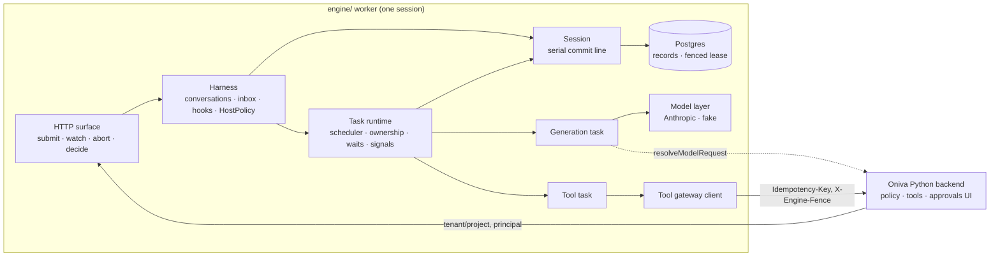
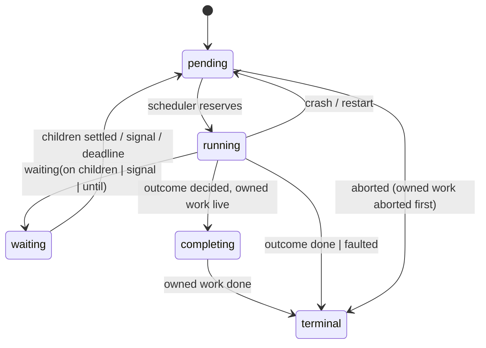

# Oniva Durable Agent Engine v1 - Plan

## Goal Capsule

- **Objective:** an Oniva-owned TypeScript durable agent engine in `engine/` that passes the bake-off scenario. The scenario is a kill -9 mid-tool resume, an approval wait of more than an hour, a steer while busy, a subagent, a duplicate submit, and a lease takeover, all on Postgres.
- **Authority:**
  1. this plan;
  2. `reports/Oniva engine roadmap.md`;
  3. the research notes under `research_notes/Oniva harness rebuild on Pi/` — Oniva's own words, behavioural reference only;
  4. the claude-api skill reference, for Anthropic SDK specifics.
- **Clean-room rule (hard stop):**
  - Implementers must not open, read, search or copy any upstream harness source. That covers the clone in the session scratchpad, any npm package under `@earendil-works/*`, and the upstream GitHub repository.
  - No upstream names, attribution or identifiers may appear in code, comments, package names or docs.
- **Stop conditions:** stop and surface the problem, instead of guessing, if:
  - two requirements contradict each other;
  - the clean-room rule would have to bend;
  - Postgres semantics make the fenced lease unachievable as designed.
- **Execution profile:**
  - One npm package.
  - The session, task runtime and storage units are built test-first.
  - Each unit lands as its own commit with green tests.
  - SQL stays compatible with Postgres 14, the local version; CI runs Postgres 16.

---

## Product Contract

### Summary

Build a durable agent engine that Oniva owns. Every conversation entry, task step and tool outcome is committed to Postgres before anyone sees it. A crashed worker therefore resumes where it stopped, and side effects are never silently repeated. The Python backend stays the control plane for tenants, keys, tools and approvals. The engine runs agents.

### Problem Frame

Oniva runs five separate agent loops with no durability. Runs die on refresh or restart, and approvals are simulated. The audit behind `reports/Oniva engine roadmap.md` found that the boot sweep marks every replica's live jobs as failed and that cancel maps exist in one process only. Roadmap Phase 2 needs a working durable-engine candidate. The user chose to write an Oniva-owned engine rather than vendor an upstream one.

### Requirements

**Model layer**
- R1. Messages, stream events and tool calls use one provider-neutral model.
  - v1 ships an Anthropic adapter and a scripted fake provider.
  - Supported features: streaming text, thinking, tool calls, usage and abort.
- R2. Before every model request, the host policy's `resolveModelRequest` returns the model, an API key and quota admission, or a denial. Keys are never persisted.

**Durable session**
- R3. Each session has one serialized commit line. A commit atomically writes immutable entries, task records, submissions and typed JSON documents. Only committed state is observable.
- R4. A storage error is fatal to the open session. Recovery is a reopen, and committed state is always consistent.

**Task runtime**
- R5. Tasks are durable state machines. They checkpoint each phase and resume after a process restart.
- R6. Side effects follow intent → effect → outcome commits.
  - After a crash, a replay-safe tool reruns.
  - A non-replay-safe gateway tool is first reconciled against the gateway's stored outcome. If none is found, the model gets an `interrupted` result that warns the effect may have happened.
- R7. Tasks own child tasks and can wait on them (`allSettled` or `failFast`), on an external signal, or until a deadline. Abort runs bottom-up and runs each task's abort handler.

**Agent loop**
- R8. A run is a chain of generation tasks. Each generation task owns its tool tasks, and the tools in one round run in parallel by default.
- R9. The host registers `beforeRequest`, `afterResponse`, `beforeTool` and `afterTool` hooks.
  - The host policy's `authorizeTool` runs last, on the final arguments.
  - Its verdict (allow, block, or require approval) cannot be removed or overridden by conversation configuration.
- R10. A tool call that requires approval suspends durably until a decision arrives or the approval expires. While suspended it holds no running task.

**Conversation control**
- R11. Submissions are idempotent by `requestId`.
- R12. While a conversation is busy, an input can steer the current run, queue as a follow-up, or be rejected. A display-only write is appended immediately.
- R13. A subagent is a conversation owned by a tool task. The tool task waits durably on the child's answer. Aborting or failing the owner aborts the child.
- R14. Compaction summarizes older context once the token estimate exceeds a threshold, and retries once after a provider context-overflow error.

**Storage, ownership and surfaces**
- R15. The storage interface has memory and Postgres backends that pass one shared conformance suite.
- R16. Each session has exactly one owning worker.
  - Ownership is enforced by a lease row with a fencing token, timed by Postgres `now()`.
  - A stale owner's commits are rejected.
  - A worker self-fences, aborting in-flight work, before its lease can lapse.
- R17. A committed-state watch stream with a per-session monotonic cursor lets a late or reconnecting client resume from its cursor or receive a snapshot.
- R18. An HTTP tool-gateway client calls Oniva's backend.
  - Each tool's manifest side-effect class and its `idempotent` flag set its replay policy.
  - Writes carry `Idempotency-Key: runId:toolCallId` and an `X-Engine-Fence` lease token.
- R19. The HTTP service surface offers submit, watch (SSE with `Last-Event-ID`), abort and approval decision.
  - Every route is bound to the conversation's tenant and project.
  - Approval decisions take a principal verified by the backend.
- R20. Engine-level limits:
  - tool calls per round;
  - subagent depth;
  - request body size;
  - entry and document size per commit.
  - Host-supplied redaction runs on tool arguments, results and error text before commit.

### Acceptance Examples

- AE1. A worker is SIGKILLed while a non-replay-safe gateway tool runs, and a new worker takes the lease.
  - If the gateway recorded an outcome for the call's idempotency key, that outcome becomes the tool result.
  - If not, the model sees `interrupted`, with a warning and the output committed so far. The tool is not re-executed either way.
- AE2. The same kill hits a replay-safe tool. The new worker re-executes it with the same idempotency key, and the run completes.
- AE3. A tool requires approval and no decision arrives. The shared scenario clock advances past 1 hour and the worker is restarted. An approval then arrives through HTTP: the tool executes once and the run completes.
- AE4. A steer is submitted while tools run. It appears after the current tool round and before the next model request, in the same run.
- AE5. A subagent tool's owning run is aborted. The child conversation's tasks reach terminal state with outcome `aborted` before the parent reports idle.
- AE6. The same `requestId` is submitted twice, including across a restart. Both calls return the same submission id, and only one user entry exists.
- AE7. Two workers contend for one session. Exactly one holds the lease. A worker whose lease was taken over can neither commit nor execute a tool after takeover.

### Scope Boundaries

- **Not in v1:**
  - Model and tool features: the OpenAI adapter and cross-provider transform (types stay provider-neutral), code mode, deferred tool search, MCP client, image handling.
  - Conversation features: forks, background subagents that outlive their owner, a derived agent-events stream.
  - Runtime features: document migrations and idle eviction, multi-session claim loops per worker.
- **Not in v1 (Oniva side):** the Python `/internal/tools/*` and `/internal/models/policy` endpoints. v1 ships the client plus a fake gateway that defines the contract.
- **Not in v1 (migration):** wiring Oniva's frontend or existing loops to the engine. That is roadmap Phase 4 onward.

### Deferred to Follow-Up Work

- The OpenAI adapter and cross-provider transform.
- Workers that claim many sessions with `FOR UPDATE SKIP LOCKED` and a wake-at index.
- The DBOS comparison candidate (roadmap Phase 2, candidate B).
- The Python gateway endpoints that honour `X-Engine-Fence` and outcome lookup.
- OpenTelemetry spans.
- Transcript retention and deletion policy.

---

## Planning Contract

### Key Technical Decisions

- **KTD1 — One package with subpath modules.**
  - `engine/` is a single npm package, `@oniva/engine`: ESM, TypeScript strict, Node ≥ 22.
  - Rationale: one maintainer, and workspaces add nothing yet.
- **KTD2 — Postgres in production, memory in unit tests.**
  - Postgres uses `pg`, and migrations are ordered plain SQL files.
  - Integration tests boot a throwaway cluster through local `initdb`/`pg_ctl` when `ENGINE_TEST_PG_URL` is unset. CI uses a Postgres 16 service.
  - Rationale: Oniva is Postgres-only.
- **KTD3 — A lease with a fencing token, timed by the database.**
  - The lease lives in `engine_session_leases(session_id, owner_id, token, expires_at)`.
  - Acquire, renew and expiry are all computed in SQL against `now()`. A takeover bumps `token`.
  - Each commit takes the lease row `FOR UPDATE` and compares tokens.
  - The worker self-fences once `lastRenewal + ttl − safetyMargin` passes (measured on the monotonic process clock), and aborts every running task.
  - Rationale: this works under PgBouncer transaction pooling, and clock skew between workers can't break ownership.
- **KTD4 — One session per worker in v1.**
  - A worker starts with one `sessionId` and serves only that session.
  - The session id is opaque; Oniva maps one session to one project.
  - A request that reaches a non-owner gets `409` with the owner id.
  - Postgres lookups map `conversation_id → session_id` and `tool_task_id → session_id`.
  - While it waits, the lease holder heartbeats; waiting tasks hold no invocation.
  - Rationale: this is the smallest placement model that makes AE3 and AE7 real. Multi-session claim loops are deferred.
- **KTD5 — Whole records plus document snapshots.**
  - Each commit that touches a document stores its full JSON snapshot.
  - Watch frames carry JSON Patch diffs, computed at publish time.
  - `engine_commits.seq` is per session and gap-free.
  - Rationale: simple and debuggable. U14 measures the cost.
- **KTD6 — zod v4 schemas.** Tool parameters and documents use zod, converted to JSON Schema for providers.
- **KTD7 — An Anthropic adapter on `@anthropic-ai/sdk`.**
  - It uses the Messages API with thinking, tool use and cache control.
  - Model ids and parameters come from the claude-api reference. Defaults: `claude-opus-5-5`, with `claude-haiku-5-5` for summaries.
- **KTD8 — One `HostPolicy` object, given at harness open.** It has two required functions:
  - `resolveModelRequest(ctx)` returns the model, key and maxTokens, or a denial.
  - `authorizeTool(call)` returns `allow`, `block`, or `requireApproval`, with an optional `expiresAt`.
  - Generic hooks are separate. Policy always runs after them and its verdict is final.
- **KTD9 — Approval is a signal wait.**
  - `requireApproval` makes the tool task commit `waiting({ signal: "approval", until? })` together with an approval record.
  - `decideApproval` commits the decision and signals the task.
  - Rationale: a long wait holds no running task.
- **KTD10 — An injected clock for engine logic; the database clock for leases.**
  - Scheduler deadlines, approval expiry and progress throttling read the injected clock.
  - The scenario suite uses a database-backed shared test clock (`engine_test_clock`) so that every worker process sees the same time. It is available only in the test entry point.
- **KTD11 — Throttled progress commits.** Partial model and tool output is committed at most every 100 ms, which is configurable.
- **KTD12 — HTTP on `node:http`.**
  - Watch uses SSE; commands are JSON.
  - A bearer service token is compared in constant time.
  - The backend passes the tenant and project in headers, and the principal on decisions. The engine checks them against the stored conversation binding.

### High-Level Technical Design

Components:



Task lifecycle:



Tool task, including crash recovery:

```text
beforeTool hooks → HostPolicy.authorizeTool(final args)
  block           → [commit] blocked result
  requireApproval → [commit] approval record + waiting(signal, until?) … signal → approve | deny | expired
  allow / approved → [commit] intent → execute (gateway: Idempotency-Key, X-Engine-Fence) → [commit] result entry
restart in intent phase:
  replay-safe     → execute again
  gateway write   → GET outcome by key → found: commit it | missing: commit interrupted("may have happened")
  local non-safe  → commit interrupted
```

### Assumptions

- The user asked for end-to-end execution, so scoping confirmation was skipped. The review-driven scope cuts listed in Scope Boundaries stand unless the user redirects.
- Local Postgres binaries are present (14.x); Docker is not running.
- Live provider tests run only when `ANTHROPIC_API_KEY` is set.

### Sequencing

- Phase A runs strictly in order: U1 → U2 → U3 → U4. U6 can start any time after U1.
- U5 needs U4.
- U7 needs U5 and U6.
- After U7, U8, U9, U10, U11 and U13 are independent and may run in parallel. U13 needs U9 for approval-aware manifests.
- U12 follows U8 and U9.
- U14 needs U4, U8, U9, U10, U12 and U13. U11 is not on the bake-off's critical path.

---

## Output Structure

```text
engine/
  package.json  tsconfig.json  vitest.config.ts  biome.json  README.md
  migrations/            # ordered .sql files (PG14-compatible)
  docs/                  # bakeoff.md
  src/
    index.ts
    core/                # ids, clock, context, errors, json, limits
    storage/             # types, memory, conformance, postgres/
    session/             # session, transaction, documents, publish
    tasks/               # define, scheduler, runtime, ownership, abort, signals
    models/              # types, stream, anthropic, fake, usage
    agent/               # harness, conversation, generation, tool-task, hooks, policy, inbox, approvals, subagents, compaction, prompt
    tools/               # registry, gateway
    watch/               # view, stream
    server/              # http, routes, auth
  test/                  # unit + integration + scenario + support/
  scripts/               # worker.ts, worker-test-harness.ts
.github/workflows/engine.yml
```

---

## Implementation Units

| U-ID | Title | Key files | Depends on |
|---|---|---|---|
| U1 | Package scaffold & core primitives | `engine/src/core/*`, CI | — |
| U2 | Storage interface, memory backend, conformance suite | `engine/src/storage/*` | U1 |
| U3 | Session commit line & documents | `engine/src/session/*` | U2 |
| U4 | Postgres backend & fenced lease | `engine/src/storage/postgres/*`, `engine/migrations/*` | U3 |
| U5 | Task runtime | `engine/src/tasks/*` | U4 |
| U6 | Model layer | `engine/src/models/*` | U1 |
| U7 | Agent loop, hooks & HostPolicy | `engine/src/agent/*`, `engine/src/tools/registry.ts` | U5, U6 |
| U8 | Submissions & inbox | `engine/src/agent/inbox.ts` | U7 |
| U9 | Approvals | `engine/src/agent/approvals.ts` | U7 |
| U10 | Subagents | `engine/src/agent/subagents.ts` | U7 |
| U11 | Compaction | `engine/src/agent/compaction.ts` | U7 |
| U12 | Watch stream & HTTP surface | `engine/src/watch/*`, `engine/src/server/*` | U8, U9 |
| U13 | Tool gateway client | `engine/src/tools/gateway.ts` | U7, U9 |
| U14 | Bake-off scenario suite | `engine/test/scenario/*`, `engine/scripts/*` | U4, U8, U9, U10, U12, U13 |

### U1. Package scaffold & core primitives

**Goal:** a buildable, testable `@oniva/engine` package with shared primitives.
**Requirements:** R3, R4, R20 (foundations).
**Dependencies:** none.
**Files:**
- `engine/package.json`, `engine/tsconfig.json`, `engine/vitest.config.ts`, `engine/biome.json`
- `engine/src/core/{ids,clock,context,errors,json,limits}.ts`
- `engine/test/core/*.test.ts`
- `.github/workflows/engine.yml`, `engine/README.md`
**Approach:**
- **IDs:** time-ordered UUIDv7 strings with kind prefixes (`conv_`, `ent_`, `task_`, `subm_`, `appr_`).
- **Clock:** a `Clock` interface with real and manual implementations.
- **Context:** cancellation built on `AbortSignal`, with a deadline and a reason.
- **Errors:** typed classes `SessionFailed`, `StorageRequestError`, `LeaseLost`, `ConversationBusy`, `NotOwner` and `LimitExceeded`.
- **JSON:** strict validation.
- **Limits:** defaults for every R20 limit.
- **CI:** typecheck, Biome lint and vitest against a Postgres 16 service.
**Test scenarios:**
- IDs minted in the same millisecond still sort in creation order.
- The manual clock fires timers in deadline order when advanced, and never fires them early.
- A parent abort cascades to child contexts with the parent's reason; a child abort leaves the parent untouched.
- Strict JSON rejects `undefined`, `NaN` and cycles, and accepts nested plain data.
**Verification:** `npm test` and `npm run typecheck` pass in `engine/`.

### U2. Storage interface, memory backend, conformance suite

**Goal:** a narrow storage contract and a reusable conformance suite.
**Requirements:** R3, R4, R15.
**Dependencies:** U1.
**Files:**
- `engine/src/storage/{types,memory,conformance}.ts`
- `engine/test/storage/memory.conformance.test.ts`
**Approach:**
- **Records:** conversations (with `tenantId`, `projectId`, `ownerTaskId?`), entries (immutable), tasks (full replace), submissions (unique `requestId` per conversation) and documents (kind plus scope id).
- **Operations:**
  - `commit(batch, fence)` returns a per-session `seq`.
  - Keyed lookups, including `submissionByRequestId`.
  - Cursor-paged scans and `mintId`.
- **Errors:** a duplicate or invalid write in a batch throws `StorageRequestError` and leaves the session open. Callers look up before committing, so a duplicate means a real conflict. Any other throw is fatal.
- **Memory backend:** copies data on both write and read.
- **Export:** the suite is exported as `defineStorageConformanceSuite(api, factory)`.
**Execution note:** write the conformance suite first.
**Test scenarios** (in the suite):
- A batch writing an entry, a task and a document becomes visible all at once. A batch rejected by validation leaves nothing behind.
- Rewriting an existing entry id is rejected.
- A duplicate `requestId` in one conversation is rejected with `StorageRequestError`.
- Scans page in both orders with no duplicates or gaps across pages.
- `seq` strictly increases per session, including across a reopen.
- Mutating a value returned by a read does not change stored state.
- An unknown conversation or a malformed cursor raises `StorageRequestError`.
**Verification:** the memory backend passes the suite.

### U3. Session commit line & documents

**Goal:** a single-writer session that publishes only committed state.
**Requirements:** R3, R4, R20.
**Dependencies:** U2.
**Files:**
- `engine/src/session/{session,transaction,documents,publish}.ts`
- `engine/test/session/*.test.ts`
**Approach:**
- `session.commit(async tx => …)` takes the commit line, runs the callback, stores the batch and adopts it. Only then are observers notified.
- **`tx` methods:**
  - `appendEntry`, `createTask`, `replaceTask`, `createSubmission`, `createConversation`;
  - `doc(definition, scopeId)`, which returns a draft that zod validates and snapshots at commit.
- Table reads after the first table write throw.
- `defineDoc({ kind, scope, initial, schema })`. Documents stay loaded for the session's lifetime.
- **Limits and redaction:** size limits are enforced at commit. A host `redact` function rewrites tool arguments, results and error text before they are stored.
- **Fatal storage errors:** a fatal storage error fails the session. Pending waits reject with `SessionFailed`, and `closed` resolves with `failed`.
**Execution note:** test-first.
**Test scenarios:**
- Two concurrent commits run one after the other, and the second sees the first's writes.
- A throwing callback rolls back the whole commit.
- Observers never see uncommitted state.
- A storage failure rejects the failing call, makes later calls reject with `SessionFailed`, and resolves `closed` as `failed`.
- A draft can't be used after its callback settles, and invalid document data rolls the commit back.
- An oversized entry fails with `LimitExceeded` and rolls back.
- `redact` masks a token-shaped string in a tool result before it is stored.
**Verification:** session tests pass on the memory backend.

### U4. Postgres backend & fenced lease

**Goal:** production storage with single-owner sessions.
**Requirements:** R15, R16.
**Dependencies:** U3.
**Files:**
- `engine/src/storage/postgres/{storage,lease,migrate}.ts`
- `engine/migrations/001_init.sql`
- `engine/test/storage/{postgres.conformance,lease}.test.ts`, `engine/test/support/pg.ts`
**Approach:**
- **Schema:** tables keyed by `session_id`, plus lookup indexes on `conversation_id` and `tool_task_id`. `engine_commits` holds the per-session `seq`.
- **Commit transaction:** lock the lease row `FOR UPDATE`, compare the token, write the batch, then insert the commit row.
- **Lease operations:** `acquire`, `renew` and `release`, all timed in SQL with `INSERT … ON CONFLICT … WHERE expires_at < now()`. They return the token.
- **Self-fencing:**
  - A heartbeat renews at `ttl/3`.
  - Missing the self-fence deadline fails the session with `LeaseLost` and aborts all running task contexts.
- **Tests:** the test helper boots and drops a temporary cluster.
**Test scenarios:**
- The conformance suite passes on Postgres.
- Covers AE7.
  - Two clients race for the lease and exactly one acquires it.
  - When heartbeats stop past the TTL, the second client acquires with a higher token, and the first client's next commit fails with `LeaseLost` and writes nothing.
- A heartbeat keeps the lease across several TTLs.
- Covers AE7. If the heartbeat is blocked past the self-fence deadline, an in-flight tool context is aborted before a second worker can acquire.
- Reopening reads back every committed record identically.
- A dropped connection mid-commit leaves no partial batch.
**Verification:** Postgres conformance and lease tests pass locally (PG14) and in CI (PG16).

### U5. Task runtime

**Goal:** durable state machines with checkpoints, ownership, waits, signals and abort.
**Requirements:** R5, R7, R10.
**Dependencies:** U4.
**Files:**
- `engine/src/tasks/{define,scheduler,runtime,ownership,abort,signals}.ts`
- `engine/test/tasks/*.test.ts`
**Approach:**
- **Defining tasks:** `defineTask({ kind, phases, onAbort? })`. A handler returns, through `runtime.commit`, one of:
  - `next(phase, checkpoint)`;
  - `waiting({ on?: taskIds, policy?, signal?, until? })`;
  - `done(outcome)`.
- **Statuses:** `pending`, `running`, `waiting`, `completing`, `terminal`. A terminal task carries an outcome of `done`, `aborted` or `faulted`.
- **Scheduler:** reserves pending tasks on the commit line, runs handlers off the line under a concurrency limit, and resets `running` tasks to `pending` at start.
- **Signals:** `runtime.signal(taskId, key, payload)` commits the payload and wakes a task that is waiting on that key. An elapsed `until` wakes it with reason `deadline`.
- **Ownership:**
  - A task is owned by a conversation or by another task.
  - `failFast` aborts siblings on the first failure.
  - A task that finishes while it still has live owned work enters `completing`.
  - Abort runs bottom-up and calls `onAbort`.
- **Other rules:** wait cycles are rejected. `abandonOnRestart` tasks are aborted at the next start.
**Execution note:** test-first. This unit carries the hardest invariants.
**Test scenarios:**
- A three-phase task closed mid-phase 2 resumes at phase 2, with phase 1's checkpoint, after a reopen.
- `allSettled` resumes only after all three children are terminal. With `failFast`, the first failure aborts the other two.
- Aborting a parent runs the children's `onAbort` before the parent's, and nothing is left `running`.
- A signal wait with no deadline survives a reopen and wakes on `signal`. A late second signal is rejected.
- A two-hour `until` wait wakes once the manual clock passes two hours, including across a reopen.
- A wait on yourself, or on your owner chain, is rejected.
- A throwing handler ends terminal with outcome `faulted` and does not fail the session.
- An `abandonOnRestart` task ends with outcome `aborted` and reason `restart`.
**Verification:** task tests pass on memory and Postgres.

### U6. Model layer

**Goal:** a provider-neutral streaming API with an Anthropic adapter and a scripted fake provider.
**Requirements:** R1, R2.
**Dependencies:** U1.
**Files:**
- `engine/src/models/{types,stream,anthropic,fake,usage}.ts`
- `engine/test/models/*.test.ts`
**Approach:**
- **Messages:** `user`, `assistant`, `tool_result` and `system`. An assistant message holds ordered blocks (`text`, `thinking`, `tool_call`) and is stamped with its provider and model.
- **Stream events:** `start`, a `start`/`delta`/`end` per block, `done` (with usage and stop reason) and `error`. Errors and aborts arrive as events.
- **Anthropic adapter:** maps thinking effort to a budget and puts cache control on the system prompt and the last stable message.
- **Usage pricing:** comes from a host-supplied pricing table.
- **Fake provider:** plays back scripted responses, including tool calls, delays, errors and context-overflow errors.
**Test scenarios:**
- The fake provider streams text and then a tool call. The aggregated message keeps both blocks in order and reports usage.
- The Anthropic adapter maps recorded SSE fixtures (text, thinking, tool use, `max_tokens` stop) to the expected events.
- An abort mid-stream yields `error` with reason `aborted` and keeps the partial message.
- A denial from `resolveModelRequest` yields `error` without any network call.
- A live smoke test, skipped when no key is set, returns a one-word answer.
**Verification:** model tests pass, and the live smoke test passes when a key is set.

### U7. Agent loop, hooks & HostPolicy

**Goal:** conversations answer inputs through durable generation and tool tasks.
**Requirements:** R2, R6, R8, R9, R20.
**Dependencies:** U5, U6.
**Files:**
- `engine/src/agent/{harness,conversation,generation,tool-task,hooks,policy,prompt,context-builder,usage}.ts`
- `engine/src/tools/registry.ts`
- `engine/test/agent/*.test.ts`
**Approach:**
- **Harness:** `Harness.open(storage, { sessionId, models, tools, policy: HostPolicy, hooks, redact, clock, settings })`. A conversation records its tenant, project and agent configuration.
- **Generation task:**
  - Builds context from the newest compaction head, and appends a `system` entry only when the prompt or tool set changed.
  - Calls `resolveModelRequest` and streams, committing throttled partial output to a `live` document.
  - Commits the assistant entry and one tool task per call, up to the per-round limit. Calls over the limit get a `limit_exceeded` result.
  - Waits `allSettled`, then hands off to the next generation or finishes the run.
- **Tool task:**
  - Validates the arguments, then runs the generic `beforeTool` hooks, which may rewrite them.
  - Runs `HostPolicy.authorizeTool` on the final arguments, then commits intent, executes, and commits the result entry.
  - Recovery follows the HTD tool-task flow. Local tools that are not replay-safe yield `interrupted` with a warning.
- **Hook errors:** a throwing generic hook is reported and skipped. A throwing `authorizeTool` blocks the call.
- **Tool flags:** tools run in parallel unless marked `sequential`. `terminate: true` on every result ends the run.
- **Usage:** a `usage` document keeps totals per conversation and per model.
**Execution note:** start with an end-to-end fake-provider test (one input, two tool calls, final answer).
**Test scenarios:**
- One input with two parallel tool calls produces the expected entries in order, and the submission ends `done`.
- Covers AE1 (unit level): a local non-replay-safe tool interrupted between intent and result, then reopened, yields `interrupted` with the partial output, and execute ran once.
- Covers AE2 (unit level): a replay-safe tool reruns, and the second result is the one used.
- A conversation hook that rewrites allowed arguments into blocked ones gets a `blocked` result, because policy saw the final arguments.
- `authorizeTool` blocking a tool the conversation enables yields `blocked`.
- Invalid arguments yield `invalid_arguments` without executing.
- Calls over the per-round limit get `limit_exceeded`.
- An unchanged prompt is not re-appended on the next turn.
- A model `error` fails the run, and the input settles `unanswered(model_error)`.
**Verification:** agent tests pass on memory and Postgres.

### U8. Submissions & inbox

**Goal:** idempotent submits and handling of busy conversations.
**Requirements:** R11, R12.
**Dependencies:** U7.
**Files:**
- `engine/src/agent/{inbox,submission}.ts`
- `engine/test/agent/inbox.test.ts`
**Approach:**
- `submit` first looks up `requestId` and returns the existing submission if there is one. Otherwise it commits.
- **Modes:** an input takes `whenBusy: "followUp" | "steer" | "reject"`.
  - Steers are placed at the next tool-round boundary.
  - Follow-ups start the next run.
  - Display-only writes are appended immediately.
- **Waiting:** `submission.wait()` settles `done` or `unanswered(reason)`. `harness.submission(id)` reacquires a submission after a restart.
- **Abort:** `conversation.abort()` withdraws queued inputs and aborts current work.
**Test scenarios:**
- Covers AE6: duplicate `requestId` submits, before and after a reopen, return the same id and leave one user entry.
- Covers AE4: a steer submitted during a tool round lands after the tool results and before the next model request, in the same run.
- A follow-up submitted while busy starts a second run after the first run answers.
- `reject` while busy throws `ConversationBusy` and stores nothing.
- `abort()` while busy leaves the conversation idle, with queued inputs `unanswered(withdrawn)` and no tasks running.
**Verification:** inbox tests pass.

### U9. Approvals

**Goal:** durable human approval for tool calls.
**Requirements:** R10, R19.
**Dependencies:** U7.
**Files:**
- `engine/src/agent/approvals.ts`
- `engine/test/agent/approvals.test.ts`
**Approach:**
- When `authorizeTool` returns `requireApproval`, the tool task commits an item to the `approvals` document (`toolTaskId, call, reason, requestedAt, expiresAt?`) and waits with `waiting({ signal: "approval", until: expiresAt })`.
- `decideApproval({ conversationId, toolTaskId, decision, principal, note? })`:
  - checks that the conversation owns the tool task;
  - commits the decision with the verified principal;
  - signals the task.
  - A second decision is rejected.
- **Outcomes:** `approve` leads to intent and execute. `deny` yields a `denied` result. Expiry yields an `approval_expired` result.
**Test scenarios:**
- Covers AE3 (unit level): with approval required, the clock advanced 61 minutes and the harness reopened, an approval runs the tool once and the result records the principal.
- A denial yields `denied`, and the model continues.
- With `expiresAt` at 30 minutes and the clock at 31, the result is `approval_expired` and later decisions are rejected.
- A decision naming a conversation that does not own the tool task is rejected.
- No task is `running` during the wait.
**Verification:** approval tests pass on memory and Postgres.

### U10. Subagents

**Goal:** a subagent tool that waits durably on a child conversation it owns.
**Requirements:** R13, R7.
**Dependencies:** U7.
**Files:**
- `engine/src/agent/subagents.ts`
- `engine/test/agent/subagents.test.ts`
**Approach:**
- `createSubagentTool({ name, model?, tools?, maxDepth })` creates a multi-phase tool task.
- **Phase 1:** find or create the child owned by the task, then submit with `requestId = subagent:<taskId>`.
- **Phase 2:** wait on the child's answering task.
- **Phase 3:** read the child's committed final answer as the result.
- The child copies the parent agent configuration with overrides, and its depth is limited by `maxDepth` (default 1). The tool's details record the child's conversation id.
**Test scenarios:**
- The parent calls the subagent, the child answers, and the parent receives the answer.
- Covers AE5: aborting the parent mid-child-run brings all child tasks to terminal `aborted` before the parent reports idle.
- A crash during the child run followed by a reopen reuses the same child and submission.
- A child waiting on an approval leaves zero `running` tasks in the session.
- A spawn beyond `maxDepth` yields `limit_exceeded`.
**Verification:** subagent tests pass.

### U11. Compaction

**Goal:** keep the context within the model window.
**Requirements:** R14.
**Dependencies:** U7.
**Files:**
- `engine/src/agent/compaction.ts`
- `engine/test/agent/compaction.test.ts`
**Approach:**
- **Token estimate:** the last reported usage plus a character heuristic for newer entries.
- **Thresholds:**
  - A background compaction starts once the estimate exceeds `window − reserve − backgroundMargin`.
  - Once the estimate reaches `window − reserve`, the next request waits for a compaction.
- **Compaction task:** summarizes the entries before a cut point that keeps about `keepRecentTokens` of recent context verbatim. It appends a `compaction` entry, which becomes the context head.
- **Overflow:** a context-overflow error triggers one compaction and one retry.
- **Usage:** summary spend counts toward usage.
**Test scenarios:**
- Past the blocking threshold, the next request waits, and its context starts at the compaction entry.
- A background compaction completes while answering continues, and the summary is placed at the next turn boundary.
- One overflow causes one compaction and a retry. A second overflow fails the run with `model_error`.
- A compaction failure at the blocking threshold settles the input as `unanswered`, carrying the compaction error.
**Verification:** compaction tests pass.

### U12. Watch stream & HTTP surface

**Goal:** committed-state views and a service API bound to tenants.
**Requirements:** R17, R19, R20.
**Dependencies:** U8, U9.
**Files:**
- `engine/src/watch/{view,stream}.ts`
- `engine/src/server/{http,routes,auth}.ts`
- `engine/test/watch/*.test.ts`, `engine/test/server/*.test.ts`
**Approach:**
- **View:** `{ entries, live, inbox, approvals, usage, agent }`. Watch frames are `{ cursor: seq, patch }`.
  - A client resuming within the in-memory retained window gets the missed frames; otherwise it gets a snapshot.
  - A consumer more than 100 frames behind gets a snapshot.
- **Routes:**
  - `POST /v1/conversations` (create, with tenant and project)
  - `POST /v1/conversations/:id/submissions`
  - `GET /v1/conversations/:id/watch` (SSE with `Last-Event-ID`)
  - `POST /v1/conversations/:id/abort`
  - `POST /v1/conversations/:id/approvals/:toolTaskId/decision`
  - `GET /v1/health`
- **Request checks:**
  - Every route except health requires the bearer token, compared in constant time.
  - It also requires the `X-Oniva-Tenant` and `X-Oniva-Project` headers, which must match the stored conversation binding (`403` otherwise).
  - Decisions require `X-Oniva-Principal`.
  - A session this worker does not own gets `409` with the owner id.
  - Bodies over the limit get `413`.
**Test scenarios:**
- A watcher attached mid-run gets a snapshot and then patches; applying them reproduces the final view.
- `Last-Event-ID` inside the window delivers only the missed frames; outside it, a snapshot.
- A slow consumer never blocks commits.
- A duplicate HTTP submit returns the same submission id.
- A missing or wrong token gets `401`. A tenant mismatch gets `403`, including on watch and decision.
- A decision with no principal gets `400`. A valid decision wakes the tool.
- An oversized body gets `413`.
**Verification:** watch and server tests pass. A manual curl session can submit to and watch a fake-provider run.

### U13. Tool gateway client

**Goal:** run Oniva's Python tools safely from the engine.
**Requirements:** R6, R18.
**Dependencies:** U7, U9.
**Files:**
- `engine/src/tools/gateway.ts`
- `engine/test/tools/gateway.test.ts`, `engine/test/support/fake-gateway.ts`
**Approach:**
- **Manifest:** `GET {base}/internal/tools/manifest` returns tools with JSON Schema plus these fields:
  - `sideEffect: "none" | "write"`
  - `idempotent?: boolean` (default false)
  - `timeoutMs`
  - `requiresApproval?: boolean`
- **Replay policy:** `none`, or `write` with `idempotent: true`, means `replay: "safe"`. `requiresApproval` feeds `authorizeTool`.
- **Invoke:** `POST {base}/internal/tools/{name}/invoke` with `{ args, runId, toolCallId }`.
  - Tenant and project are taken from the stored conversation binding, never from model output.
  - Headers: `Idempotency-Key: runId:toolCallId`, `X-Engine-Fence: <lease token>`, and the service token.
- **Recovery:** `GET {base}/internal/tools/invocations/{key}` returns a stored outcome, or `404`.
- **Failures:**
  - Writes are never retried; reads retry with backoff.
  - A timeout yields a `timeout` result.
  - A `409` fence rejection yields `lease_lost` and fences the worker.
- The fake gateway implements this whole contract and acts as its specification.
**Test scenarios:**
- A three-tool manifest registers three tools with the expected schemas and replay policies, including `write` with `idempotent`.
- An invoke sends the idempotency key, fence token, service token and the stored tenant.
- Restart reconciliation:
  - Covers AE1: if the outcome exists at the gateway, it becomes the result and there is no re-execution.
  - If it is missing, the result is `interrupted` with the "may have happened" warning.
- A `503` on a write is not retried and becomes an error result. A `503` on a read is retried and then succeeds.
- A timeout aborts the request and yields `timeout`.
- A fence rejection fences the worker.
**Verification:** gateway tests pass against the fake gateway.

### U14. Bake-off scenario suite

**Goal:** prove the engine against roadmap Phase 2 with real processes and Postgres.
**Requirements:** AE1–AE7, and the roadmap Phase 2 exit.
**Dependencies:** U4, U8, U9, U10, U12, U13.
**Files:**
- `engine/scripts/{worker,worker-test-harness}.ts`
- `engine/test/scenario/{crash-resume,approval-wait,steer,subagent,duplicate-submit,lease,load}.test.ts`
- `engine/docs/bakeoff.md`
**Approach:**
- `worker.ts` is the production entry point. It refuses to start if `ENGINE_TEST_HARNESS` is set while `NODE_ENV=production`.
- `worker-test-harness.ts` wraps it with the fake provider, the fake gateway and the database-backed shared test clock. A clock endpoint exists only there.
- Tests spawn workers, drive them over HTTP, SIGKILL them at marked points, and start replacements.
- `bakeoff.md` records results, timings and effort per unit. It also restates the kill criteria for an Oniva-owned engine:
  1. conformance fails on Postgres;
  2. the AE7 fencing scenario fails;
  3. p99 commit latency under the load scenario exceeds 250 ms;
  4. the build exceeds 30 working days.
**Test scenarios:**
- Covers AE1 and AE2: SIGKILL during a gateway write, both with and without a recorded outcome, and during a replay-safe tool. The fake gateway's effect counters show exactly the expected executions.
- Covers AE3: an approval is pending, the shared clock advances 61 minutes, the worker is killed and replaced, and an HTTP approval completes the run.
- Covers AE4: an HTTP steer during a blocked tool round lands in the same run.
- Covers AE5: an HTTP abort of a subagent run aborts the child.
- Covers AE6: a duplicate submit across a worker restart returns the same submission.
- Covers AE7: two workers start on one session; one serves and the other answers `409`. Killing the owner lets the second take over within TTL plus one heartbeat. A paused owner's post-takeover tool call never executes.
- Load: 10 concurrent conversations in one session, each streaming a 4k-token fake response at the 100 ms throttle. Record p50/p99 commit latency and bytes per commit.
- The production `worker.ts` returns `404` for the clock endpoint.
**Verification:** the scenario suite passes three consecutive runs, and `engine/docs/bakeoff.md` is complete.

---

## Risks & Dependencies

| Risk | Mitigation |
|---|---|
| Clean-room contamination | Hard rule in the Goal Capsule, plus a clean-room grep in the Verification Contract |
| Serial commit line under load | KTD11 throttling; U14 load scenario with a p99 kill criterion |
| Double side effects at failover | Self-fencing, `X-Engine-Fence`, and outcome reconciliation by idempotency key |
| Python gateway not yet honouring fence and outcome lookup | Contract defined by the fake gateway; flagged for roadmap Phase 3 |
| Ownership and abort bugs | U5 test-first on both backends; scenario suite run three times |
| PG14 locally vs PG16 in CI | Avoid PG15+ syntax (`MERGE`, `NULLS NOT DISTINCT`) |

## Sources & Research

- `reports/Oniva engine roadmap.md`: session granularity, the fenced lease, policy ownership, bake-off framing.
- `research_notes/Oniva harness rebuild on Pi/pi_durable_local_investigation.md`: behavioural reference.
- `research_notes/Oniva harness rebuild on Pi/code_agent_runtime.md` §1.8: current event contracts that a later migration must map onto the watch stream.
- `research_notes/Oniva harness rebuild on Pi/code_tools_security.md`: the tool-bridge readiness list behind U13.
- Document review (2026-10-14): coherence, feasibility, adversarial, security and scope passes. All P1 findings were folded into the KTDs and units above.

---

## Verification Contract

- In `engine/`, all of these pass:
  - `npm run typecheck`
  - `npm run lint`
  - `npm test` (unit and integration, with Postgres auto-booted or `ENGINE_TEST_PG_URL`)
  - `npm run test:scenario`
- Both backends pass the conformance suite.
- `.github/workflows/engine.yml` runs the same gates with Postgres 16.
- Clean-room check: `grep -riE "earendil|pi-durable|pi-ai|pi-agent|mariozechner|badlogic|registerStorageConformance" engine` returns no matches.

## Definition of Done

- Each of U1–U14 meets its Verification line.
- AE1–AE7 pass in U14 on Postgres in three consecutive runs.
- `engine/README.md` documents the API, how to run a worker, the storage and lease model, and the gateway contract.
- `engine/docs/bakeoff.md` records results against the restated kill criteria.
- No abandoned or experimental code remains.
- No upstream identifiers appear in `engine/`.
