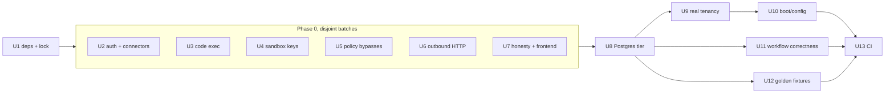

# Backend Phase 0-1 Hardening - Plan

## Goal Capsule

- **Objective:** close the Python backend's exploitable holes (roadmap Phase 0) and give it a trustworthy safety net (roadmap Phase 1). Both must be done before the backend becomes the control plane for `@oniva/engine`.
- **Authority, highest first:**
  1. This plan.
  2. `reports/Oniva engine roadmap.md` (Phases 0–1).
  3. The code audits in `research_notes/Oniva harness rebuild on Pi/`, read in this order: `code_tools_security.md`, `code_workflow_data.md`, `code_agent_runtime.md`, `code_quality_ops.md`, `code_frontend.md`. File:line citations there are leads to re-verify, not facts.
- **Stop conditions:** stop and surface instead of guessing if:
  - a fix would break a user-visible feature that has no safe replacement;
  - running as the non-superuser role reveals RLS policies too broken to fix within a unit;
  - the dependency set cannot resolve on the declared Python.
- **Execution profile:**
  - Sonnet subagents, one unit at a time or disjoint-file batches.
  - Security units are proof-first: write the failing exploit test, then fix.
  - Each unit lands as its own commit.

---

## Product Contract

### Summary

Make the backend safe to run and honest about what it does. Every P0 and P1 found in the audit gets a regression test. The backend then gets CI, a Postgres test tier, real tenant isolation, and recorded event contracts, which the engine migration will be checked against.

### Problem Frame

The audit found three ways in:
- an unauthenticated connectors API that rewrites shared credentials;
- host code execution through the in-process "sandbox";
- real provider keys handed to sandboxes that have open network egress.

RLS is bypassed because the app connects as a superuser. The pinned dependencies do not resolve. There is no CI, and every database test runs on SQLite.

### Requirements

**Phase 0 — stop the bleeding**
- R1. Every API route requires authentication unless it is explicitly allow-listed. Connector routes also require RBAC and tenant ownership.
- R2. Connector credentials are bound to each call and each tenant. No process-global client holds credentials.
- R3. No code path executes model- or user-supplied code inside the API process. Code tools refuse to run without a sandbox.
- R4. Sandboxes never receive real provider keys:
  - the token proxy is on by default;
  - egress is allow-listed;
  - the per-execution cost cap is enforced.
- R5. Tool policy cannot be bypassed:
  - the XML tool-call rescue is removed, or confined to the agent allow-list and run through the guards;
  - the HTTP node never injects provider keys;
  - no request-scoped data lives on shared singletons;
  - cache keys include the tenant.
- R6. Outbound HTTP is safe:
  - SSRF checks re-run on every redirect and block CGNAT and IPv4-mapped addresses;
  - non-idempotent methods are never retried;
  - OpenAPI path parameters are encoded;
  - connector tokens are sent only to the configured base URL.
- R7. The product is honest:
  - the approval node is labeled simulated;
  - node types with no executor are hidden;
  - mock compliance skills are labeled;
  - the README matches the code;
  - the frontend respects `NEXT_PUBLIC_API_URL`.

**Phase 1 — safety net**
- R8. The dependency set resolves and is locked with uv. Test-only packages are split out, and unused packages are removed.
- R9. A Postgres test tier runs Alembic and exercises RLS as `oniva_app`, `SKIP LOCKED`, and the `FOR UPDATE` paths.
- R10. The app connects as the non-superuser `oniva_app`. Scheduler and webhook work uses a separate, narrowly granted role.
  - Startup refuses to run as a superuser or as a role with BYPASSRLS.
  - A test fails if any `tenant_id` table lacks FORCE RLS.
- R11. The production boot path works:
  - the URL validator accepts Postgres URLs;
  - k8s supplies `ENCRYPTION_SALT` and `CORS_ORIGINS`;
  - Alembic replaces `create_all`.
- R12. Workflows report failure truthfully:
  - executor `"error"` is normalized to `"failed"`;
  - `tokens_used` is read correctly;
  - `DurableWorkflowEngine` fails runs on node failure and keeps the checkpoints of in-flight runs;
  - an untaken condition branch is skipped.
- R13. Golden event-contract fixtures exist for chat SSE, Deep Work, Fleet and workflow streams, recorded with a fake model.
- R14. CI runs on every PR:
  - backend: ruff, the pytest unit tier, and the Postgres tier;
  - frontend: `tsc` and jest;
  - gitleaks.
  - Known failures are quarantined with tracked reasons.

### Acceptance Examples

- AE1. An unauthenticated `POST /api/v1/connectors/{id}/connect` returns 401 and changes no credentials.
- AE2. Running `re.enum.sys.modules['subprocess'].check_output(...)` through any code tool, with `ENABLE_SANDBOX` false, is refused, and no process is spawned.
- AE3. A sandbox execution's environment contains no real provider key, only a proxy token.
- AE4. Assistant text containing `<invoke name="delete_file">` does not execute `delete_file` unless that tool is on the agent's allow-list and passes the guards.
- AE5. The app connected as `oniva_app` with no tenant context set reads zero rows from every tenant table, including `users`.
- AE6. A workflow whose agent node fails ends with status `failed`.

### Scope Boundaries

- **Not in this plan:**
  - the engine-facing Python endpoints (roadmap Phase 3);
  - KMS and key rotation (Phase 3);
  - a unified tracing stack (Phase 7);
  - real approval execution (Phase 5);
  - migrating any loop to the engine (Phases 4–6).
- **Not in this plan:** rewriting the Python agent loops. Only targeted fixes are in scope.

### Deferred to Follow-Up Work

- Splitting oversized frontend components.
- Unifying the SSE transports. Phase 4 replaces them with the engine watch stream.
- Postgres HA, PgBouncer, and the Terraform ECS service (roadmap Phase 7).

---

## Planning Contract

### Key Technical Decisions

- **KTD1 — uv for dependencies.** Use `backend/pyproject.toml` with `uv.lock`, keeping `requirements.txt` generated for the Dockerfiles. The dev Dockerfile already installs from requirements.
- **KTD2 — The Postgres tier uses local binaries or `TEST_DATABASE_URL`.** A session fixture boots a throwaway cluster with `initdb`/`pg_ctl`, needs the pgvector extension, and runs Alembic. CI uses a `pgvector/pgvector:pg16` service. The tier is marked `@pytest.mark.postgres`, so the SQLite unit tier stays fast.
- **KTD3 — Fail closed.**
  - `AuthMiddleware` denies by default.
  - Public routes are an explicit allow-list: health, login/refresh, SAML/OAuth callbacks, and webhooks, which use HMAC.
  - Code tools without a sandbox return a refusal result. They never fall back.
- **KTD4 — Two database roles.**
  - `oniva_app` (RLS enforced) serves requests.
  - `oniva_system` (BYPASSRLS, narrowly granted) is used only by the scheduler, webhook ingestion and startup recovery, through an explicitly named session factory.
- **KTD5 — Fixtures record the current contract.** Golden fixtures capture what the backend emits today, quirks included. Phase 4 maps those quirks deliberately; this plan does not fix them.
- **KTD6 — Quarantine, don't delete.** Known-failing tests get `xfail(strict=True)` with a reason and an issue reference. A strict `xfail` that starts passing fails CI, which forces removal of the marker.

### Sequencing

### Assumptions

- The user asked for end-to-end execution, so the scoping confirmation was skipped.
- Local research reused the five code audits from 2026-10-14 instead of new research agents.
- No external research: the fixes follow standard patterns, and the audits carry the evidence.
- The local machine has Postgres 14 at `/opt/homebrew/bin` and no Docker. pgvector may be missing locally. If so, the Postgres tier skips vector tests locally and runs them fully in CI.

---

## Implementation Units

| U-ID | Title | Key files | Depends on |
|---|---|---|---|
| U1 | Resolvable deps + uv lock | `backend/pyproject.toml`, `backend/uv.lock`, `backend/requirements*.txt` | — |
| U2 | Deny-by-default auth, connector lockdown | `backend/app/auth/middleware.py`, `backend/app/api/v1/connectors.py`, `backend/app/connectors/registry.py` | U1 |
| U3 | Remove in-process code execution | `backend/app/agents/skills/execute_python/`, `backend/app/agents/skills/code.py`, `backend/app/node_executors/code_executor.py` | U1 |
| U4 | Sandbox key isolation | `backend/app/services/sandbox_executor.py`, `backend/app/services/deep_work/engine.py` | U1 |
| U5 | Tool-policy bypasses | `backend/app/services/xml_tool_rescue.py`, `backend/app/node_executors/http_executor.py`, `backend/app/agents/base.py` | U1 |
| U6 | Outbound HTTP safety | `backend/app/security/url_validator.py`, `backend/app/connectors/http_client.py` | U1 |
| U7 | Product honesty + frontend URL | `frontend/lib/api/index.ts`, workflow builder palette, `README.md` | U1 |
| U8 | Postgres test tier | `backend/tests/conftest.py`, `backend/tests/postgres/` | U2–U7 |
| U9 | Real tenancy | `backend/app/db/*`, `backend/migrations/versions/*`, `backend/app/main.py` | U8 |
| U10 | Boot and config | `backend/app/config.py`, `k8s/*`, `docker-compose.prod.yml` | U9 |
| U11 | Workflow correctness | `backend/app/services/workflow_orchestrator.py`, `backend/app/services/durable_workflow_engine.py`, `backend/app/node_executors/*` | U8 |
| U12 | Golden event fixtures | `backend/tests/contracts/` | U8 |
| U13 | CI | `.github/workflows/backend.yml`, `.github/workflows/frontend.yml` | U10, U11, U12 |

### U1. Resolvable deps + uv lock

**Goal:** `uv sync` resolves and installs cleanly, and the existing suite runs.
**Requirements:** R8.
**Files:** `backend/pyproject.toml` (new), `backend/uv.lock`, `backend/requirements.txt` (generated), `backend/requirements-dev.txt` (generated), `backend/Dockerfile`, `backend/Dockerfile.prod`.
**Approach:**
- Derive compatible versions starting from the unpinned resolution the audit found:
  - pydantic-ai 1.77 needs a newer fastapi/starlette, python-dotenv and griffe;
  - litellm needs a compatible aiohttp.
- Add `pytz`. Move pytest and its plugins to a dev group. Drop `dbos`, `logfire` and `prometheus-client` unless something imports them.
- Make the Dockerfiles install from the generated requirements.
- Record the baseline: pass/fail counts before and after.
**Test expectation:** none — packaging. Verify that `uv sync` and the full pytest run reproduce the audit baseline (about 1206 pass / 13 fail) or better.
**Verification:** a clean venv installs; the suite runs; the failures are listed for U13 quarantine.

### U2. Deny-by-default auth, connector lockdown

**Goal:** close P0 #1.
**Requirements:** R1, R2, AE1.
**Files:**
- `backend/app/auth/middleware.py`
- `backend/app/api/v1/connectors.py`
- `backend/app/connectors/registry.py`
- `backend/app/services/agent_resolver.py`
- tests in `backend/tests/security/test_auth_default_deny.py` and `test_connector_isolation.py`
**Approach:**
- The middleware returns 401 when no user resolves, except on the explicit public allow-list (KTD3).
- Connector routes require a permission and check tenant ownership.
- The registry hands out per-call clients built from the tenant's stored credentials. `connect` writes encrypted credentials to the tenant's connector row, never to a singleton.
- Wire credentials on the chat path, so the `authenticate()` that is currently never called runs per call.
**Execution note:** start with the AE1 exploit test failing.
**Test scenarios:**
- Covers AE1. An unauthenticated connect gets 401 and stored credentials are unchanged.
- Every non-allow-listed route returns 401 without a token. Parametrize over the app's route table.
- Allow-listed routes (health, login, webhook with HMAC) still work.
- Tenant A cannot connect, read or invoke tenant B's connector (403/404).
- Two concurrent tenants' connector calls each use their own credentials.
**Verification:** the security tests pass and the existing connector tests are green.

### U3. Remove in-process code execution

**Goal:** close P0 #2.
**Requirements:** R3, AE2.
**Files:**
- `backend/app/agents/skills/execute_python/tool_legacy.py` (delete)
- `backend/app/agents/skills/code.py`
- `backend/app/node_executors/code_executor.py`
- `backend/app/agents/tools/bash_tool.py` (delete, dead)
- `backend/app/services/session_memory.py`, which references a nonexistent tool
- tests in `backend/tests/security/test_no_inprocess_exec.py`
**Approach:**
- Every code path routes to the E2B executor.
- When the sandbox is disabled, the tool returns a clear refusal. No `exec`/`eval` of supplied code remains anywhere: verify with a grep test over `app/` for `exec(` / `eval(` on non-literal input.
**Execution note:** start with the AE2 payload test failing.
**Test scenarios:**
- Covers AE2. The escape payload, run through each of the three entry points with the sandbox off, is refused and no subprocess is spawned. Assert by patching `subprocess.Popen`.
- With the sandbox on and a mocked E2B, code is forwarded and the result is returned.
- The grep-guard test fails if a new `exec(`/`eval(` of a variable appears in `app/`.
**Verification:** the tests pass, and no runtime import references the deleted files.

### U4. Sandbox key isolation

**Goal:** close P0 #3.
**Requirements:** R4, AE3.
**Files:**
- `backend/app/services/sandbox_executor.py`
- `backend/app/services/deep_work/engine.py` (~895)
- `backend/app/config.py`, for the defaults
- token proxy module (locate it)
- tests in `backend/tests/security/test_sandbox_keys.py`
**Approach:**
- Turn the control-plane token proxy on by default.
- Remove real-key injection.
- The proxy enforces the model allow-list and real usage-based cost.
- Add an egress allow-list config passed to E2B.
- Enforce `_MAX_COST_PER_EXECUTION`.
**Test scenarios:**
- Covers AE3. The env passed to the sandbox, including from the deep-work output agent, contains a proxy token and no provider key.
- The proxy rejects a model outside the allow-list.
- An execution exceeding the cost cap is stopped and reported.
- Egress config is set on sandbox creation.
**Verification:** the tests pass with a mocked E2B.

### U5. Tool-policy bypasses

**Goal:** close the P1 bypasses.
**Requirements:** R5, AE4.
**Files:**
- `backend/app/services/xml_tool_rescue.py`
- `backend/app/node_executors/http_executor.py` (~126)
- `backend/app/agents/base.py` (~322 RAG results)
- `backend/app/api/v1/chat.py` (~987)
- the adornment cache module
- tests in `backend/tests/security/test_policy_bypass.py`
**Approach:**
- Remove the XML rescue. If kept, it may only dispatch tools on the agent's allow-list, through the harness guards.
- Delete provider-key injection from the HTTP node.
- Move `_last_rag_results` into request-scoped state.
- Add the tenant to cache keys.
**Test scenarios:**
- Covers AE4. Rescue text naming an out-of-allow-list tool does not execute.
- An HTTP node calling a URL that contains `api.openai.com` sends no Authorization header unless one is configured explicitly.
- Two concurrent chat requests from different tenants each get only their own RAG sources.
- The same adornment cache input under two tenants yields distinct entries.
**Verification:** the tests pass.

### U6. Outbound HTTP safety

**Goal:** close the SSRF and retry holes.
**Requirements:** R6.
**Files:**
- `backend/app/security/url_validator.py`
- `backend/app/connectors/http_client.py` (~231-262)
- the OpenAPI connector factory
- the `browse_url` skill
- tests in `backend/tests/security/test_ssrf.py`
**Approach:**
- Validate every redirect hop, or disable auto-redirect and follow manually with validation.
- Block 100.64.0.0/10, IPv4-mapped IPv6, and the other non-public ranges.
- Use async DNS resolution and pin the resolved IP.
- Retry only GET, HEAD and OPTIONS.
- URL-encode path parameters.
- Send connector tokens only to the configured base host.
**Test scenarios:**
- A public URL redirecting to `169.254.169.254` is blocked.
- `100.64.1.1` and `::ffff:10.0.0.1` are blocked.
- A POST that gets a 503 is not retried; a GET is.
- A path param `../admin` is encoded.
- A spec whose `servers` URL points elsewhere does not receive the token.
**Verification:** the tests pass.

### U7. Product honesty + frontend URL

**Goal:** the UI and docs claim only what the code does.
**Requirements:** R7.
**Files:**
- `frontend/lib/api/index.ts` (L18)
- the workflow builder node palette and config panel (locate them)
- `backend/app/agents/skills/*` manifests for the mock skills
- `README.md`
**Approach:**
- `API_BASE_URL` reads `NEXT_PUBLIC_API_URL`.
- The approval node shows a "Simulated — approvals auto-approve" badge.
- Remove `data`, `analysis`, `research` and `schedule_trigger` from the palette, or mark them "coming soon" and disable them.
- Skills returning mock data get `mock: true` metadata and the UI labels them.
- Correct the README claims: DBOS, MCP, logit masking, memory tiers.
**Test scenarios:**
- A jest test checks that `API_BASE_URL` honours the env var.
- A palette render test checks that the four types are absent or disabled.
- A backend test checks that the mock skills' manifests carry `mock: true`.
**Verification:** the tests pass, and `tsc` is clean for the touched files.

### U8. Postgres test tier

**Goal:** real Postgres behavior is tested.
**Requirements:** R9.
**Files:**
- `backend/tests/conftest.py`
- `backend/tests/postgres/conftest.py` (new)
- `backend/tests/postgres/test_migrations.py`, `test_skip_locked.py`, `test_background_dispatch.py`
- `backend/app/services/background_dispatch.py` (~36-62)
**Approach:**
- Add a session fixture per KTD2 that runs `alembic upgrade head`.
- Fix the `count(*) ... FOR UPDATE` query: lock the rows via a subquery or use an advisory lock.
**Test scenarios:**
- Alembic upgrades to a single head on an empty DB, and downgrade/upgrade of the last revision works.
- Two concurrent scheduler claims under `SKIP LOCKED` never claim the same schedule.
- `check_and_create_background_job` succeeds on Postgres. Before the fix, Postgres rejects it.
- pgvector similarity search returns the nearest item (skipped when the extension is unavailable locally).
**Verification:** `pytest -m postgres` passes locally and the unit tier is unchanged.

### U9. Real tenancy

**Goal:** RLS actually applies.
**Requirements:** R10, AE5.
**Files:**
- `backend/app/db/session.py` (or equivalent)
- `backend/app/config.py`
- `backend/app/main.py` (~90-121, the startup sweep)
- a new Alembic revision for roles and policies
- `backend/app/services/workflow_scheduler.py`
- the webhook trigger service
- tests in `backend/tests/postgres/test_rls.py`
**Approach:**
- The request path connects as `oniva_app`.
- `oniva_system` handles the scheduler, webhook and startup paths through a named factory (KTD4).
- On startup, assert `NOT rolsuper AND NOT rolbypassrls` for the request role.
- The migration:
  - adds policies plus FORCE to `approval_requests`, `teams`, `team_memberships` and `sandbox_executions`;
  - removes the `users` SELECT policy that passes without a tenant context.
- Replace `create_all` in `init_db` with Alembic. `sandbox_executions` gets a migration.
- Make the startup sweep lease-aware, or limit it to this process's own jobs. At minimum, stop failing other replicas' jobs: mark them only when their heartbeat is stale.
**Execution note:** test-first. Start with the AE5 test as `oniva_app`.
**Test scenarios:**
- Covers AE5. As `oniva_app` with no tenant set, every table with a `tenant_id` returns 0 rows.
- Tenant A's context never sees tenant B's rows; parametrize over the tables.
- A meta-test fails if any table with a `tenant_id` column lacks FORCE RLS.
- Startup as a superuser raises and refuses to serve.
- The scheduler claims due schedules through the system role.
- The startup sweep does not fail a job whose heartbeat is fresh.
**Verification:** the tests pass on the Postgres tier.

### U10. Boot and config

**Goal:** the production boot path works.
**Requirements:** R11.
**Files:**
- `backend/app/config.py` (~381-388)
- `k8s/*.yaml`
- `docker-compose.prod.yml`
- `backend/tests/test_config_production.py`
**Approach:**
- Fix the validator so it rejects insecure values, not Postgres URLs.
- k8s:
  - add `ENCRYPTION_SALT` and `CORS_ORIGINS`;
  - fix `$(DB_PASSWORD)` expansion;
  - point probes at `/health/live` and `/health/ready`;
  - add a Redis password;
  - pin image tags via kustomize variables.
- Document the read-only rootfs session path: mount a volume or move sessions to `/tmp`.
**Test scenarios:**
- `ENVIRONMENT=production` with a valid asyncpg URL validates.
- The same with the default `SECRET_KEY` fails.
- A YAML lint test checks that the k8s manifests reference the required env keys.
**Verification:** the tests pass, and the app boots locally with production-like env against the test Postgres.

### U11. Workflow correctness

**Goal:** workflows report the truth.
**Requirements:** R12, AE6.
**Files:**
- `backend/app/node_executors/*`, which use `status="error"` in 24 places and `execution_time=` in 32
- `backend/app/services/workflow_orchestrator.py` (~374-384)
- `backend/app/services/durable_workflow_engine.py` (~180-184, 236-382)
- `backend/app/node_executors/wait_executor.py`
- tests in `backend/tests/workflows/test_correctness.py`
**Approach:**
- Normalize to a single failure status at the orchestrator boundary, or change the executors to `"failed"`.
- Use `elapsed_ms` and `tokens_used`.
- `DurableWorkflowEngine`:
  - checks `result.status`;
  - keys checkpoints by execution id;
  - stops deleting other runs' checkpoints;
  - makes recovery restore state.
- Implement branch skipping for untaken condition edges, including join semantics.
- The wait node honours real durations, or rejects ones it cannot honour.
**Test scenarios:**
- Covers AE6. A failing agent node fails the run under both engines.
- A condition true→A / false→B with a true condition runs A and skips B. A join after both runs once.
- Two concurrent runs of one workflow keep their own checkpoints.
- Recovery resumes from the last completed node.
- Token totals are summed.
**Verification:** the tests pass.

### U12. Golden event fixtures

**Goal:** a recorded contract that Phase 4 migrates against.
**Requirements:** R13.
**Files:** `backend/tests/contracts/` (recorder helper plus fixtures as JSON), `backend/tests/contracts/test_contracts.py`.
**Approach:**
- Drive each stream with a fake model. Use pydantic-ai `TestModel`/`FunctionModel` where the loop uses pydantic-ai, and patch the LiteLLM gateway elsewhere.
- Streams to record: chat SSE (text, tool call, error), Deep Work engine events, Fleet steps, and workflow progress.
- Normalize ids and timestamps, and store the result.
- The test compares live output to the fixtures; an env var re-records.
**Test scenarios:** each of the four streams matches its fixture. A deliberate event rename makes the test fail (checked once, manually).
**Verification:** the fixtures are committed and the test is green.

### U13. CI

**Goal:** every PR is gated.
**Requirements:** R14.
**Files:** `.github/workflows/backend.yml`, `.github/workflows/frontend.yml`, `.github/workflows/gitleaks.yml`, `backend/pyproject.toml` (ruff config), quarantine markers in the failing tests.
**Approach:**
- Backend:
  - `uv sync --frozen`;
  - ruff with a baseline config: errors only, autofix the existing formatting once;
  - pytest unit tier, then the Postgres tier against a `pgvector/pgvector:pg16` service.
- Frontend: `npm ci`, `tsc --noEmit`, jest.
- gitleaks on the diff.
- Quarantine the remaining known failures per KTD6.
**Execution note:** smoke verification. Run each workflow's commands locally where possible.
**Test expectation:** none — CI configuration. Verify locally that the commands pass.
**Verification:** the workflow files are valid, and the local equivalents pass.

---

## Risks & Dependencies

| Risk | Mitigation |
|---|---|
| Deny-by-default breaks a route the frontend relies on without auth | Build the allow-list from a route audit; the parametrized 401 test lists every exception explicitly |
| Removing the XML rescue degrades models that emit XML tool calls | Keep the allow-list-guarded variant if tests show real usage; log occurrences |
| `oniva_app` exposes broken policies | Postgres-tier tests per table; the stop condition in the Goal Capsule |
| Dependency upgrades change behaviour | Compare the baseline suite before and after U1 |
| Local pgvector missing | Vector tests skip locally and run in CI |

## Verification Contract

- `cd backend && uv run pytest`: the unit tier passes, except for quarantined strict-`xfail` tests.
- `cd backend && uv run pytest -m postgres`: passes against the local or CI Postgres.
- `cd backend && uv run ruff check app tests`: clean under the baseline config.
- `cd frontend && npx tsc --noEmit && npx jest`: pass (requires `npm ci`).
- Every AE1–AE6 has a named, passing test.

## Definition of Done

- U1–U13 each meet their Verification line.
- Every P0/P1 from `code_tools_security.md` that falls under Phase 0 has a regression test.
- The README no longer claims unimplemented features.
- No abandoned or experimental code remains.
