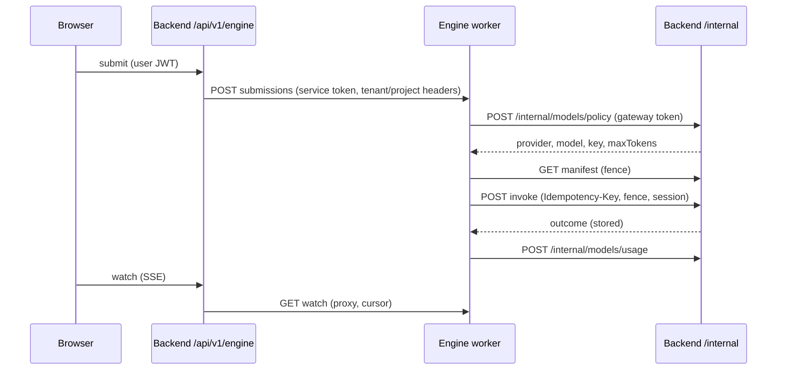

# Engine Python Interfaces - Plan

## Goal Capsule

- **Objective:** build the Python side of the interfaces `@oniva/engine` needs, so a real engine worker runs against the real backend: service auth, the tool gateway, the model policy and usage ledger, and the backend's authenticated front for the browser. This is roadmap Phase 3 narrowed to the engine-facing seams.
- **Authority, highest first:**
  1. This plan.
  2. `engine/test/support/fake-gateway.ts` TSDoc, the normative tool-gateway contract; then `engine/README.md` and `engine/src/tools/gateway.ts`.
  3. `reports/Oniva engine roadmap.md` (Phase 3: tool gateway, model policy service, ledger).
  4. `research_notes/Oniva harness rebuild on Pi/code_tools_security.md` ("Tool-bridge readiness") and `code_agent_runtime.md` ("Seams and reuse"). File:line citations there are leads to re-verify.
- **Stop conditions:** stop and surface instead of guessing if:
  - a skill cannot be classified (side effect, idempotency) and its misclassification would let a write run twice;
  - the fence/idempotency design cannot be made atomic on Postgres without holding a lock the engine's manifest timeout cannot tolerate;
  - the engine cannot be changed additively (U9) without breaking its own test suite.
- **Execution profile:**
  - Sonnet subagents, one unit at a time, or disjoint-file batches.
  - Contract units (U5-U7) are test-first: write the conformance scenario from the fake gateway, watch it fail, then implement.
  - Each unit lands as its own commit.
  - The only TypeScript change is U9, kept additive.

---

## Product Contract

### Summary

Add an internal, service-authenticated API to the FastAPI backend that implements the engine's tool-gateway contract over the existing skill registry, resolves and prices model calls, and writes the usage ledger. Add the reverse direction: backend routes that create engine conversations, submit, watch, abort and decide approvals on behalf of an authenticated browser user. A conformance suite and an end-to-end smoke test (real worker, fake model, real backend) prove the two sides fit.

### Problem Frame

The engine is built and tested against a fake gateway. The backend has no service-to-service auth, no per-tool metadata, no idempotent invocation, no fence handling, and no model-policy API. Its skills assume a full `SkillContext` (all provider keys, a DB session) built in-process. LiteLLM-based loops stay for now; the engine is the adopted engine on the durable path, so it calls providers directly and the backend only decides and records.

### Requirements

**Service auth and binding**
- R1. Every `/internal` route requires a bearer service token compared in constant time. It is not part of user auth and is not public: a user JWT, a missing token or a wrong token gets 401.
- R2. The two directions use distinct secrets: `ENGINE_GATEWAY_TOKEN` (engine to backend) and `ENGINE_SERVICE_TOKEN` (backend to engine). With either unset, the feature it guards is off (fail closed), never open.
- R3. Tenant and project come from the engine's request body and are validated server-side: the tenant exists, the project belongs to it, and the conversation (when named) is bound to both.

**Tool gateway**
- R4. `GET /internal/tools/manifest` returns real JSON Schema per tool (generated from skill signatures via pydantic) and `sideEffect`, `idempotent`, `timeoutMs`, `requiresApproval` for every registered tool. A tool without a declared spec defaults to write, non-idempotent, and a test fails until it is declared.
- R5. `POST /internal/tools/{name}/invoke` builds the `SkillContext` server-side with only the credentials and DB access the tool declares. It never passes the full key dict or the request's DB session.
- R6. Outcomes are stored under the `Idempotency-Key` in a new RLS-scoped table with a unique key. A completed key returns the stored outcome without re-running. A started effect finishes even if the client disconnects.
- R7. Fencing follows the fake gateway: a per-session high-water mark raised by any fenced request, a lower token gets `409 fence_rejected`, and an old owner's effect cannot start or commit after a successor raised the mark.
- R8. `GET /internal/tools/invocations/{key}` returns the stored outcome or 404, and a 404 after a fenced raise is final.
- R9. Invocation enforces the tool timeout, a per-tenant rate limit, argument validation (400 `invalid_request`), credential redaction and a result size cap.

**Model policy and ledger**
- R10. `POST /internal/models/policy` resolves provider, model, key and token budget per tenant, tier and routing, restricted to providers the caller says it supports, or returns a typed denial.
- R11. Quota admission runs before a key is returned. Denials carry `code`, `reason` and `retryable`.
- R12. The tenant key travels only over the authenticated internal channel, is never logged or stored by the backend beyond its existing encrypted storage, and responses are `no-store`.
- R13. `POST /internal/models/usage` writes `llm_usage_records`, priced from `llm_pricing` (not the caller's cost), counts quota, and is idempotent per request id.

**Backend as the browser's front**
- R14. Authenticated users create engine conversations, submit, abort and decide approvals through backend routes. Each route checks the user's tenant against the conversation's recorded binding before calling the engine.
- R15. The watch route proxies the engine SSE stream to the browser with cursor resume, and closes the upstream when the browser disconnects.
- R16. An approval decision is forwarded only after the backend authorizes the user, with the verified user id as the principal.

**Proof and wiring**
- R17. A pytest conformance suite reproduces every behavior of `engine/test/support/fake-gateway.ts` against the Python endpoints.
- R18. An end-to-end test runs an engine worker with a scripted model against the real backend: tool call, idempotent replay, policy and usage.
- R19. Config, secrets and deploy manifests carry the new settings. `/internal` is unreachable from outside the cluster.

### Acceptance Examples

- AE1. Covers R1, R2. `GET /internal/tools/manifest` with no token, a wrong token or a valid user JWT returns 401. With `ENGINE_GATEWAY_TOKEN` unset the `/internal` routes are not mounted.
- AE2. Covers R7. After a fenced request with token 7 for session S, an invoke with token 6 returns `409 {error:"fence_rejected", highWater:7}` and the tool effect count is unchanged.
- AE3. Covers R6. Two invokes with the same `Idempotency-Key` run a write tool once and return the same outcome.
- AE4. Covers R7, R8. An old owner's invoke is in flight (token 6). A successor's fenced manifest load (token 7) completes only after the effect finishes; the following reconcile returns the stored outcome. An invoke that arrives after the raise is rejected and stores nothing.
- AE5. Covers R10, R11. A tenant over its `llm_tokens` quota gets `{ok:false, code:"quota_exceeded", retryable:false}` and no key in the body.
- AE6. Covers R13. Posting the same usage `requestId` twice creates one record, with `cost_usd` computed from `llm_pricing`.
- AE7. Covers R14. Tenant B's user calling watch on tenant A's conversation gets 404.
- AE8. Covers R5. `web_search` runs with only its declared provider keys in `ctx.api_keys` and `ctx.db` is `None`.
- AE9. Covers R4. Registering a skill with no spec entry makes `test_every_skill_has_a_tool_spec` fail.
- AE10. Covers R18. The smoke test's worker calls `write_file` through the backend once, survives a replayed key, and the usage ledger shows the fake model's tokens.

### Scope Boundaries

- **Not in this plan:**
  - moving the chat UI onto the engine (Phase 4);
  - real approval execution and the review-ticket path (Phase 5);
  - MCP and KMS/key rotation (Phase 3 remainder);
  - the event schema v1 adapter, the single guard middleware and embeddings off LiteLLM;
  - model-data refresh (stale model IDs and price tables);
  - orchestrating one worker per session (Phase 7).
- **Not changed:** the LiteLLM loops. They keep calling `LLMGateway` and are unaffected.

### Deferred to Follow-Up Work

- Streaming and long-running tools as async jobs with polling (sandbox, browser, deep research). v1 invokes them synchronously within their timeout.
- A per-conversation user for tools beyond the recorded conversation owner.

---

## Planning Contract

### Key Technical Decisions

- KTD1 — Separate internal package and router. New `backend/app/internal_api/` holds auth, tool gateway, model policy, and usage. It is mounted at `/internal` only when `ENGINE_GATEWAY_TOKEN` is set. `AuthMiddleware`, CSRF and tenant middleware skip `/internal/` for user auth, and an `InternalAuth` dependency is the only gate. The deny-by-default route test pins `/internal` as a distinct, token-guarded class rather than adding it to `PUBLIC_ROUTES`.
- KTD2 — Two secrets, one per direction. `ENGINE_GATEWAY_TOKEN` guards `/internal`; `ENGINE_SERVICE_TOKEN` is what the backend presents to the engine. They must differ, be at least 32 characters and differ from `SECRET_KEY`. An optional `ENGINE_GATEWAY_TOKEN_PREVIOUS` accepts the old value during rotation.
- KTD3 — Tenant binding from the body, narrowed by the database. The engine is trusted to name the tenant (its token is a shared secret), but the backend verifies tenant, project and conversation against `engine_conversations` and `projects`. The user for `SkillContext` comes from the conversation's recorded `user_id`, never from the engine.
- KTD4 — Fence state lives on the system role, effects on the tenant role. `engine_fences(session_id, high_water)` has no `tenant_id` and is reachable only through `get_system_session`. Raising uses one upsert (`GREATEST`). A write effect holds `FOR SHARE` on the session's fence row on a system connection for its duration, so a successor's raise waits for in-flight effects. After the raise returns, no old effect is running and none can start; that makes the reconcile 404 final. A raise waits at most 5 s for the lock, then answers 503 with `Retry-After`; the engine's manifest retry absorbs it.
- KTD5 — Outcome store beside the effect. `tool_invocations(key unique, tenant_id, session_id, tool, args_hash, status, outcome jsonb, fence_token)` has tenant RLS (ENABLE + FORCE). The claim row is inserted `in_flight` with `ON CONFLICT`; the outcome is written in the same transaction as DB-only effects, or immediately after non-DB effects. Same key with different args is `422 idempotency_key_reuse`. Reconcile reads by key through a narrow system-role query and checks the session matches the row.
- KTD6 — Effects are detached from the request. The invoke handler runs the tool in an `asyncio.create_task` and awaits it with `asyncio.shield`, so a client disconnect does not cancel it. A concurrent duplicate of an `in_flight` key answers 503 + `Retry-After: 1`. An `in_flight` row older than `timeoutMs` + grace is stale: idempotent tools re-run it, and the startup sweep stores `{isError:true, details:{error:"interrupted", outcome:"unknown"}}` for non-idempotent ones, so reconcile never claims "did not run" wrongly.
- KTD7 — Tool specs are a code table, schemas are generated. `backend/app/internal_api/tool_specs.py` maps skill name to `ToolSpec(side_effect, idempotent, timeout_ms, requires_approval, needs_keys, needs_db, needs_connectors)`. JSON Schema comes from the skill's signature (minus `ctx`) through `pydantic.create_model`, with descriptions from the docstring `Args:`. Defaults when a skill has no entry: write, non-idempotent, 30 s, no keys, no DB. SKILL.md `timeout_seconds` overrides the default timeout; `rate_limit` feeds R9. Interactive-only skills (`ask_user`, `present_plan`, `complete_task`) are excluded from the manifest.
- KTD8 — Scoped context, not a shared one. The gateway builds `SkillContext` per call: `api_keys` filtered to `needs_keys` (decrypted for that tenant), `connectors` filtered to the ones the tool is allowed to use, and `db` only when `needs_db`, as a fresh tenant-scoped session (RLS enforces the boundary). Sessions for fence and outcome storage are never handed to a tool.
- KTD9 — Model policy returns the tenant's real key, with exact limits. Vendor keys cannot be scoped or expired by us, so `/internal/models/policy` returns the key over the authenticated channel for one request. The response carries `expiresAt` (60 s, a cache bound for the caller), `Cache-Control: no-store`, and wraps the key in a `SecretStr`-backed model. A log filter drops any `apiKey` field. The policy path never falls back to platform or wrong-provider keys; no tenant key means `no_key`. In production the policy URL must be https unless `INTERNAL_ALLOW_PLAINTEXT` is set.
- KTD10 — Request id keys the ledger. The engine sends `requestId = runId:round:purpose` on both policy and usage calls. Policy is repeatable for the same id. `llm_usage_records` gains `request_id` with a unique index on `(tenant_id, request_id)`; usage inserts use `ON CONFLICT DO NOTHING`. Cost is computed from `app/config/llm_pricing.py`; an unpriced model records `cost_usd=0`, `status="unpriced"` and a warning, never the caller's number.
- KTD11 — Additive engine change only. The gateway body gains an optional `conversationId` so the backend can map a call to its user. The backend requires it once `engine_conversations` is in use and rejects the call with `400 conversation_required` otherwise. The fake gateway ignores it, so no existing engine test changes meaning.
- KTD12 — Backend front is a thin authenticated proxy. Routes live at `/api/v1/engine/conversations` behind `ENABLE_ENGINE_API` (default false), use normal user auth and RBAC, and call the engine through one `EngineClient` (httpx) with `ENGINE_SERVICE_TOKEN`. Worker location comes from a small `EngineDirectory`: v1 is `ENGINE_URL` + `ENGINE_SESSION_ID`, with a seam for a per-session map later.
- KTD13 — Conformance is a test suite, not prose. `backend/tests/internal/` mirrors each fake-gateway behavior one for one; the TS-side live test (U10) runs the real `createGatewayTools` client against a running backend.

### High-Level Technical Design

Invoke pipeline in `GW`: authenticate, validate body and binding, admit fence (raise high-water), claim idempotency key, run the tool detached under the fence share lock, store outcome, answer.

### Assumptions

- The skill registry loads the same ~46 tools in the API process that the chat path uses (`SkillRegistry.initialize`, `invoke_skill`).
- U1 to U13 of `docs/plans/2026-10-14-002-fix-backend-phase0-1-hardening-plan.md` have landed: deny-by-default auth, `oniva_app`/`oniva_system` roles, Alembic baseline and the Postgres test tier. This plan builds on them.
- The engine worker serves one session per process; the single configured session is enough for v1.
- Local Postgres tests follow the existing `@pytest.mark.postgres` tier; Node 22 is available for U9-U11.

---

## Implementation Units

| U-ID | Title | Key files | Depends on |
|---|---|---|---|
| U1 | Config, secrets, internal auth, router mount | `backend/app/config/__init__.py`, `backend/app/internal_api/auth.py`, `backend/app/auth/middleware.py`, `backend/app/main.py` | — |
| U2 | Persistence: invocations, fences, conversations, ledger key | `backend/migrations/versions/102_engine_interfaces.py`, `backend/app/models/engine.py`, `backend/app/models/llm_usage.py` | U1 |
| U3 | Tool specs and manifest | `backend/app/internal_api/tool_specs.py`, `backend/app/internal_api/schemas.py`, `backend/app/internal_api/tools.py` | U1 |
| U4 | Scoped execution context and tool guards | `backend/app/internal_api/execution.py`, `backend/app/agents/skills/context.py` | U3 |
| U5 | Invoke, idempotency, fencing, reconcile | `backend/app/internal_api/tools.py`, `backend/app/internal_api/fence.py`, `backend/app/internal_api/invocations.py` | U2, U4 |
| U6 | Model policy endpoint | `backend/app/internal_api/models.py`, `backend/app/services/llm_gateway.py` | U1, U2 |
| U7 | Usage ledger endpoint | `backend/app/internal_api/models.py`, `backend/app/config/llm_pricing.py` | U2, U6 |
| U8 | Engine client and browser-facing conversation routes | `backend/app/services/engine_client.py`, `backend/app/api/v1/engine_conversations.py` | U1, U2 |
| U9 | Engine additive changes: conversationId, policy client, usage reporter | `engine/src/tools/gateway.ts`, `engine/src/worker/backend-policy.ts`, `engine/scripts/worker.ts` | U5, U6, U7 |
| U10 | Contract conformance suite | `backend/tests/internal/`, `engine/test/tools/gateway.live.test.ts` | U5, U6, U7, U9 |
| U11 | End-to-end smoke and deploy wiring | `backend/tests/e2e/test_engine_smoke.py`, `k8s/*`, `docker-compose.prod.yml` | U8, U9, U10 |

### U1. Config, secrets, internal auth, router mount

**Goal:** a token-guarded `/internal` namespace that is closed unless configured.
**Requirements:** R1, R2, R19, AE1.
**Dependencies:** none.
**Files:**
- `backend/app/config/__init__.py`
- `backend/app/internal_api/__init__.py`, `backend/app/internal_api/auth.py`, `backend/app/internal_api/router.py`
- `backend/app/auth/middleware.py`, `backend/app/middleware/csrf.py`, the tenant middleware
- `backend/app/main.py`
- `backend/tests/security/test_auth_default_deny.py`, `backend/tests/internal/test_internal_auth.py`
**Approach:**
- Settings: `ENGINE_URL`, `ENGINE_SESSION_ID`, `ENGINE_SERVICE_TOKEN`, `ENGINE_GATEWAY_TOKEN`, `ENGINE_GATEWAY_TOKEN_PREVIOUS`, `ENABLE_ENGINE_API` (false), `ENGINE_REQUEST_TIMEOUT_S`, `INTERNAL_ALLOW_PLAINTEXT` (false). Validators: tokens differ, length at least 32, differ from `SECRET_KEY`; production requires https for `ENGINE_URL` unless overridden.
- `InternalAuth` dependency: parse `Authorization: Bearer`, compare with `hmac.compare_digest` against the current and previous token, answer `401 {error:"unauthorized"}` (no `WWW-Authenticate` detail leak). Never read cookies or query tokens.
- Mount `internal_router` at `/internal` only when `ENGINE_GATEWAY_TOKEN` is set. In `AuthMiddleware`, `/internal/` paths bypass user-token resolution (a user JWT there is ignored, not honored) and CSRF/tenant middleware skip them; the dependency is the sole gate. Add a log filter that masks `Authorization` and `apiKey` for `/internal`.
**Test scenarios:**
- Covers AE1. No token, wrong token, token of equal length but different bytes, and a valid user JWT all return 401.
- With `ENGINE_GATEWAY_TOKEN` unset, `/internal/tools/manifest` returns 404 and is absent from `app.routes`.
- The route-table 401 test treats `/internal` routes as token-guarded: each returns 401 without the service token.
- Settings validation rejects equal tokens, short tokens and a token equal to `SECRET_KEY`.
- A request carrying both a user JWT cookie and a valid service token is served as the service, with no user context set.
**Verification:** `uv run pytest tests/internal/test_internal_auth.py tests/security/test_auth_default_deny.py`.

### U2. Persistence: invocations, fences, conversations, ledger key

**Goal:** the tables every later unit stores into, with RLS.
**Requirements:** R6, R7, R13, R14.
**Dependencies:** U1.
**Files:**
- `backend/migrations/versions/102_engine_interfaces.py`
- `backend/app/models/engine.py` (new), `backend/app/models/llm_usage.py`, `backend/app/models/__init__.py`
- `backend/tests/postgres/test_engine_tables.py`
**Approach:**
- `tool_invocations`: `id`, `tenant_id`, `idempotency_key` (unique), `session_id`, `tool`, `args_hash`, `status` (`in_flight|completed`), `outcome jsonb`, `fence_token bigint`, `started_at`, `completed_at`. Index on `(session_id, status, started_at)` for the sweep.
- `engine_fences`: `session_id` PK, `high_water bigint`, `updated_at`. No `tenant_id`; grant to `oniva_system` only.
- `engine_conversations`: `conversation_id` PK, `tenant_id`, `project_id`, `user_id`, `session_id`, `created_at`. Tenant RLS.
- `llm_usage_records`: add nullable `request_id`, `run_id`, `conversation_id`; unique index on `(tenant_id, request_id)` where `request_id is not null`; allow `status="unpriced"`.
- ENABLE + FORCE RLS and tenant policies on the two tenant tables, matching the baseline's systematic pattern, so the existing "every `tenant_id` table has FORCE RLS" meta-test covers them. Grants for `oniva_app` and the narrow `oniva_system` surface.
**Test scenarios:**
- Alembic upgrades to a single head; downgrade/upgrade of this revision works.
- As `oniva_app` with no tenant set, `tool_invocations` and `engine_conversations` return zero rows; tenant A never sees tenant B's.
- A second insert with the same `idempotency_key` fails on the unique constraint; the usage unique index rejects a duplicate `(tenant_id, request_id)` but allows several nulls.
- `oniva_app` cannot read or write `engine_fences`.
**Verification:** `uv run pytest -m postgres tests/postgres/test_engine_tables.py tests/postgres/test_rls.py`.

### U3. Tool specs and manifest

**Goal:** a manifest with real JSON Schema and complete metadata for every tool.
**Requirements:** R4, AE9.
**Dependencies:** U1.
**Files:**
- `backend/app/internal_api/tool_specs.py`, `backend/app/internal_api/schemas.py`, `backend/app/internal_api/tools.py`
- `backend/app/agents/skills/registry.py` (read-only use), the three broken `SKILL.md` manifests found in the audit
- `backend/tests/internal/test_manifest.py`
**Approach:**
- Declare a `ToolSpec` for every registered skill (read: `web_search`, `browse_url`, `read_file`, `list_workspace`, `search_knowledge`, ...; write: `write_file`, `delete_file`, `store_decision`, `create_task`, `invoke_connector_tool`, `execute_python`, ...). Classification rules:
  - reads are `none`; idempotent writes are those whose repeat under the same key has the same effect (`write_file` to a fixed path, `update_todo`); everything uncertain stays write + non-idempotent;
  - `requires_approval` true for code execution, `delete_file` and connector writes (the engine's `authorizeTool` consumes it; real approval flow is Phase 5);
  - `timeout_ms` from SKILL.md `timeout_seconds` else a category default (web 30 s, sandbox 90 s, browser 120 s).
- Generate `parameters` from the handler signature with `pydantic.create_model` (extra forbidden), `model_json_schema()`, root `type: "object"`. Strip `ctx`. Inline `$defs` where the engine's `z.fromJSONSchema` cannot follow them.
- `GET /internal/tools/manifest` returns `{tools: [...]}` sorted by name, only skills the process can serve. Mock skills get a "[simulated]" description prefix. Manifest requests carrying `X-Engine-Fence` and `X-Engine-Session` pass through the fence admission added in U5 (the route is wired to it there).
- Fix the three broken manifests so their skills load and appear.
**Test scenarios:**
- Covers AE9. `test_every_skill_has_a_tool_spec` iterates the loaded registry and fails on a skill with no `ToolSpec`; a spec with no skill also fails.
- Each `parameters` validates as a JSON Schema (jsonschema Draft 2020-12), has `type: "object"`, and round-trips a sample valid argument set.
- A known write tool is `sideEffect:"write"`, non-idempotent; `web_search` is `none`.
- Interactive-only skills are absent; mock skills carry the prefix.
- The response satisfies the engine's `parseManifest` constraints: unique names, positive integer `timeoutMs`, booleans typed.
**Verification:** `uv run pytest tests/internal/test_manifest.py`.

### U4. Scoped execution context and tool guards

**Goal:** a tool receives exactly what it declared, and its result is safe to return.
**Requirements:** R5, R9, AE8.
**Dependencies:** U3.
**Files:**
- `backend/app/internal_api/execution.py`
- `backend/app/agents/skills/context.py` (a `for_gateway` constructor)
- `backend/tests/internal/test_execution.py`
**Approach:**
- `build_skill_context(spec, tenant, project, user, conversation)`:
  - decrypt only `spec.needs_keys` through the existing tenant key resolution;
  - include only the connectors the spec names;
  - open a fresh tenant-scoped session (via `set_tenant_context` on `oniva_app`) only when `spec.needs_db`, and close it after the call;
  - set `session_id`, `workflow_run_id` from the run id, `metadata` with `run_id` and `tool_call_id`.
- Execute through `SkillRegistry.invoke_skill` inside `asyncio.wait_for(timeout)`. A timeout cancels the tool and yields an error outcome.
- Guards: reuse the harness credential scan and truncation on the result; cap the serialized outcome at 512 KiB with an explicit truncation marker; per-tenant, per-tool rate limit from SKILL.md `rate_limit` (Redis counter, 429 + `Retry-After`; no Redis means no limit and a startup warning).
- Exceptions become `{content, isError:true, details:{error:<class>}}` without stack traces or secrets.
**Test scenarios:**
- Covers AE8. A spy tool declared with `needs_keys=["tavily"]` sees only `tavily`; one with no declarations sees empty keys and `db is None`.
- A tool needing the DB gets a session whose queries are RLS-limited to the tenant.
- A tool exceeding its timeout is cancelled and returns an error outcome.
- A result containing a provider key pattern is redacted; an oversized result is truncated with a marker.
- The rate limit returns 429 with `Retry-After` after the configured calls.
**Verification:** `uv run pytest tests/internal/test_execution.py`.

### U5. Invoke, idempotency, fencing, reconcile

**Goal:** the three tool routes behave exactly as the fake gateway specifies.
**Requirements:** R3, R6, R7, R8, R9, AE2, AE3, AE4.
**Dependencies:** U2, U4.
**Files:**
- `backend/app/internal_api/tools.py`, `backend/app/internal_api/fence.py`, `backend/app/internal_api/invocations.py`
- `backend/app/services/startup_recovery.py` (interrupted-invocation sweep)
- `backend/tests/internal/test_invoke.py`, `test_fence.py`, `test_reconcile.py`
**Approach:**
- Body: `{args, runId, toolCallId, tenantId, projectId, conversationId?}`; `Idempotency-Key` must equal `runId:toolCallId` (else 400 `invalid_request`); unknown tool 404 `unknown_tool`; malformed fence header 400 `invalid_fence`.
- Fence admission (`fence.py`): one upsert `INSERT ... ON CONFLICT (session_id) DO UPDATE SET high_water = EXCLUDED.high_water WHERE engine_fences.high_water <= EXCLUDED.high_water RETURNING`; no row returned means a higher mark exists, so `409 {error:"fence_rejected", highWater}`. It applies to the manifest, invoke and reconcile routes whenever `X-Engine-Fence` is present. Session key is `X-Engine-Session`, else `tenantId/projectId` for invokes; other routes without a session are unchecked.
- Invoke flow, in order:
  1. admit fence;
  2. verify binding (tenant, project, conversation to user);
  3. return the stored outcome if the key is `completed` (and args hash matches, else 422);
  4. claim the key `in_flight` (stale takeover per KTD6; a live duplicate answers 503 + `Retry-After: 1`);
  5. for write tools, take `FOR SHARE` on the session fence row on a system connection and re-check the token against the mark;
  6. run the tool detached and shielded (U4);
  7. store the outcome (`completed`), release the lock, answer 200.
  Read tools skip the share lock but re-check the mark at the start.
- Raising the mark for a write-holding session waits up to 5 s for the lock, then `503 Retry-After: 1`.
- Reconcile: `GET /internal/tools/invocations/{key}`; `200` with the stored outcome when `completed` and the session matches, `404 {error:"not_found"}` otherwise, including `in_flight`. Fenced like the others.
- Startup sweep (stale-only, in the U9-of-plan-002 style): `in_flight` rows older than max timeout + grace for non-idempotent tools get the `interrupted/unknown` outcome.
**Execution note:** write the fence and idempotency scenarios first, from the fake gateway TSDoc.
**Test scenarios:**
- Covers AE3. Same key twice: effect ran once; both answers equal. Same key, different args: 422.
- Covers AE2. Token 6 after token 7: 409 with `highWater: 7`, effect count unchanged, no stored outcome. A read (manifest) carrying a higher token raises the mark for later invokes.
- Covers AE4. With a write invoke held in flight at token 6, a manifest load at token 7 blocks until the effect completes (or 503 after 5 s); the reconcile then returns the stored outcome; a late invoke at token 6 is rejected.
- Client disconnect mid-effect: the effect still completes and the outcome is stored; a later reconcile returns it.
- Reconcile for an unknown key and for an `in_flight` key returns 404; for another session's key returns 404.
- An invoke without `conversationId` where bindings exist returns 400 `conversation_required`; a conversation of another tenant returns 404/403 without running.
- Concurrent duplicate of an `in_flight` key returns 503 with `Retry-After`; two writes never run twice.
- A stale `in_flight` row: an idempotent tool re-runs; a non-idempotent one is answered from the swept `interrupted` outcome.
**Verification:** `uv run pytest -m postgres tests/internal/test_invoke.py tests/internal/test_fence.py tests/internal/test_reconcile.py`.

### U6. Model policy endpoint

**Goal:** per-request model, key and admission decision for the engine.
**Requirements:** R10, R11, R12, AE5.
**Dependencies:** U1, U2.
**Files:**
- `backend/app/internal_api/models.py`
- `backend/app/services/llm_gateway.py` (a policy-only helper; no change to the LiteLLM loops)
- `backend/tests/internal/test_model_policy.py`
**Approach:**
- `POST /internal/models/policy` body: `{tenantId, projectId, conversationId?, runId, round, purpose, requestId, agent:{model?, tier?}, supportedProviders:[...], estimate:{inputTokens?, maxOutputTokens?}}`.
- Resolution: model hint, else `resolve_model_for_policy` (routing policy), else `resolve_model_for_tier`; strip the LiteLLM provider prefix to the bare id the engine adapter expects; choose the provider from the tenant's active providers filtered by `supportedProviders`, honoring `priority`. `purpose: "compaction"` uses the low tier. Never use platform or other-provider fallback keys (R12).
- Admission: `QuotaService.check_quota(LLM_TOKENS, estimated)`; also deny for a disabled tenant. Success: `{ok:true, provider, model, apiKey, maxTokens, expiresAt, requestId}`. Denial: `{ok:false, code, reason, retryable}` with codes `quota_exceeded`, `no_key`, `no_supported_provider`, `tenant_disabled`; denials use HTTP 200 so the engine maps them to `ModelResolution` without treating them as transport errors.
- `Cache-Control: no-store`; response model keeps the key in `SecretStr` and serializes it only in this handler; the log filter masks `apiKey`; no request-body logging on `/internal/models`.
**Test scenarios:**
- Tenant with an Anthropic provider returns that provider's bare model id and key; a tenant with only an unsupported provider returns `no_supported_provider`.
- Covers AE5. Over-quota returns `quota_exceeded` and the body contains no key.
- A tenant with no key returns `no_key` and never a platform key (assert with platform env keys set).
- Routing policy and tier overrides change the chosen model.
- Captured logs for a successful call contain neither the key nor the `Authorization` value.
- Repeating the same `requestId` returns the same decision; the response has `Cache-Control: no-store`.
**Verification:** `uv run pytest tests/internal/test_model_policy.py`.

### U7. Usage ledger endpoint

**Goal:** engine usage lands in `llm_usage_records`, priced and counted once.
**Requirements:** R13, AE6.
**Dependencies:** U2, U6.
**Files:**
- `backend/app/internal_api/models.py`, `backend/app/config/llm_pricing.py` (cache-token pricing helper if missing)
- `backend/tests/internal/test_usage_ledger.py`
**Approach:**
- `POST /internal/models/usage` body: `{tenantId, projectId, conversationId?, runId, requestId, provider, model, usage:{inputTokens, outputTokens, cacheReadTokens, cacheWriteTokens}, latencyMs?, status}`.
- Price with `calculate_cost` over `LLM_PRICING`, including cache read/write rates; ignore any caller cost. Insert with `ON CONFLICT (tenant_id, request_id) DO NOTHING`; only a new row increments quota via `QuotaService.increment_usage`.
- Map `provider` to the tenant's `llm_providers` row for `provider_id` when found. Unknown model: `cost_usd=0`, `status="unpriced"`, warning log.
- Respond `200 {recorded: true|false}`; both are success so the engine can retry freely.
**Test scenarios:**
- Covers AE6. Same `requestId` twice: one record, one quota increment, cost from the pricing table (and not from a supplied cost field).
- Cache tokens are priced at the cache rates.
- An unpriced model records `unpriced` with zero cost.
- A failed-status usage record is stored with its status.
- Tenant mismatch (project not in tenant) returns 404 and writes nothing.
**Verification:** `uv run pytest -m postgres tests/internal/test_usage_ledger.py`.

### U8. Engine client and browser-facing conversation routes

**Goal:** the backend authenticates users and fronts the engine.
**Requirements:** R14, R15, R16, AE7.
**Dependencies:** U1, U2.
**Files:**
- `backend/app/services/engine_client.py`, `backend/app/services/engine_directory.py`
- `backend/app/api/v1/engine_conversations.py`, `backend/app/main.py`
- `backend/tests/internal/test_engine_routes.py`
**Approach:**
- `EngineClient` (httpx, shared `AsyncClient`, bearer `ENGINE_SERVICE_TOKEN`, timeouts from `ENGINE_REQUEST_TIMEOUT_S`) exposes create, submit, abort, decide and `watch_stream`. `EngineDirectory.url_for(session_id)` returns `ENGINE_URL` (v1).
- Routes under `/api/v1/engine/conversations`, mounted only when `ENABLE_ENGINE_API`:

  | Route | Action |
  |---|---|
  | `POST /` | validate project in tenant, create engine conversation with a backend-generated id, record `engine_conversations(user_id, tenant, project, session)` |
  | `POST /{id}/submissions` | check binding, forward with `requestId`/`Idempotency-Key` |
  | `GET /{id}/watch` | check binding, proxy SSE |
  | `POST /{id}/abort` | check binding, forward |
  | `POST /{id}/approvals/{toolTaskId}/decision` | check binding and RBAC, forward with principal |

- Every call sends `X-Oniva-Tenant` and `X-Oniva-Project` from the recorded binding, never from the request. A binding for another tenant answers 404.
- SSE proxy: a streaming `httpx` response relayed through `StreamingResponse`; pass `Last-Event-ID` and `?cursor=`; `Cache-Control: no-cache`, `X-Accel-Buffering: no`; close the upstream on browser disconnect; relay engine `409 not_owner` as 503 + `Retry-After`. Auth via the existing header/cookie/`?token=` paths; the binding is re-checked on every reconnect.
- Approval decision: authorize through the existing RBAC (conversation owner or tenant admin), then forward `X-Oniva-Principal: <user_id>`. A user lacking the right gets 403 and the engine is not called.
**Test scenarios:**
- Covers AE7. Tenant B's user gets 404 on watch, submit, abort and decision for tenant A's conversation; the engine mock receives no call.
- Create stores the binding and forwards tenant/project headers taken from the user, not the body.
- Watch relays events with ids, resumes from `Last-Event-ID`, and stops reading upstream when the client disconnects.
- Engine `409 not_owner` becomes 503 with `Retry-After`; engine 5xx is surfaced without leaking the service token.
- Unauthorized approval decision: 403, no engine call. Authorized: the engine call carries the verified principal, ignoring any principal in the client body.
- With `ENABLE_ENGINE_API` false the routes are absent.
**Verification:** `uv run pytest tests/internal/test_engine_routes.py`.

### U9. Engine additive changes: conversationId, policy client, usage reporter

**Goal:** the engine can call the new endpoints without changing existing behavior.
**Requirements:** R3, R10, R13.
**Dependencies:** U5, U6, U7.
**Files:**
- `engine/src/tools/gateway.ts` (add `conversationId` to the invoke body)
- `engine/src/worker/backend-policy.ts` (new), `engine/src/worker/config.ts`, `engine/scripts/worker.ts`, `engine/scripts/worker-test-harness.ts`
- `engine/test/tools/gateway.test.ts`, `engine/test/worker/backend-policy.test.ts`, `engine/README.md`
**Approach:**
- Gateway client sends `conversationId: api.conversation.id`. The fake gateway and existing assertions keep passing; one new assertion checks the field.
- `backend-policy.ts`: when `ENGINE_POLICY_URL` is set, `workerHostPolicy.resolveModelRequest` posts to `/internal/models/policy` with `requestId = runId:round:purpose` and the registered provider names, using `ENGINE_GATEWAY_TOKEN`. It maps `{ok:true}` to `ModelResolution` and `{ok:false}` to `{ok:false, reason, code}`; transport errors deny with `code: "policy_unavailable"`. Keys are held for one request only. Without the URL the static `modelDefaults` path is unchanged.
- Usage reporter: after each model response the worker posts `/internal/models/usage` with the same `requestId` and the response usage, using the engine's existing per-response hook; failures are logged and retried by the next response, not blocking (the ledger is idempotent, so a bounded retry is safe).
- Document the two env vars (`ENGINE_POLICY_URL`, reuse of `ENGINE_GATEWAY_URL`/`ENGINE_GATEWAY_TOKEN`) in the README table.
**Test scenarios:**
- Existing gateway tests are unchanged and green; the invoke body now includes `conversationId`.
- A policy `{ok:false}` response blocks the model request with the backend's `code`; `{ok:true}` yields the key for that request only.
- A policy transport failure denies with `policy_unavailable` and does not fall back to a static key when `ENGINE_POLICY_URL` is set.
- The usage reporter posts once per response with a stable `requestId`.
**Verification:** from `engine/`: `npm run typecheck && npm run lint && npm test`.

### U10. Contract conformance suite

**Goal:** the Python endpoints provably equal the fake gateway's contract.
**Requirements:** R17.
**Dependencies:** U5, U6, U7, U9.
**Files:**
- `backend/tests/internal/test_gateway_conformance.py`, `backend/tests/internal/conftest.py`
- `engine/test/tools/gateway.live.test.ts`
**Approach:**
- Pytest conformance, one test per fake-gateway behavior, driven through an ASGI client against the real app and Postgres tier:
  - auth (401 without a token);
  - manifest shape;
  - invoke validation: 400 on a bad body or key mismatch, 404 `unknown_tool`;
  - stored-outcome replay;
  - fence 409 and raise-on-read;
  - the session-less invoke keyed by `tenantId/projectId`;
  - a session-less fence on other routes is unchecked;
  - commit-time fence recheck;
  - reconcile 200/404;
  - disconnect-survival;
  - `Retry-After` on 503/429;
  - response size within the engine's 1 MiB cap.
- `gateway.live.test.ts` runs the engine's real `createGatewayTools` against `BACKEND_LIVE_URL` (skipped when unset) with a seeded tenant, covering: manifest parses into zod, an invoke for a read and an idempotent write, a replay, a reconcile, and a fence rejection calling `onFenceRejected`.
- A guard test fails when `fake-gateway.ts`'s documented routes or statuses change without a matching conformance test (compares a checked-in list of covered statuses/routes).
**Test scenarios:** every behavior above, each named after the fake-gateway clause it mirrors; the live test's five cases.
**Verification:** `uv run pytest -m postgres tests/internal/`; `BACKEND_LIVE_URL=... npm test -- gateway.live` in `engine/`.

### U11. End-to-end smoke and deploy wiring

**Goal:** a real worker, a scripted model and the real backend work together; deploy config carries the new settings.
**Requirements:** R18, R19, AE10.
**Dependencies:** U8, U9, U10.
**Files:**
- `backend/tests/e2e/test_engine_smoke.py`, `backend/tests/e2e/conftest.py`
- `k8s/*.yaml`, `docker-compose.prod.yml`, `.env.example`, `backend/tests/test_config_production.py`
- `README.md` (internal API and token section)
**Approach:**
- Marker `@pytest.mark.e2e` (also `postgres`). Fixture steps:
  1. boot a throwaway Postgres (existing tier), run Alembic, start the real app with uvicorn on a free port connected as `oniva_app`;
  2. seed a tenant, user, project and an Anthropic provider row with a dummy key;
  3. spawn the engine worker via `npm run worker:test` in `engine/` with `DATABASE_URL`, `ENGINE_SESSION_ID`, `ENGINE_SERVICE_TOKEN`, `ENGINE_GATEWAY_URL`, `ENGINE_GATEWAY_TOKEN`, `ENGINE_POLICY_URL` pointed at the backend;
  4. register the scripted model under the provider name the policy returns.
- Scenario: create a conversation through the backend route with a user JWT; submit; the scripted model calls `write_file`; assert the file exists once; replay the same invoke key and assert no second effect; read the watch stream to a completed turn; assert `llm_usage_records` holds the scripted tokens priced from the table; kill and restart the worker mid-turn and assert the run completes without a duplicate write.
- Ops: add `ENGINE_GATEWAY_TOKEN`, `ENGINE_SERVICE_TOKEN`, `ENGINE_URL`, `ENGINE_SESSION_ID` to secrets and env in k8s and compose; add a NetworkPolicy/ingress rule so `/internal` is served only inside the cluster and the ingress denies it from outside; document token rotation (`ENGINE_GATEWAY_TOKEN_PREVIOUS`).
**Test scenarios:**
- Covers AE10. The smoke scenario above passes, including the restart and replay.
- Production config validation: equal tokens, plaintext `ENGINE_URL` and missing tokens with `ENABLE_ENGINE_API` on are rejected.
- A manifest lint test checks that the k8s manifests reference the new secret keys and that the ingress blocks `/internal`.
**Verification:** `uv run pytest -m e2e tests/e2e/test_engine_smoke.py`; `uv run pytest tests/test_config_production.py`.

---

## Risks & Dependencies

| Risk | Mitigation |
|---|---|
| A skill is misclassified as idempotent and runs twice | Default is write + non-idempotent; only a reviewed allow-list is idempotent; test asserts the idempotent set explicitly |
| The `FOR SHARE` fence lock delays a successor past the engine's manifest timeout | 5 s lock wait then 503 + `Retry-After`; engine retries and stays on standby; effect duration bounded by `timeoutMs`; stop condition if long tools make this unworkable |
| Holding system connections for write effects exhausts the pool | Concurrency semaphore per process; size `system_engine` for it; load note in U11 |
| The tenant key returned by policy leaks through logs or proxies | `SecretStr`, log filter, `no-store`, no body logging, https required in production, a caplog test |
| Skills need `ctx.db` and become unusable with a scoped session | `needs_db` per spec with a fresh RLS-bound session; tests per DB-using skill category |
| Engine and backend contract drift | Conformance guard test (U10) plus the live engine test (U10, U11) |
| Browser SSE proxy buffers or leaks upstream connections | Explicit headers, disconnect test, upstream close on cancel |
| `/internal` exposed through the public ingress | Ingress deny rule and NetworkPolicy tested in U11; token required regardless |

## Verification Contract

| Gate | Command | Applies to |
|---|---|---|
| Backend unit tier | `cd backend && uv run pytest tests/internal -m "not postgres and not e2e"` | U1, U3, U4, U6, U8 |
| Backend Postgres tier | `cd backend && uv run pytest -m postgres tests/internal tests/postgres` | U2, U5, U7, U10 |
| Security / default-deny | `cd backend && uv run pytest tests/security tests/internal/test_internal_auth.py` | U1 |
| End to end | `cd backend && uv run pytest -m e2e tests/e2e/test_engine_smoke.py` | U11 |
| Lint | `cd backend && uv run ruff check app tests` | all Python |
| Engine | `cd engine && npm run typecheck && npm run lint && npm test` | U9 |
| Live contract | `cd engine && BACKEND_LIVE_URL=<url> npm test -- gateway.live` | U10 |
| Config | `cd backend && uv run pytest tests/test_config_production.py` | U1, U11 |

Every AE1-AE10 has a named passing test.

## Definition of Done

- U1-U11 each meet their Verification line.
- The conformance suite covers every clause of `engine/test/support/fake-gateway.ts` and passes on the Postgres tier.
- The end-to-end smoke test passes, including a worker restart with no duplicate write.
- Every registered skill has a `ToolSpec`; the manifest validates as JSON Schema; no tool receives the full key dict or the request DB session.
- No tenant key appears in logs in any test.
- `/internal` is unreachable without the service token and blocked at the ingress; user JWTs are rejected there.
- Existing engine tests and the Phase 0-1 backend suites are green; the LiteLLM loops are unchanged.
- No abandoned or experimental code remains in the diff.

## Open Questions

- Deferred, non-blocking: per-submission user attribution. v1 attributes tool calls to the conversation owner recorded at creation; if shared conversations need the acting user per message, the engine submit path must carry the principal into tool context (a later contract addition).
- Deferred, non-blocking: how workers are started per session and how `EngineDirectory` finds them beyond one `ENGINE_URL`. Phase 7 owns orchestration; U8 leaves a directory seam.
