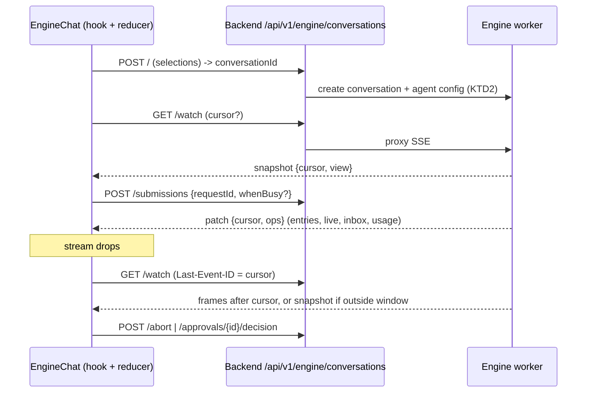
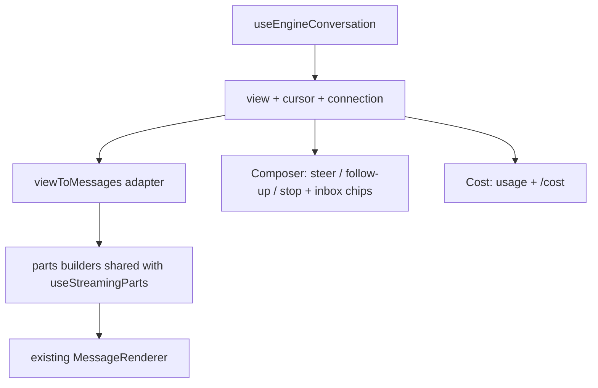

# Chat on the New Engine - Plan

## Goal Capsule

- **Objective:** run Oniva chat on `@oniva/engine` behind a per-tenant flag, with server-owned history, rejoin after refresh, steer/follow-up/stop, approvals, cost display and background compaction. This is roadmap Phase 4. Legacy chat stays as the fallback until the flag is on for everyone.
- **Authority, highest first:**
  1. This plan.
  2. `engine/README.md` and `engine/src/watch/{view,stream,patch}.ts` (the view and frame contract the UI consumes).
  3. `backend/tests/contracts/` fixtures and README (legacy chat quirks; the mapping is deliberate, see KTD6).
  4. `reports/Oniva engine roadmap.md` (Phase 4) and `docs/plans/2026-10-14-003-feat-engine-python-interfaces-plan.md` (the `/internal` gateway, policy, ledger and `/api/v1/engine/conversations` routes this plan builds on).
  5. `research_notes/Oniva harness rebuild on Pi/code_frontend.md` and `code_agent_runtime.md` (section 1.8). Line citations there are leads to re-verify.
- **Stop conditions:** stop and surface instead of guessing if:
  - the engine view cannot represent a part the legacy fixtures require (table, chart, file, source) without a new entry kind;
  - the history migration cannot preserve a legacy session's tool-call parts losslessly enough to render;
  - plan 003 U1-U11 have not landed (the routes and gateway are prerequisites).
- **Execution profile:**
  - Sonnet subagents, one unit at a time, or disjoint-file batches.
  - Backend units are test-first against the fixtures; frontend units are test-first for patch apply, adapter and reconnect.
  - Each unit lands as its own commit. The legacy chat path is not deleted in this plan.
  - Engine changes are additive (U2 only).

---

## Product Contract

### Summary

Add `ENABLE_ENGINE_CHAT`, a per-tenant flag. When on, the chat page creates or opens an engine conversation, submits through `/api/v1/engine/conversations`, and renders one watch-stream subscription (snapshot, then JSON patches with a cursor) through the existing `MessagePart` renderer. Engine conversations are append-only entries; legacy `chat_sessions` are exposed read-only through a read model. The composer stays enabled during a run and offers steer, follow-up and stop, with queued messages shown as chips from the server inbox. Cost shows per turn and per run. When the flag is off, nothing changes.

### Problem Frame

Chat today is a POST stream bound to the request. A refresh or network drop deletes the assistant bubble and loses the turn, because `persist_session` runs only after the stream ends. The client sends the whole transcript every turn, so the server does not own history and a client can forge tool results. Message state lives in three places in `frontend/components/chat/ChatInterface.tsx` (1565 lines): component state, a localStorage Zustand store and React Query. Context overflow drops the oldest messages. `done.usage` is sent and never shown. The engine already provides durable runs, a cursor-resumable view, an inbox and approvals; chat has to move onto it.

### Requirements

**Routing and rollout**
- R1. A per-tenant flag `ENABLE_ENGINE_CHAT` (default off) selects engine chat; the chat page learns it from one authenticated settings read. Off means the legacy `POST /api/v1/chat` path, untouched.
- R2. A tenant can be switched back to legacy at any time without data loss: engine conversations stay listable and readable; legacy sessions stay readable.
- R3. Flag evaluation is server-side. A client cannot select the engine path for a tenant without the flag (the engine routes also require `ENABLE_ENGINE_API`).

**Agent configuration**
- R4. A new engine conversation carries agent config built from the tenant's chat agent: system prompt, tool allow-list (from the gateway manifest filtered by the agent's enabled skills and the user's selected skills and connectors), and model tier.
- R5. Tool exposure matches legacy semantics for the selections the composer already offers (skills, connectors, web search toggle, knowledge bases), per the parity table.
- R6. Knowledge-base retrieval is a gateway tool, not hidden context injection.

**History and persistence**
- R7. The server owns history. A submission carries only the new user message and a `requestId`; the engine's entries are the transcript. The client never sends prior messages.
- R8. Existing `chat_sessions` are migrated into a read model that the UI lists and renders as completed, read-only transcripts; continuing one starts an engine conversation seeded with a summary, not a rewrite of the old rows.
- R9. Background compaction replaces drop-oldest truncation for engine chat, using the engine's compaction with the policy-selected low tier.

**Live view, rejoin, recovery**
- R10. The browser holds one watch-stream subscription per open conversation, applies snapshot and JSON-patch frames in cursor order, and resumes from the last cursor on reconnect.
- R11. Opening a conversation mid-run renders committed entries plus the live message and running tools; refresh is never destructive.
- R12. A reconnecting banner shows while the stream is down or the backend answers 503; it clears on the first frame. A stalled run is distinguishable from a disconnected tab.
- R13. Submit is idempotent: a retried submit with the same `requestId` produces one user entry.

**Composer and run control**
- R14. While a run is active the composer stays enabled with three actions: steer (delivered after the current tool round), follow-up (next run) and stop (abort).
- R15. Queued messages show as chips from the server inbox with state (queued, consumed, rejected) and survive refresh; a queued chip can be cancelled.
- R16. Tool approvals render as inline cards bound to the server approval id and decide through the decision route; a user without the right sees the card read-only.

**Cost and parts**
- R17. Per-turn and per-run cost and tokens show from the view's `usage`, priced by the backend ledger rather than the client.
- R18. The view maps to the existing `MessagePart` types so the current renderer is reused; parts the engine cannot yet produce are listed in the parity table as deferred.

**Cleanup and proof**
- R19. `ChatInterface.tsx` is split so engine chat has one state owner (server view plus optimistic pending entries); localStorage and React Query no longer mirror engine messages.
- R20. Chat fixtures pass for the engine path, and an end-to-end test kills the engine mid-turn and shows the run resuming in an open tab.

### Acceptance Examples

- AE1. Covers R1, R3. Tenant A has the flag on and tenant B off. B's user sees legacy chat; a crafted request to B's engine route returns 404.
- AE2. Covers R7, R13. The client submits the same `requestId` twice after a timeout; the transcript has one user entry and one run.
- AE3. Covers R11. Refresh mid-run: the page shows the committed user entry, partial assistant text and the running tool, then continues streaming without a new submit.
- AE4. Covers R10, R12. The network drops for 8 s. The banner appears, the stream resumes from the last cursor, and no entry is duplicated or missing. A cursor outside the retained window arrives as a snapshot and replaces state.
- AE5. Covers R14, R15. During a run the user sends a steer and a follow-up. Two chips appear, the steer is consumed after the tool round, the follow-up after the run, and a refresh keeps the chips until consumed.
- AE6. Covers R16. A write tool needs approval; the card appears inline, an unauthorized user cannot decide it (403), the owner approves and the run continues.
- AE7. Covers R17. After a two-turn conversation, each turn shows its tokens and cost, and the run total equals the sum of the ledger rows for the conversation.
- AE8. Covers R8. A legacy session with a tool call and a source renders read-only with the same parts as before; "continue" starts an engine conversation with a summary entry.
- AE9. Covers R9. A conversation exceeding the context budget compacts in the background; the transcript still shows every entry and the model sees the summary.
- AE10. Covers R20. The engine worker is killed mid-turn and restarted; the open tab shows the banner, then the run completes without a duplicate tool effect.

### Scope Boundaries

- **Not in this plan:**
  - deleting legacy chat or `chat_sessions`; that waits for the flag to be on everywhere;
  - Deep Work, Fleet and workflow runs on the engine (Phase 6);
  - the global "Needs attention" inbox and the review-ticket path (Phase 5); this plan wires only the in-chat approval card;
  - Agent Studio chat (`backend/app/api/v1/agent_chat.py`), a separate SSE translator;
  - per-user attribution on shared conversations.
- **Not changed:** the LiteLLM loops and legacy `/api/v1/chat`.

### Feature parity (Phase 4 vs deferred)

| Legacy capability | Engine chat in Phase 4 | How / why |
|---|---|---|
| Streaming text, word pacing | Yes | `live` message in the view; pacing applied to live diffs in the adapter |
| Reasoning display | Yes | Reasoning entries/live reasoning mapped to the `thinking` accordion part |
| Tool calls with status, duration | Yes | Tool tasks and `toolOutput`; adapter yields `tool_call` parts (fixes the missing `toolName` quirk) |
| Skills selected in composer (`active_skill_ids`) | Yes | Allow-list at conversation agent config (U3) |
| Connectors (`active_connector_ids`) | Yes | Gateway `invoke_connector_tool`, allow-listed per conversation |
| Web search toggle, `specific_sites` | Yes | `web_search` in the allow-list; sites passed as agent instruction and tool default |
| Knowledge base / RAG (`active_knowledge_base_ids`) | Yes | Gateway tool `search_knowledge` scoped to selected KBs (KTD3) |
| Sources panel (web, memory, document) | Yes | Derived from tool results of `web_search`, `search_knowledge`, memory tools |
| Memory read | Yes | Memory search tool in the allow-list |
| Memory write (`store_memory_async`, `memory_saved` part) | Deferred | Needs a post-run hook; chat uses the explicit memory tool only |
| File parts (`write_file`, `save_report`) | Yes, from tool results | Adapter emits file parts from `write_file`-class results, with `content` omitted as legacy did |
| Table, chart, metric, image, diff parts | Deferred | Legacy derived them by tool-name heuristics; the adapter ports the file and source heuristics only |
| `deep_work_suggested` banner | Deferred | Complexity assessment stays on legacy; engine chat hides the banner |
| File uploads / attachments in the message | Yes | Submission `content` carries file references; the file tool reads them |
| Workflow preview/progress cards | Deferred | Not emitted by legacy `chat.py` either |
| `ask_user`, `present_plan` interactive cards | Deferred | Phase 5 wires question cards; they remain tool results |
| Approval cards | Yes (in-chat) | Existing decision route (R16) |
| Cost/tokens per turn and run | Yes (new) | View `usage` plus ledger |
| Stop | Yes (new) | Abort route |

---

## Planning Contract

### Key Technical Decisions

- KTD1 — Flag at three levels, resolved on the server. `ENABLE_ENGINE_CHAT` is a tenant setting (tenant settings table, default false) read by the existing feature-flags endpoint the frontend `useFeature` hook already calls. The engine routes also require `ENABLE_ENGINE_API` (plan 003). The chat page chooses `EngineChat` or `LegacyChat` once per mount from the flag; no mid-conversation switching. Legacy and engine conversations appear in one sidebar list, each tagged by source.
- KTD2 — Agent config is built server-side at conversation creation. A new service `build_engine_chat_agent(tenant, user, project, selections)` produces `{systemPrompt, model/tier, tools allow-list, policy}` from the tenant's chat agent (the one `agent_resolver` resolves for legacy chat), the user's skill/connector/KB selections and the gateway manifest. The client sends only selections, never a prompt or a tool list. Selections are stored on the conversation; changing them mid-conversation updates the agent config document through the engine's config route rather than creating a new conversation.
- KTD3 — RAG is a gateway tool, not a pre-request hook. `search_knowledge` is already a skill; engine chat exposes it with the selected `knowledge_base_ids` bound at the conversation level (the gateway fills them from the recorded selections, so the model cannot widen scope). Reason: results become visible tool calls with sources and durations, are replayed from stored outcomes after a crash, and need no hidden injected context that the transcript does not contain. The cost is one extra model round for retrieval; mitigated by a system-prompt instruction to search first when KBs are selected. A pre-request hook stays out of scope.
- KTD4 — One watch subscription, one reducer. `frontend/lib/engine/` holds `EngineConversationClient` (create, submit, abort, decide, watch), a pure `applyFrame(view, frame)` using an RFC 6902 subset matching `engine/src/watch/patch.ts` (add/remove/replace with `~0`/`~1` escapes), and a `useEngineConversation(id)` hook exposing `{view, cursor, connection, pending}`. The stream is read with `fetch` and a streaming reader (not `EventSource`) so 401 refresh and CSRF headers work; it sends `Last-Event-ID`/`?cursor=`, backs off exponentially (cap 15 s), and treats any `snapshot` frame as a full replace. A patch that fails to apply, or a cursor gap, triggers a reconnect without a cursor to fetch a snapshot. The event schema is fixed at the view shape; the shape-inference fallback in `parseChatSSE.ts` is not used for engine chat.
- KTD5 — The adapter is the seam. `viewToMessages(view)` converts entries, `live`, `toolOutput`, `approvals` and `usage` into the existing `Message[]` with `MessagePart[]`, reusing the part builders of `frontend/hooks/useStreamingParts.ts` and `frontend/lib/fleet/traceToMessageParts.ts`. Those builders are extracted into `frontend/lib/chat/parts/` (pure functions) so both the legacy hook and the adapter call them; the legacy hook's behavior is pinned by tests before extraction. The adapter is pure and memoized per entry id so a patch re-renders only the changed message.
- KTD6 — Legacy fixtures are the adapter's oracle, not the engine's. `backend/tests/contracts/fixtures/chat_text|chat_tool_call|chat_error.json` hold `persisted_messages[].message_parts` (the legacy `metadata.parts`). The adapter tests feed an engine view built from an equivalent scripted run and assert the same `MessagePart[]`, except for deliberate differences recorded in a table in the test: `tool_call` parts gain `toolName` (legacy omitted it), the error path persists the partial text and an error part (legacy dropped it), `source` uses `description` consistently, and `partIndex` quirks disappear. Each difference is asserted, not tolerated.
- KTD7 — Read model by projection, with the old rows left alone. A migration adds `chat_session_messages` (`session_id`, `seq`, `role`, `parts jsonb`, `created_at`, tenant RLS FORCE) filled from `chat_sessions.messages` by an idempotent backfill (resume by session id, batch size configurable). `GET /api/v1/chat-sessions/{id}` serves from the read model when present, else falls back to the JSONB column. Engine conversations are listed through a view union `chat_conversations_v` (legacy sessions plus `engine_conversations`) with title, source, updated_at. New legacy writes (flag off) dual-write the read model in `persist_session` so both stay consistent until legacy is retired. Legacy rows are never mutated by engine chat.
- KTD8 — Continuing a legacy session starts a new engine conversation. The backend creates it with a summary entry (generated once through the model policy low tier, stored as the first entry with `source: "legacy_session:<id>"`) instead of replaying legacy tool calls, which would be forgeable and unreplayable. The UI links back to the read-only original.
- KTD9 — Idempotent submit with client `requestId`. The hook generates a uuid per user submission, adds an optimistic pending entry keyed by it, and retries the POST with the same id (and `Idempotency-Key`) on network error or 503. The pending entry is replaced when an entry carrying that `requestId` arrives in the view. The existing `whenBusy` field maps composer actions: steer to `steer`, follow-up to `followUp`; sending while idle submits normally.
- KTD10 — Compaction is engine-owned. Engine chat enables `engine/src/agent/compaction.ts` with the policy `purpose: "compaction"` tier (plan 003 KTD, low tier). The summary lands as an entry of its own kind and is rendered as a collapsed "Earlier messages summarized" marker; entries before it stay in the transcript. Thresholds come from agent config (`compactAtTokens`), defaulted from the model's context window by the backend config builder. Legacy `trim` of oldest messages is not applied on this path.
- KTD11 — Cost from the ledger, shown from the view. `view.usage` provides tokens per run; the cost per turn comes from a small backend endpoint `GET /api/v1/engine/conversations/{id}/cost` reading `llm_usage_records` by `conversation_id` grouped by `run_id` (priced by the ledger, plan 003 KTD10), polled once when a run completes and on rejoin. The client never prices tokens.
- KTD12 — Retire client mirrors for engine chat only. Engine chat reads the view hook as the single source; the localStorage `oniva-chat-sessions` store keeps only UI preferences (selected model, toggles, draft text) and the legacy path's sessions. The React Query `['chat-session', id]` cache is not used for engine conversations; the sidebar list uses one query keyed by the union list. Existing localStorage legacy sessions are not migrated (the server already holds persisted ones); an unsent draft survives.
- KTD13 — Split before swapping. `ChatInterface.tsx` becomes: a thin `ChatPage` that picks the mode, `LegacyChat` (the current logic moved verbatim, no behavior change), `EngineChat`, and shared `ChatShell` (layout, sidebar, header), `MessageList`, `Composer`, `ChatSelections` (skills, connectors, KBs, web search). The split lands first as a pure move with the existing chat tests green, so the engine work does not change legacy behavior.
- KTD14 — Approvals use the existing routes. The adapter renders `view.approvals` pending entries as `ApprovalCard` (already present, unwired) with handlers calling the decision route. Authority is enforced by the backend (owner or tenant admin); the UI only hides the buttons. Edit-args and comment are out of scope; approve and deny with an optional note.
- KTD15 — Connection state is a first-class value. The hook exposes `connection: "live" | "reconnecting" | "stalled" | "closed"`. `reconnecting` is the stream being down; `stalled` is a live stream with an active run and no frame for 45 s (the engine publishes live doc changes every ~100 ms during generation, so silence means a stuck worker or a restart). The banner copy differs for the two.

### High-Level Technical Design

### Assumptions

- Plan 003 U1-U11 have landed: `/internal` gateway, model policy and ledger, `engine_conversations`, and the routes in `backend/app/api/v1/engine_conversations.py` (create, submissions, watch proxy, abort, decision).
- The engine exposes (or U2 adds) the config update and per-entry `requestId` fields listed in U2; the view shape in `engine/src/watch/view.ts` is the contract.
- One engine worker serves the single configured session in v1 (`EngineDirectory`); multi-worker routing is Phase 7.
- Frontend tests run with `npm test` (jest); Playwright or the repo's existing e2e runner is available for the browser-level test, otherwise U11 drives the hook with a mocked EventSource-free fetch stream plus the Python e2e harness.

---

## Implementation Units

| U-ID | Title | Key files | Depends on |
|---|---|---|---|
| U1 | Tenant flag and chat routing | `backend/app/services/feature_flags.py`, `backend/app/api/v1/tenant_settings.py`, `frontend/lib/hooks/useFeature.ts` | — |
| U2 | Engine additions: requestId on entries, agent config update | `engine/src/agent/submission.ts`, `engine/src/agent/prompt.ts`, `engine/test/` | — |
| U3 | Agent config mapping and RAG tool binding | `backend/app/services/engine_chat_agent.py`, `backend/app/api/v1/engine_conversations.py` | U1 |
| U4 | ChatInterface split (pure move) | `frontend/components/chat/*` | — |
| U5 | Engine conversation client, patch reducer, reconnect | `frontend/lib/engine/` | U1 |
| U6 | View to MessagePart adapter and shared part builders | `frontend/lib/chat/parts/`, `frontend/lib/engine/viewToMessages.ts` | U4, U5 |
| U7 | Composer: steer, follow-up, stop, queued chips | `frontend/components/chat/Composer.tsx`, `frontend/lib/engine/useEngineConversation.ts` | U2, U5, U6 |
| U8 | Approval cards | `frontend/components/chat/shared/interactive/ApprovalCard.tsx`, adapter | U6 |
| U9 | Cost: per-turn and per-run | `backend/app/api/v1/engine_conversations.py`, `frontend/components/chat/CostBadge.tsx` | U6 |
| U10 | History read model, listing and legacy continuation | `backend/migrations/versions/103_chat_read_model.py`, `backend/app/services/chat_service.py`, `backend/app/api/v1/chat_sessions.py` | U1 |
| U11 | Compaction and rejoin hardening | `engine/src/agent/compaction.ts` config, `frontend/lib/engine/` | U3, U7 |
| U12 | End-to-end: kill the engine mid-turn | `backend/tests/e2e/test_chat_engine_recovery.py`, `frontend/e2e/` | U7, U8, U9, U10, U11 |

### U1. Tenant flag and chat routing

**Goal:** the server decides, per tenant, whether chat uses the engine.
**Requirements:** R1, R2, R3, AE1.
**Dependencies:** none.
**Files:**
- `backend/app/config/__init__.py` (`ENABLE_ENGINE_CHAT` global default false)
- `backend/app/services/feature_flags.py` (tenant override resolution), `backend/app/api/v1/tenant_settings.py`
- `frontend/lib/hooks/useFeature.ts`, `frontend/app/(dashboard)/chat/page.tsx`
- `backend/tests/test_engine_chat_flag.py`, `frontend/lib/hooks/__tests__/useFeature.test.ts`
**Approach:**
- `engine_chat_enabled(tenant)` = global flag AND `ENABLE_ENGINE_API` AND engine configured AND tenant setting true. Expose it on the existing feature-flags read used by `useFeature`.
- Engine conversation routes return 404 for a tenant where it is false, in addition to the route mount condition (defense in depth, so a global-on deploy still honors per-tenant off).
- The chat page renders `ChatPage` (U4) which chooses mode from the flag; the choice is fixed for the mount.
**Test scenarios:**
- Covers AE1. Tenant A on and B off: B's flags read false; B calling any engine route gets 404; A works.
- Global flag off overrides a tenant setting of true.
- Flag flips while a page is open: the open page keeps its mode until reload; the next load picks the new mode; old engine conversations remain readable in both modes.
**Verification:** `cd backend && uv run pytest tests/test_engine_chat_flag.py`; `cd frontend && npm test -- useFeature`.

### U2. Engine additions: requestId on entries, agent config update

**Goal:** the UI can match its optimistic message to an entry, and the backend can change an agent config after creation.
**Requirements:** R4, R13.
**Dependencies:** none.
**Files:**
- `engine/src/agent/submission.ts` (carry the submission `requestId` onto the user entry payload as `requestId`)
- `engine/src/agent/prompt.ts` (agent config document update path), `engine/src/server/` route for config update (follow the existing route module layout)
- `engine/README.md`, `engine/test/agent/submission.test.ts`, `engine/test/server/config.test.ts`
**Approach:**
- Verify first whether the user entry already includes the request id; add it only if absent. Additive only: no existing field changes meaning.
- Add `PUT /conversations/{id}/agent` accepting a partial agent config, validated by the existing `agentConfigDoc` schema, committed as a document change so watchers receive a patch.
- Backend `EngineClient` gains `update_agent` (U3 uses it).
**Test scenarios:**
- A submission with `requestId` yields a user entry whose payload carries it; the same `requestId` again yields no second entry (existing dedupe, asserted).
- An agent config update commits a document change and appears as a patch to a watcher.
- An invalid config is rejected with 400 and commits nothing.
- Existing engine suites unchanged.
**Verification:** from `engine/`: `npm run typecheck && npm run lint && npm test`.

### U3. Agent config mapping and RAG tool binding

**Goal:** a new engine conversation gets the same prompt, tools and model tier the legacy chat would have used.
**Requirements:** R4, R5, R6.
**Dependencies:** U1.
**Files:**
- `backend/app/services/engine_chat_agent.py` (new)
- `backend/app/api/v1/engine_conversations.py` (create accepts `selections`; new `PATCH /{id}/selections`)
- `backend/app/internal_api/tools.py` (bind KB ids from the conversation record), `backend/app/models/engine.py` (`selections jsonb` on `engine_conversations`), a migration revision `103a`
- `backend/tests/internal/test_engine_chat_agent.py`
**Approach:**
- Reuse `agent_resolver` to resolve the tenant's chat agent and its prompt (including project instructions and the date/context block legacy builds). Do not copy the prompt-building logic: extract the shared function if it is inline in `chat.py`, with a test pinning legacy output.
- Tool allow-list = manifest names intersected with: agent enabled skills, the user's `active_skill_ids`, connectors in `active_connector_ids` (as allowed `invoke_connector_tool` targets), `web_search`/`browse_url` when the toggle is on, `search_knowledge` when KBs are selected. Interactive-only skills stay excluded (plan 003 KTD7).
- Persist `selections` on the conversation. `search_knowledge` invocations through the gateway read the KB ids from the conversation record and ignore any model-supplied KB ids outside the selection; a KB the user cannot access (RBAC) is dropped at creation.
- Model: tier from the agent config; the engine asks the policy endpoint per request, so no model id or key is sent at creation.
- Selection changes call `update_agent` and update the record.
**Test scenarios:**
- A tenant chat agent with a custom prompt and two enabled skills yields a config with that prompt and exactly those tools plus selected connectors.
- Web search off removes `web_search` and `browse_url`; KB selected adds `search_knowledge` with the selection bound (a call naming a different KB is rejected or narrowed).
- A user without access to a selected KB: that KB is dropped and the response lists what was dropped.
- Client-supplied `systemPrompt` or `tools` in the create body are ignored.
- Patching selections mid-conversation changes the allow-list for the next run only.
**Verification:** `cd backend && uv run pytest tests/internal/test_engine_chat_agent.py`.

### U4. ChatInterface split (pure move)

**Goal:** `ChatInterface.tsx` no longer holds both worlds; legacy behavior is unchanged.
**Requirements:** R19.
**Dependencies:** none.
**Files:**
- `frontend/components/chat/ChatInterface.tsx` (shrinks to a re-export of `ChatPage`)
- `frontend/components/chat/ChatPage.tsx`, `LegacyChat.tsx`, `ChatShell.tsx`, `MessageList.tsx`, `Composer.tsx`, `ChatSelections.tsx` (new), `frontend/components/chat/__tests__/`
**Approach:**
- Step 1: add characterization tests for legacy chat that exist today only as gaps (no tests cover `parseChatSSE` or `useStreamingParts`): a stream parser test from recorded `backend/tests/contracts/fixtures/chat_*.json` events (copied into `frontend/lib/sse/__fixtures__/` with a sync script and a drift check), and a `ChatInterface` smoke render.
- Step 2: move code without logic edits: layout and sidebar to `ChatShell`, input row to `Composer` (props-driven, with the legacy submit), selection popovers to `ChatSelections`, list rendering to `MessageList`, all streaming and session logic to `LegacyChat`. No new state mirrors; refs stay in `LegacyChat`.
- `ChatPage` renders `LegacyChat` for now; U7 adds the engine branch.
- Fix `jest.config.js` `moduleNameMapper` so `@/types` and `@/app` resolve, needed by the new tests.
**Test scenarios:**
- Legacy fixture events through `parseChatSSE` and `useStreamingParts` produce the persisted `message_parts` of `chat_text` and `chat_tool_call` (this becomes the oracle for U6).
- Rendering `ChatPage` with the flag off mounts `LegacyChat`; sending a message calls `POST /api/v1/chat` with the same body shape as before.
- No file in `frontend/components/chat/` except `LegacyChat.tsx` exceeds 600 lines.
**Verification:** `cd frontend && npm test && npm run lint && npx tsc --noEmit`.

### U5. Engine conversation client, patch reducer, reconnect

**Goal:** one subscription per conversation that stays correct across drops.
**Requirements:** R10, R11, R12, R13, AE2, AE3, AE4.
**Dependencies:** U1.
**Files:**
- `frontend/lib/engine/client.ts`, `patch.ts`, `sse.ts`, `useEngineConversation.ts`, `types.ts`
- `frontend/lib/engine/__tests__/patch.test.ts`, `sse.test.ts`, `useEngineConversation.test.tsx`
- `frontend/lib/engine/__fixtures__/` (frames recorded from `engine/src/watch/stream.ts` tests)
**Approach:**
- `types.ts` mirrors `ConversationView` and `WatchFrame` from `engine/src/watch/{view,stream}.ts`; a drift test imports the engine's JSON fixture of a view and parses it with a runtime guard (hand-written, no `as` cast on wire data).
- `sse.ts`: a `fetch` streaming reader with a carry-over buffer, `event:`/`id:`/`data:`/comment handling and `{stream:true}` decoding (the FlowEditor bug class, tested with frames split mid-line and mid-UTF-8).
- `patch.ts`: `applyJsonPatch(doc, ops)` supporting `add` (including array append), `remove`, `replace`, pointer escapes, structural sharing so unchanged subtrees keep identity. Invalid op throws `InvalidPatch`.
- `client.ts`: `create`, `submit({requestId, text, content, whenBusy})`, `abort`, `decide`, `watch(cursor)`. All use the shared fetch wrapper with credentials, CSRF and one 401-refresh retry; streaming requests call the same refresh path once before reconnecting.
- Hook state machine: `connecting -> live -> reconnecting -> live`; on `snapshot` replace the view; on `patch` apply if `cursor` is greater than the stored cursor, ignore if less or equal, treat a non-contiguous failure to apply as a resync (reconnect without cursor). Backoff 0.5 s doubling to 15 s with jitter; reset on first frame. A 503 `Retry-After` is honored. Stop reconnecting on 404 (not found or flag off) and show a terminal error. Close on unmount; one subscription per conversation id even under React strict-mode double mount.
- Optimistic pending entries live in hook state keyed by `requestId` and are dropped when a view entry carries that id; submit retries use the same id (KTD9).
- `stalled` detection per KTD15 using a timer reset on any frame or SSE comment ping.
**Test scenarios:**
- Patch apply: add to array end, nested replace, remove, escaped keys (`~0`, `~1`), failure on a bad path, identity preserved for untouched subtrees.
- Covers AE4. Frames delivered, stream cut, reconnect with `Last-Event-ID` equal to the last cursor, remaining frames applied; final view deep-equals the server's final view. A snapshot after the cut replaces state and drops stale optimistic entries that now exist.
- A patch with cursor not greater than current is ignored; a patch that fails to apply triggers a resync.
- SSE reader: event split mid-line, mid-multibyte character, comment pings, `id:` carried.
- Covers AE2. Submit times out then retries with the same `requestId`; one pending entry; after the entry arrives the pending one is removed.
- Strict-mode double mount opens one connection (or closes the first before the second).
- Banner state: `reconnecting` after a drop, `live` after the first frame, `stalled` after 45 s of silence during an active run, with fake timers.
- Covers AE3. Mounting with a snapshot containing a non-empty `live` renders it without any submit.
**Verification:** `cd frontend && npm test -- lib/engine`.

### U6. View to MessagePart adapter and shared part builders

**Goal:** the existing renderer shows engine conversations, with the legacy quirks mapped on purpose.
**Requirements:** R11, R17 (display), R18, AE3.
**Dependencies:** U4, U5.
**Files:**
- `frontend/lib/chat/parts/` (extracted pure builders: text, thinking, tool call, source, file), `frontend/hooks/useStreamingParts.ts` (calls the extracted builders), `frontend/lib/fleet/traceToMessageParts.ts`
- `frontend/lib/engine/viewToMessages.ts`, `frontend/lib/engine/__tests__/viewToMessages.test.ts`
- `frontend/components/chat/EngineChat.tsx` (first version: list only, no composer actions)
**Approach:**
- Inspect `engine/src/agent/conversation.ts` and `tool-task.ts` for entry kinds and payloads before writing mappings; the table below is the intended mapping and the unit's first task is to confirm each row against the engine source and record deviations in the test.
- Mapping: user-message entry to a user `Message` (attachments from content references); assistant text entries and the `live` message to `text` parts (`isStreaming` true only for `live`); reasoning to a `thinking` accordion part; each tool task to a `tool_call` part with `status` (running, success, error, awaiting approval), `args`, `result` from the tool-result entry, partial output from `toolOutput`, `durationMs` from task timestamps, and `toolName` always present; `web_search`/`search_knowledge`/memory results to `source` parts (legacy `sourceType` url, document, memory); `write_file`-class results to `file` parts without `content`; compaction summary entry to a collapsed marker part; error entries to an error part carrying `retryable` from the engine's classification instead of the substring check.
- Group consecutive assistant entries between two user entries into one assistant `Message` so the UI shows one bubble per turn (legacy shape).
- Pacing: the adapter outputs target text; a `useSmoothText` wrapper applies the 2-3 words per 20 ms pacing to `live` only; committed entries render at once. Pacing is skipped under `prefers-reduced-motion`.
- Memoize per entry id; a patch to `live` or `toolOutput` re-renders only the last message.
- `aria-live="polite"` on the live message container (a gap the audit flagged).
**Test scenarios:**
- Fixture-driven (KTD6): build views equivalent to `chat_text` and `chat_tool_call`; adapter output equals the legacy `message_parts` except the asserted differences (`toolName` present, `source.description`, error part kept with partial text for `chat_error`).
- A live message with a running tool and partial `toolOutput` renders a running tool part with output; after the commit the same parts appear with `isStreaming: false` and no duplicate text.
- Reasoning entry becomes one accordion part with the accumulated text.
- Memoization: appending an entry leaves earlier messages referentially equal.
- Compaction marker renders collapsed and does not hide earlier entries.
- Extracted builders keep `useStreamingParts` and `traceToMessageParts` outputs identical (their existing tests plus the U4 fixture tests).
**Verification:** `cd frontend && npm test -- viewToMessages useStreamingParts traceToMessageParts`.

### U7. Composer: steer, follow-up, stop, queued chips

**Goal:** the engine chat page is usable end to end and the composer never locks during a run.
**Requirements:** R12, R13, R14, R15, AE5, plus wiring of flag-on mode.
**Dependencies:** U2, U5, U6.
**Files:**
- `frontend/components/chat/Composer.tsx`, `QueuedChips.tsx`, `ConnectionBanner.tsx`, `EngineChat.tsx`, `ChatPage.tsx`
- `frontend/lib/engine/useEngineConversation.ts`
- tests under `frontend/components/chat/__tests__/`
**Approach:**
- Composer state from the view: idle, running, awaiting approval. Idle: send. Running: the primary action is "Send as follow-up" and a menu offers "Steer now"; Enter sends the default (follow-up), Cmd/Ctrl+Enter steers; a Stop button aborts and shows a stopping state until the run's terminal entry arrives. The default and keybindings are documented in the component test.
- `QueuedChips` renders `view.inbox` items with state labels (queued, consumed, rejected) in time order above the composer; cancel on a queued chip calls the inbox cancel route (add to the backend proxy if the engine already supports it; otherwise omit the cancel control and list it as deferred in Open Questions).
- Drafts persist in the preferences store only (unsent text, selected model, toggles).
- `ConnectionBanner`: `reconnecting` ("Reconnecting... your run continues on the server"), `stalled` ("The run has not reported progress for 45 s"), and 503 `not_owner` ("Engine is restarting"). Dismisses itself on the first frame; non-blocking, does not disable the composer except when `closed`.
- `ChatPage` renders `EngineChat` when the flag is on. Creating a conversation happens on first send (project bound), then the URL carries `?c=<conversationId>` so refresh rejoins.
- Retire for engine chat: the 180 s request timeout, 30 s stale warning, 5 s localStorage flush, `beforeunload` flush and assistant-bubble deletion on error.
**Test scenarios:**
- Covers AE5. Running view: type text, steer and follow-up produce two submissions with `whenBusy` `steer` and `followUp`; chips appear from inbox state and persist across a remount with the same view.
- Stop calls abort once, disables the button, and the composer returns to idle on the terminal entry.
- Offline during submit: pending message with a retry affordance, one eventual entry (AE2).
- Banner appears on stream drop and clears on frame; composer stays enabled while `reconnecting`.
- Unsent draft survives a reload; no message content is written to localStorage.
- Keyboard: Enter, Cmd+Enter, Escape (stop requires the button, not Escape, to avoid accidents).
**Verification:** `cd frontend && npm test -- components/chat lib/engine`.

### U8. Approval cards

**Goal:** approvals in chat are decided through the backend route with server authority.
**Requirements:** R16, AE6.
**Dependencies:** U6.
**Files:**
- `frontend/components/chat/shared/interactive/ApprovalCard.tsx`, `frontend/components/chat/shared/MessageRenderer.tsx`, `frontend/lib/engine/viewToMessages.ts`
- `frontend/components/chat/__tests__/approval.test.tsx`
**Approach:**
- The adapter emits an `approval` part for each pending entry in `view.approvals`, carrying `toolTaskId`, tool name, summarized args (credential-scrubbed) and a `canDecide` flag from the user's role (owner or admin) as a UI hint only.
- `onApprove`/`onReject` call `client.decide(conversationId, toolTaskId, decision, note)`. The card shows a pending state until the approvals document reflects the decision; a 403 shows an inline "You cannot decide this" and leaves the card.
- Decided approvals render as a compact resolved line in the transcript (who and what, from the approvals document).
- No production wiring for `question`/`form`/`oauth` cards (deferred).
**Test scenarios:**
- Covers AE6. Pending approval renders a card; approve calls the decision route once; a 403 keeps the card with an error; a patch resolving the approval swaps to the resolved line.
- Double click sends one decision.
- `canDecide` false renders read-only.
- Approval survives refresh (it is in the snapshot).
**Verification:** `cd frontend && npm test -- approval`.

### U9. Cost: per-turn and per-run

**Goal:** show what each turn and the conversation cost.
**Requirements:** R17, AE7.
**Dependencies:** U6.
**Files:**
- `backend/app/api/v1/engine_conversations.py` (`GET /{id}/cost`), `backend/app/services/usage_summary.py`
- `frontend/components/chat/CostBadge.tsx`, `frontend/lib/engine/useConversationCost.ts`
- `backend/tests/internal/test_conversation_cost.py`, frontend test
**Approach:**
- Endpoint returns `{totalUsd, inputTokens, outputTokens, runs:[{runId, usd, inputTokens, outputTokens, startedAt}]}` from `llm_usage_records` by `conversation_id` (tenant RLS, binding check as other routes). Unpriced rows are counted with `unpriced: true` so the UI shows "n/a" rather than zero.
- The hook refetches on rejoin and when a run's terminal entry arrives (one fetch, no polling). While a run is active, tokens come from `view.usage`, labelled as estimates without dollars.
- UI: a small per-turn caption (tokens, cost) under the last assistant message of each turn, and a conversation total in the header. Map runs to turns by the entry `runId` (confirm the field in the engine entry payload; otherwise by order).
**Test scenarios:**
- Covers AE7. Two runs with ledger rows: per-turn values and the total equal the row sums; an unpriced row shows n/a.
- Tenant B gets 404 on tenant A's conversation cost.
- Active run shows tokens only; dollars appear after the terminal entry.
- A late usage report (ledger written after the terminal entry) is picked up by a delayed single refetch (2 s) and a manual refresh.
**Verification:** `cd backend && uv run pytest -m postgres tests/internal/test_conversation_cost.py`; `cd frontend && npm test -- CostBadge`.

### U10. History read model, listing and legacy continuation

**Goal:** old sessions remain readable, server-owned history is the only history, and the sidebar lists both kinds.
**Requirements:** R7, R8, R2, AE8.
**Dependencies:** U1.
**Files:**
- `backend/migrations/versions/103_chat_read_model.py`, `backend/app/models/chat_session.py`
- `backend/app/services/chat_service.py` (dual-write in `persist_session`), `backend/app/services/chat_backfill.py`
- `backend/app/api/v1/chat_sessions.py` (read-model reads, union list, `POST /{id}/continue`)
- `backend/app/api/v1/chat.py` (server-side history guard, see Approach)
- `frontend/lib/api/chat-sessions.ts`, `frontend/components/chat/ChatSidebar.tsx`
- `backend/tests/test_chat_read_model.py`, `backend/tests/postgres/test_chat_read_model_rls.py`
**Approach:**
- Table `chat_session_messages` per KTD7 with FORCE RLS and a unique `(session_id, seq)`. `chat_backfill.run(batch)` is idempotent (`ON CONFLICT DO NOTHING`), resumable, and runs as an admin command plus a lazy path: reading a session with no read-model rows backfills it first.
- Parts are copied as-is from `metadata.parts`; sessions with no parts get a single text part from `content`. A validation pass flags rows whose parts fail a schema check instead of dropping them.
- Union list `GET /api/v1/chat-sessions?include=engine`: legacy sessions plus engine conversations, with `source`, `title`, `updated_at`; engine titles come from the first user entry text (truncated), set by the backend at the first completed turn.
- `POST /chat-sessions/{id}/continue` (flag on): creates an engine conversation with selections copied from the request, writes the summary entry via the policy low tier (KTD8), and returns the new conversation id. Failure of the summary call falls back to a deterministic last-N-turns text recap.
- Legacy `POST /api/v1/chat` (flag off path) gains a server-side history guard only when a `sessionId` is supplied and the session exists: it uses stored history for tool-call parts and ignores client-supplied assistant/tool parts, keeping client text for the new user message only. This fixes forged history for legacy users without changing the response contract; behind a setting `CHAT_SERVER_HISTORY` (default on) with a documented off switch.
- `done.usage` still flows on legacy; no change.
**Test scenarios:**
- Covers AE8. A legacy session with thinking, tool call, source and final text reads from the read model with parts equal to the stored JSONB; continuing starts an engine conversation whose first entry is the summary and which links back.
- Backfill twice yields the same rows; an interrupted backfill resumes; RLS: tenant B never reads tenant A's messages; `oniva_app` without a tenant sees none.
- Dual-write: a legacy turn writes both stores in one transaction; failure rolls back both.
- Server-history guard: a client-forged tool_result part in `messages` does not reach the model for a stored session; a new session (no stored history) behaves as before; the contracts tests (`backend/tests/contracts`) still pass unchanged.
- Union list ordering by `updated_at`, pagination stable across sources.
**Verification:** `cd backend && uv run pytest tests/test_chat_read_model.py tests/contracts && uv run pytest -m postgres tests/postgres/test_chat_read_model_rls.py`.

### U11. Compaction and rejoin hardening

**Goal:** long conversations stay within context without dropping entries, and rejoin is correct under stress.
**Requirements:** R9, R11, R12, AE3, AE4, AE9.
**Dependencies:** U3, U7.
**Files:**
- `backend/app/services/engine_chat_agent.py` (compaction settings), `engine/src/agent/compaction.ts` (configuration only; code changes only if the policy tier is not honored)
- `frontend/lib/engine/useEngineConversation.ts`, `frontend/components/chat/CompactionMarker.tsx`
- `frontend/lib/engine/__tests__/rejoin.test.tsx`, `engine/test/agent/compaction.chat.test.ts`
**Approach:**
- Agent config carries `compactAtTokens` (a fraction of the model context window from `llm_pricing`/model metadata, default 70 percent) and the `purpose: "compaction"` policy tier; verify that `compaction.ts` calls the model through the policy hook so compaction cost lands in the ledger with `purpose` recorded.
- UI shows a transient "Summarizing earlier messages" state while the compaction task runs and the marker after.
- Rejoin: the hook handles a snapshot arriving while optimistic entries exist, a snapshot after the retained window (500 frames) and a `maxLag` snapshot (100 frames) during a fast stream; none may duplicate text or lose the cursor.
- Multi-tab: two tabs on one conversation both render the same view; steer from one shows as a chip in the other.
**Test scenarios:**
- Covers AE9. Scripted conversation crossing the threshold produces a compaction entry; the next request's context starts with the summary; the transcript retains all entries; the ledger has a compaction row.
- Covers AE4. Cursor outside the window yields a snapshot; the final view equals a fresh load; no duplicate text with a `live` message mid-stream.
- A burst of more than 100 patches while the tab is hidden resolves to one snapshot and correct state.
- Two hooks on one conversation converge to equal views.
**Verification:** from `engine/`: `npm test -- compaction`; `cd frontend && npm test -- rejoin`.

### U12. End-to-end: kill the engine mid-turn

**Goal:** prove the phase exit criterion.
**Requirements:** R20, AE10, and the integrated AE2, AE3, AE5-AE7.
**Dependencies:** U7, U8, U9, U10, U11.
**Files:**
- `backend/tests/e2e/test_chat_engine_recovery.py`, `backend/tests/e2e/conftest.py` (extends the plan 003 U11 harness)
- `frontend/e2e/chat-engine-recovery.spec.ts` (Playwright) and `frontend/playwright.config.ts` if absent
- `backend/tests/contracts/` (engine-path fixture set, below)
**Approach:**
- Reuse the plan 003 harness: Postgres, real backend, engine worker with a scripted model. Script: a turn that calls `write_file`, pauses on a gate the test controls, then answers.
- Backend-level test (`@pytest.mark.e2e`): create via the flag-on route, submit, wait for the tool call to be in flight, kill the worker, restart it, release the gate; assert the watch stream (consumed with the Python client from the last cursor) ends with the answer, `write_file` ran once, usage rows exist, and the conversation cost endpoint matches the ledger.
- Browser test: open the chat page against the same stack, submit, kill the worker when the tool shows running, assert the reconnecting banner, restart, assert the run completes in the same tab with no duplicate message or tool effect; then refresh mid-run in a second scenario and assert rejoin (AE3).
- Engine-path chat fixtures: record `chat_engine_text`, `chat_engine_tool_call`, `chat_engine_error` views and the adapter output next to the legacy ones in `backend/tests/contracts/fixtures/`, using the recorder's normalization; the README gains a section listing the deliberate differences from KTD6. A guard test fails when a legacy fixture has no engine counterpart.
- CI: the Playwright test is tagged `@recovery` and runs in the e2e job only.
**Test scenarios:**
- Covers AE10. Kill and restart mid-tool; banner shown; run completes; one effect.
- Refresh mid-run rejoins without a new submit.
- Steer during the run produces one chip, consumed after the tool round.
- Fixture guard: every legacy chat fixture has an engine counterpart; all pass.
**Verification:** `cd backend && uv run pytest -m e2e tests/e2e/test_chat_engine_recovery.py tests/contracts`; `cd frontend && npx playwright test chat-engine-recovery`.

---

## Risks & Dependencies

| Risk | Mitigation |
|---|---|
| Engine view lacks data the adapter needs (run id on entries, tool names, reasoning) | U2 and U6 start by verifying against engine source; gaps become additive engine changes in U2 before UI work |
| Legacy parts (table, chart, metric, `memory_saved`, `deep_work_suggested`) disappear for flagged tenants | Parity table marks them deferred; rollout starts with internal tenants; flag off restores them |
| Pre-request RAG quality drops versus hidden injection (extra tool round) | System-prompt instruction to search first; measure on a fixed question set in U3 review; hook approach remains available later |
| Frame loss or reordering corrupts the view | Cursor monotonic check, resync on failure, snapshot fallback, tests with injected gaps |
| Backfill of large `chat_sessions` is slow or locks | Batched, idempotent, resumable, lazy on read; no table rewrite of the old rows |
| Server-history guard changes legacy behavior | Behind `CHAT_SERVER_HISTORY`; contract fixtures pinned; only applies to existing stored sessions |
| Engine restart exposes `not_owner` windows to users | Proxy maps to 503 + `Retry-After`; hook treats it as `reconnecting`; U12 covers it |
| `ChatInterface` split regresses legacy | U4 is a pure move behind characterization tests and lands first |
| Cost shown before the ledger write | Tokens live, dollars after terminal entry plus delayed refetch |
| Plan 003 not complete | Stop condition; U1 and U4 can start without it |

## Verification Contract

| Gate | Command | Applies to |
|---|---|---|
| Backend unit | `cd backend && uv run pytest tests/test_engine_chat_flag.py tests/internal/test_engine_chat_agent.py tests/test_chat_read_model.py` | U1, U3, U10 |
| Backend Postgres | `cd backend && uv run pytest -m postgres tests/postgres tests/internal/test_conversation_cost.py` | U9, U10 |
| Legacy contracts | `cd backend && uv run pytest tests/contracts` | U10, U12 |
| Backend e2e | `cd backend && uv run pytest -m e2e tests/e2e/test_chat_engine_recovery.py` | U12 |
| Backend lint | `cd backend && uv run ruff check app tests` | all Python |
| Engine | `cd engine && npm run typecheck && npm run lint && npm test` | U2, U11 |
| Frontend unit | `cd frontend && npm test` | U4-U9, U11 |
| Frontend types and lint | `cd frontend && npx tsc --noEmit && npm run lint` | all TS |
| Browser e2e | `cd frontend && npx playwright test chat-engine-recovery` | U12 |

Every AE1-AE10 has a named passing test.

## Definition of Done

- U1-U12 each meet their Verification line.
- With the flag off, legacy chat behaves as before and `backend/tests/contracts` pass unchanged.
- With the flag on, a conversation survives refresh, network drop and engine kill-and-restart in an open tab, with no duplicate entry or tool effect.
- Steer, follow-up, stop, queued chips, approval cards and per-turn/per-run cost work on the engine path.
- The server is the only history source on the engine path; no client-sent transcript is accepted.
- Existing `chat_sessions` are readable through the read model; RLS tests pass.
- `ChatInterface.tsx` is a thin re-export; no engine message state is mirrored in localStorage or React Query.
- The parity table matches shipped behavior; deferred items are listed in the README of the chat feature or this plan's follow-ups.
- No abandoned or experimental code remains in the diff.

## Open Questions

- Deferred, non-blocking: whether the engine inbox supports cancelling a queued item today. If not, U7 ships chips without cancel and a later engine change adds it.
- Deferred, non-blocking: memory writes after a run (`store_memory_async` parity) need a post-run hook in the engine; chat uses the explicit memory tool until then.
- Deferred, non-blocking: whether to keep the 500-frame retained window per conversation as is for chat under many concurrent tabs; revisit with real usage.
