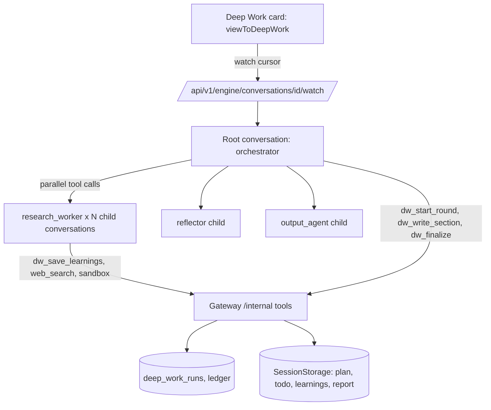
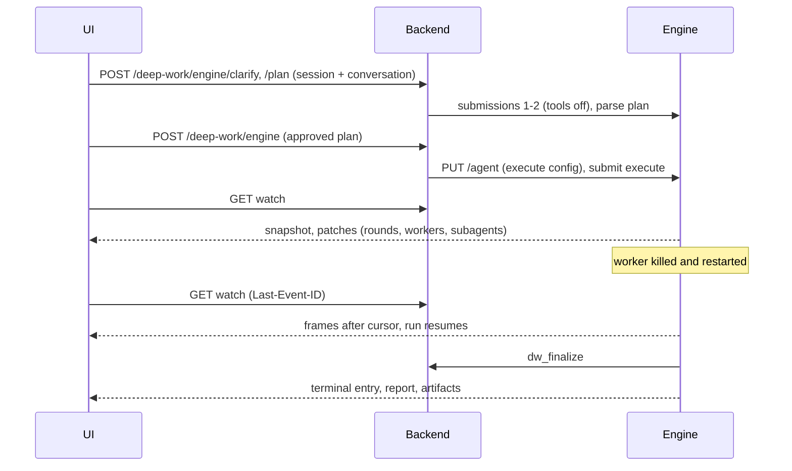

# Deep Work on the New Engine - Plan

## Goal Capsule

- **Objective:** run Deep Work (clarify, plan, research workers, reflection, synthesis, sandbox output) on `@oniva/engine` behind a per-tenant flag, so a run survives a worker kill, a refresh and a second tab, and cancel actually stops work. This is the Deep Work slice of roadmap Phase 6. Fleet and workflows are not in this plan. Legacy engine v2 stays as the fallback until the flag is on everywhere.
- **Authority, highest first:**
  1. This plan.
  2. `engine/README.md`, `engine/src/agent/subagents.ts`, `engine/src/tasks/*` and `engine/src/watch/{view,stream,patch}.ts` (runtime and view contract).
  3. `backend/tests/contracts/` fixtures `deep_work_success.json` / `deep_work_failure.json` and their README section (legacy quirks; the mapping is deliberate, see KTD9).
  4. `reports/Oniva engine roadmap.md` (Phase 6) and `docs/plans/2026-10-14-003-feat-engine-python-interfaces-plan.md` (gateway, policy, ledger, `/api/v1/engine/conversations`).
  5. `docs/plans/2026-10-15-001-feat-chat-on-engine-plan.md` (the `frontend/lib/engine/` client, reducer, banner and cost code this plan reuses).
  6. `research_notes/Oniva harness rebuild on Pi/code_agent_runtime.md` (sections 1.3, 1.4) and `code_frontend.md` (section 2.3). Line citations there are leads to re-verify.
- **Stop conditions:** stop and surface instead of guessing if:
  - parallel subagent calls in one round do not run concurrently, or ten parallel workers cannot finish under the worker pool's `concurrency` (U2 scenario test);
  - a child conversation cannot be bound to its root conversation for the gateway, policy and ledger without a change larger than KTD3;
  - the panel cannot show a running worker's activity from the parent view without a larger engine change than KTD2;
  - plan 003 U1-U11 or the chat plan's `frontend/lib/engine/` units have not landed.
- **Execution profile:**
  - Sonnet subagents, one unit at a time, or disjoint-file batches.
  - Backend and engine units are test-first; frontend units are test-first for adapter and reconnect.
  - Each unit lands as its own commit. Engine changes are additive and confined to U2.
  - Legacy engine v2 is not deleted. The dead v1 executor is deleted in U11 only.

---

## Product Contract

### Summary

Add `ENABLE_ENGINE_DEEP_WORK`, a per-tenant flag. When on, a Deep Work session is one engine conversation. The orchestrator model drives the run by calling subagent tools (`research_worker`, `reflector`, `output_agent`) and a small set of gateway tools that persist the plan, learnings, report sections and workspace files. The Deep Work panel renders one watch-stream subscription through a view adapter, replacing the `deep_work_engine_*` SSE. Cancel aborts the whole task tree, bottom-up. A killed engine worker resumes the run from committed state. When the flag is off, nothing changes.

### Problem Frame

Deep Work v2 runs in an `asyncio.create_task` inside one API pod. A restart leaves the job `running` and the boot sweep marks it failed; the research is lost. The event stream is a destructive in-memory queue with no cursor, so refresh, a second tab or a restart loses or duplicates events (`engineReport + chunk` double-applies). One `AsyncSession` is shared by the engine, the gateway and every concurrent worker. Cancel works only on the pod holding the task. The worker count and completeness threshold settings are dead. The legacy `AutonomousExecutor` is a second, text-protocol loop with Redis pause flags that the UI no longer calls. Worker `tool_call_count` counts LLM iterations. The panel's worker tree is a client-invented `w1..wN` list that hydration cannot restore. The engine already provides durable runs, parallel tool tasks, durable subagents and a cursor-resumable view.

### Requirements

**Routing and rollout**
- R1. A per-tenant flag `ENABLE_ENGINE_DEEP_WORK` (default off) selects the engine path; the Deep Work card learns it from the existing feature-flags read. Off means the legacy v2 endpoints and SSE, untouched.
- R2. Flag evaluation is server-side and requires `ENABLE_ENGINE_API`. A client cannot start an engine run for a tenant without the flag (404).
- R3. A tenant can be switched back to legacy at any time. Engine runs stay listable and readable; legacy sessions stay readable.

**Run execution**
- R4. The research workers of a round run as parallel subagent calls, at most `DEEP_WORK_MAX_WORKERS` per round (the setting becomes live, default 10 to match the legacy plan limit).
- R5. Reflection runs after each research round, at most `DEEP_WORK_MAX_REFLECTION_ROUNDS` times. The cap is enforced by the server, not only by prompt.
- R6. Synthesis writes the report section by section; the `## Sources` block is deterministic and built from stored learnings, as in legacy.
- R7. Plan, todo, learnings, report and artifacts persist as workspace files in gateway-backed storage under the session; the workspace listing and download endpoints keep working.
- R8. The sandbox output phase (shell, browser, inspect, publish) runs as gateway tools with proxy-token sandboxes (zero real secrets in the sandbox). Failure of the output phase delivers the markdown report only.
- R9. A killed engine worker resumes the run: no worker's research is repeated once its learnings are saved, no write tool takes effect twice, and the run completes.
- R10. Cancel aborts the root run and every child task, tears down sandboxes and revokes tokens, and marks the session cancelled. It works from any backend pod.
- R11. The user can send a steer message during a run through the same inbox as chat.

**Live view and recovery**
- R12. The panel renders one watch-stream subscription per session (the orchestrator conversation) with cursor resume; no second event channel for run state.
- R13. Opening a session mid-run shows the plan, finished workers with findings, running workers with current activity, reflection rounds and the report so far; refresh is never destructive.
- R14. The panel distinguishes reconnecting, stalled, recovering (resumed after a restart) and terminal states; the legacy `paused` status is removed from the engine path.
- R15. Worker rows come from the engine's task tree (KTD2), with server-minted ids, not client-invented ones. A worker can be opened to its read-only child transcript.

**Cost, history, parity**
- R16. Cost and tokens for the whole session, including every child conversation, appear in the card header from the ledger, grouped by purpose (orchestrator, worker, reflection, synthesis, output).
- R17. The shared-`AsyncSession` hazard does not exist on the engine path: every tool call and policy call uses its own tenant-scoped session.
- R18. Legacy `AutonomousExecutor`, its endpoints, Redis flags and the v1 store paths are deleted once the UI no longer calls them (the UI already does not).

**Proof**
- R19. Contract fixtures for the engine path exist next to the legacy ones, with deliberate differences recorded and asserted.
- R20. An end-to-end test kills the engine worker mid-research and shows the run resuming to a report in an open tab; a second test shows cancel stopping child work.

### Acceptance Examples

- AE1. Covers R1, R2. Tenant A has the flag on and tenant B off. B's card uses legacy endpoints; a crafted request to B's engine routes returns 404.
- AE2. Covers R4, R5. A plan has 12 sub-queries; the round-start tool rejects the 11th and 12th with an error the orchestrator can act on. A reflection round past the cap is rejected and the orchestrator proceeds to synthesis.
- AE3. Covers R9. Two workers are in flight; the engine process is killed and restarted. The finished worker's search does not rerun; the unfinished worker's `web_search` runs once for its idempotency key; the report is produced.
- AE4. Covers R12, R13. Refresh mid-research: the panel shows the plan, one finished worker with findings, one running worker with its latest activity, and continues without a new submit. A second tab shows the same view.
- AE5. Covers R10. Cancel during research: running workers become aborted, their sandboxes are torn down, the session shows cancelled, and no worker produces output afterward.
- AE6. Covers R6. The report ends with a `## Sources` block equal to the saved learnings' URLs, deduplicated, regardless of what the model wrote.
- AE7. Covers R8. The sandbox is unavailable. The run completes with the markdown report and no artifact, and the panel says the deliverable was skipped.
- AE8. Covers R11. A steer sent during the research round is consumed after the current tool round and shows as a chip.
- AE9. Covers R16. After a run with three workers and one reflection round, the header total equals the sum of ledger rows over the root and child conversations.
- AE10. Covers R14. The engine restarts mid-run: the card shows reconnecting, then a "resumed after restart" marker, then completes.

### Scope Boundaries

- **Not in this plan:**
  - Fleet, workflows, `DurableWorkflowEngine` and LiteLLM removal (rest of Phase 6);
  - deleting legacy Deep Work engine v2 (`DeepWorkEngine`, `deep_work.py` engine routes, `_sse_queues`); that waits for the flag to be on everywhere;
  - pause and resume (legacy v2 never had them; v1 is deleted);
  - live worker screenshots in the card (drill-down only, see parity table);
  - the global "Needs attention" inbox and `ask_user` cards (Phase 5);
  - enabling the chat `deep_work_suggested` banner on engine chat (it stays hidden, chat plan parity table).
- **Not changed:** the clarify and plan UI steps, the legacy v2 pipeline, and `backend/tests/contracts` legacy fixtures.

### Feature parity (legacy v2 vs engine path)

| Legacy capability / event | Engine path | How / why |
|---|---|---|
| `clarify`, `plan` endpoints | Yes | Intake and plan are the first two submissions of the session conversation, tools off (KTD5); same response shapes |
| `deep_work_engine_planned`, `gap_tasks` | Yes | `dw_start_round` call arguments per round; `planned` is round 0 |
| `deep_work_engine_phase` | Yes, derived | Adapter derives phase from which tool tasks are running (KTD8); `completed` from the `dw_finalize` result |
| `worker_started` / `worker_complete` | Yes | `research_worker` tool task status plus the worker's JSON answer (`learning_count`, `source_count`, `top_findings`); `tool_call_count` now counts real tool calls (fixes legacy iterations quirk); `duration_seconds` from task timestamps |
| `worker_activity` (`recent_actions`) | Yes | `subagents[taskId].recent` from the engine view (KTD2) |
| `reflection` {score, gaps, round, continuing} | Yes | `reflector` subagent answer (JSON) and `dw_record_reflection` |
| `source_update` | Yes | Sources array in the worker answer, merged client-side; final block from storage |
| `synthesis_chunk` | Section-level, token-level if available | `dw_write_section` arguments stream in `live` when the engine streams tool arguments (verified in U2); otherwise one update per section |
| `workspace_update` | Yes | `details.workspace` on write-tool results triggers a workspace list refetch |
| `output_started/progress/validation/complete` | Yes | `output_agent` subagent; `inspect_artifact` / `publish_artifact` results; artifacts from the `dw_finalize` result |
| `sandbox_screenshot` | Deferred | Child tool results are not in the parent view; shown on worker drill-down only |
| `deep_work_engine_error` | Yes | `run_error` entry or failed root run |
| Cancel | Yes, now real | Engine abort, bottom-up over child tasks |
| Steer | Yes (new) | `whenBusy: "steer"` submission and queued chip |
| Pause / resume | Not supported | Same as legacy v2 |
| Recovery after restart | Yes (new) | Engine resume; `recovering` marker |
| `full-state` endpoint | Yes (derived) | For engine sessions returns the conversation id plus workspace pointers; state itself comes from the view |
| Per-worker model routing (`resolve_model_for_policy`) | Yes | Per-run `metadata.subagents` override carries the tier per worker task type (KTD4) |
| Wall-clock cap `DEEP_WORK_MAX_DURATION_SEC` | Yes | Engine run deadline in agent config; verified in U2, else a gateway-side deadline check in `dw_start_round` |
| Per-tool extractor LLM call | Removed | Worker saves learnings itself via `dw_save_learnings`; fewer calls, recorded as a deliberate difference |

---

## Planning Contract

### Key Technical Decisions

- KTD1 — Map Deep Work to engine subagents, not a custom task kind. The orchestrator is the root conversation's model; workers, reflection and output are `createSubagentTool` tools. Reasons: subagents are already durable (the child and submission ids are committed with the parent's wait, so a rerun never makes a second child), one tool call per worker runs in parallel because each round's calls become sibling tool tasks joined with `allSettled`, aborting the parent aborts children bottom-up, and the watch view and ledger already exist. Waiting tasks hold no pool slot (the scheduler counts only in-flight invocations), so ten workers do not starve their own children. A custom task kind would reimplement fan-out, join and abort and need a new view and a new UI. Cost accepted: control flow (rounds, reflection, synthesis order) is model-driven. KTD6 makes the invariants server-enforced.
- KTD2 — One additive view field: `subagents`. The parent view gains `subagents: { [toolTaskId]: { conversationId, submissionId, status, startedAt, endedAt?, toolCalls, recent: string[], usage } }`, projected by the watch layer from child conversations owned by the parent's tool tasks. `recent` holds the last five tool-call descriptions (name plus short argument summary). This gives live worker activity from the single stream. Child transcripts stay in the child conversation; the drill-down opens a second watch on demand through a backend route that checks the child id against the root view. Verify in U2 whether a cheaper existing signal suffices; if not, add the field.
- KTD3 — Bind child conversations to the root. Gateway, policy and usage calls from a worker carry the child's `conversationId`, which is not an `engine_conversations` row. The engine adds `rootConversationId` (the top ancestor; equal to `conversationId` at depth 0) to gateway invoke, policy and usage bodies. The backend authorizes against the root, builds `SkillContext` for the root's user, and stores `root_conversation_id` on `llm_usage_records` and `tool_invocations`. Cost and session reads group by root.
- KTD4 — Per-run subagent overrides from agent metadata. `ENGINE_SUBAGENT_TOOL` registers a single name with static overrides. Deep Work needs three tools and per-tenant tool lists (search keys, KBs, connectors, sandbox availability differ), so the worker env adds `ENGINE_SUBAGENT_TOOLS` (a list of names) and a subagent's model, tools and system prompt resolve first from the parent's `agent.metadata.subagents[toolName]`, then from the static options. The backend writes that metadata when it builds the execute-phase agent config. Additive: absent metadata keeps today's behavior.
- KTD5 — One conversation per session, three phases as submissions. Intake (`clarify`), plan and execute are submissions to the same conversation, with the agent config swapped between them through `PUT /agent` (tools off for intake and plan, execute tools on for the run). The plan submission's answer is parsed into `DeepWorkPlan` by the backend, with one repair submission on invalid JSON (legacy had none and failed). The user-approved plan, possibly edited, is the execute submission's content. `session_id` returned to the client is the `deep_work_runs.id`; `conversation_id` is returned alongside.
- KTD6 — Server-enforced invariants through gateway tools, model-driven flow. State lives in `deep_work_runs` (Postgres, tenant RLS FORCE): `phase`, `round`, `rounds` (workers per round with status), `reflections`, `artifacts`, `plan`. Tools enforce order and caps:
  - `dw_start_round({round, workers})` registers a round: round numbers are consecutive, at most `DEEP_WORK_MAX_WORKERS` workers, at most `DEEP_WORK_MAX_REFLECTION_ROUNDS + 1` rounds, and the run deadline has not passed. It writes `plan.md` and `todo.md` (gap tasks included).
  - `dw_save_learnings({worker_id, learnings})` replaces that worker's learnings file (idempotent by worker id), updates the round, downloads and tears down that worker's sandbox, and returns counts.
  - `dw_record_reflection({round, score, gaps, should_continue, gap_tasks})` is called by the reflector and persisted per round.
  - `dw_write_section({heading, markdown})` appends or replaces a section in `report.md` and is rejected until the latest round has every worker saved or failed.
  - `dw_finalize({})` appends the deterministic `## Sources` block, writes the final report and the persisted state, sets `completed`, and returns artifacts and sizes.
  - `dw_get_learnings({worker_ids?, max_tokens?})` (read) returns the selected learnings using the existing `_select_learnings` ranking.
  The orchestrator prompt tells the model the loop; the tools make skipping a step an error result the model sees and corrects.
- KTD7 — Workspace files are gateway-backed storage, run state is Postgres. `plan.md`, `todo.md`, `report.md`, `learnings/<worker_id>.json` and `workers/<id>/artifacts/*` stay in `SessionStorage` keyed by session id, so the workspace list and download endpoints are unchanged in shape and only the ownership check moves to `deep_work_runs`. Engine documents cannot be written from the gateway and are not needed: the panel reads run state from the view and files from the workspace endpoints. File writes replace by path, so replays are idempotent. `engine_state.json`, `engine_plan.json` and `engine_report.md` are not written on this path.
- KTD8 — The panel is a pure function of the view. `frontend/lib/engine/deepWork.ts` exports `viewToDeepWork(view, runMeta)` returning `{phase, plan, rounds[], workers[], reflections[], report, sources, artifacts, usage, connection}`. Phase is derived from running tool tasks: `dw_start_round` or `research_worker` running means researching, `reflector` reflecting, `dw_write_section` synthesizing, `output_agent` or sandbox tools generating_output, a successful `dw_finalize` completed. Workers are `research_worker` tool tasks joined to `view.subagents`. Report text is the concatenation of `dw_write_section` arguments in call order (so a recovered session needs no sidecar fetch). The legacy store is bypassed for engine sessions; it keeps only clarify and plan steps.
- KTD9 — Legacy fixtures are the adapter's oracle, with asserted differences. `deep_work_success.json` and `deep_work_failure.json` define the event semantics. Engine-path views are recorded from a scripted run and `viewToDeepWork` output is compared to the legacy final state (plan, workers, reflection, report, sources). Deliberate differences, each asserted: `tool_call_count` is real tool calls; `duration_seconds` from task timestamps; parallel worker ordering is by task creation order (legacy was nondeterministic and unrecorded); invalid orchestrator JSON gets one repair instead of a zero-event failure; `report_length` is characters of the assembled report.
- KTD10 — Sandbox as gateway tools. `shell_exec`, `browser_navigate`, `browser_screenshot`, `inspect_artifact`, `publish_artifact` get entries in `backend/app/internal_api/tool_specs.py` (write, non-idempotent except inspect; sandbox timeouts), and call `execute_sandbox_tool` through a `SandboxHandle` from `get_sandbox_executor().get_or_create(session_id, worker_id, ...)`. The proxy token is minted at `get_or_create` per (session, worker) and revoked at teardown, as in `_build_control_plane_env_vars`. A crash between intent and result is handled by the engine: non-idempotent calls reconcile from the stored outcome or report `interrupted`, and the sandbox may have been lost, so a rerun recreates it and the worker prompt tells the model files may be gone. Teardown happens in `dw_save_learnings` (worker sandbox), in `publish_artifact` / `dw_finalize` (output sandbox), on cancel, and by a lazy reaper when a terminal run is read; the executor's TTL is the backstop.
- KTD11 — Status is reconciled lazily; no boot sweep. `deep_work_runs.status` is written by `dw_finalize` (completed), the cancel route, and a reconcile step on session read and list that compares the row with the engine run state (`run.active`, last terminal entry) and writes back failed or cancelled idempotently. A `background_jobs` row is created per session (`JobType.DEEP_WORK`) only so the existing session list and usage pages keep working, and is updated by the same reconcile. The legacy boot sweep applies only to legacy sessions (`is_engine = false`).
- KTD12 — Flag at the same three levels as chat. `ENABLE_ENGINE_DEEP_WORK` is a tenant setting (default false), exposed by the feature-flags read; engine Deep Work needs `ENABLE_ENGINE_API`, engine configured, and the tenant setting. The routes under `/api/v1/deep-work/` dispatch by flag: the legacy handlers stay as they are, and engine handlers live in `backend/app/api/v1/deep_work_engine.py`. The card picks its mode once per session from the flag; a session created in one mode stays in it.
- KTD13 — Steer and cancel reuse chat routes. The card submits steers through the chat plan's `submit` client and cancels through abort. `POST /deep-work/engine/{session_id}/cancel` stays as a thin wrapper that aborts the conversation, tears down sandboxes and marks the row, so the existing client call keeps working.
- KTD14 — One cost source. `GET /api/v1/engine/conversations/{id}/cost` (chat plan U9) is extended to group by `root_conversation_id` and `purpose`, so a Deep Work session's total includes every child. Purposes on policy calls: `deep_work.orchestrator`, `.worker`, `.reflection`, `.synthesis`, `.output`; the model policy maps each to a tier (workers by task type, as `resolve_model_for_policy` did).

### High-Level Technical Design

### Assumptions

- Plan 003 U1-U11 and the chat plan are implemented: `/internal` gateway, policy and ledger, `engine_conversations`, `backend/app/api/v1/engine_conversations.py`, `backend/app/services/engine_client.py`, and `frontend/lib/engine/{client,patch,sse,useEngineConversation,watcher,cost}.ts`.
- One engine worker process serves the single configured session (`EngineDirectory`); multi-worker routing is Phase 7. Ten workers plus children fit the pool's `concurrency` (16) because waiting tasks hold no slot; U2 proves it.
- Tool calls in one assistant round run concurrently up to `maxToolCallsPerRound` (32), and `maxSubagentDepth` (3) allows root, worker child and no grandchildren (workers get depth 1).
- E2B access, `SANDBOX_PROXY_URL` and `ENABLE_SANDBOX` are configured as today; the sandbox executor's Redis registry stays.
- The latest Alembic revision is `106_engine_conversation_pin_archive.py`; this plan adds `107`.

---

## Implementation Units

| U-ID | Title | Key files | Depends on |
|---|---|---|---|
| U1 | Tenant flag and endpoint dispatch | `backend/app/services/feature_flags.py`, `backend/app/api/v1/deep_work.py`, `frontend/lib/hooks/useFeature.ts` | — |
| U2 | Engine additions and verifications | `engine/src/watch/view.ts`, `engine/src/agent/subagents.ts`, `engine/src/tools/gateway.ts`, `engine/src/worker/` | — |
| U3 | Run state, root binding, workspace storage | `backend/migrations/versions/107_deep_work_runs.py`, `backend/app/services/deep_work_state.py`, `backend/app/internal_api/` | U1, U2 |
| U4 | Deep Work gateway tools | `backend/app/services/deep_work/engine_tools.py`, `backend/app/internal_api/tool_specs.py` | U3 |
| U5 | Sandbox and output tools | `backend/app/services/deep_work/sandbox_tools.py`, `backend/app/services/deep_work/engine_sandbox.py` | U4 |
| U6 | Agent configs, prompts, intake and plan | `backend/app/services/engine_deep_work_agent.py`, `backend/app/services/deep_work/prompts/` | U2, U4 |
| U7 | Engine session API: start, cancel, steer, state, workspace | `backend/app/api/v1/deep_work_engine.py` | U3, U5, U6 |
| U8 | View adapter and Deep Work hook | `frontend/lib/engine/deepWork.ts`, `frontend/lib/engine/useEngineDeepWork.ts` | U2, U7 |
| U9 | Deep Work card on the engine view | `frontend/components/deep-work/`, `frontend/hooks/useDeepWorkChat.ts` | U8 |
| U10 | Cost by root and purpose | `backend/app/api/v1/engine_conversations.py`, `backend/app/services/usage_summary.py` | U3 |
| U11 | Contract fixtures for the engine path | `backend/tests/contracts/`, `frontend/lib/engine/__fixtures__/` | U6, U8 |
| U12 | Delete the legacy executor and v1 paths | `backend/app/services/autonomous_executor.py`, `backend/app/api/v1/deep_work.py`, `frontend/lib/stores/deep-work.ts` | U9 |
| U13 | End-to-end: kill mid-research, cancel | `backend/tests/e2e/test_deep_work_engine_recovery.py`, `frontend/e2e/deep-work-engine-recovery.spec.ts` | U7, U9, U10 |

### U1. Tenant flag and endpoint dispatch

**Goal:** the server decides per tenant whether Deep Work uses the engine.
**Requirements:** R1, R2, R3, AE1.
**Dependencies:** none.
**Files:**
- `backend/app/config/__init__.py` (`ENABLE_ENGINE_DEEP_WORK` default false; new `DEEP_WORK_MAX_WORKERS` meaning below; delete the dead `DEEP_WORK_COMPLETENESS_THRESHOLD`, `DEEP_WORK_SYNTHESIS_MAX_TOKENS` only in U12)
- `backend/app/services/feature_flags.py` (`engine_deep_work_enabled(tenant)`, `FlagMeta`), `frontend/lib/hooks/useFeature.ts`
- `backend/app/api/v1/deep_work.py` (the `clarify`, `plan`, `start`, `cancel` handlers delegate to engine handlers when the flag is on)
- `backend/tests/test_engine_deep_work_flag.py`, `frontend/lib/hooks/__tests__/useFeature.test.ts`
**Approach:**
- `engine_deep_work_enabled(tenant)` = global flag AND `ENABLE_ENGINE_API` AND engine configured AND tenant setting true, modeled on `engine_chat_enabled`.
- Dispatch on the same URLs so the client keeps one API; the response carries `is_engine` and `conversation_id` for engine sessions.
- Set `DEEP_WORK_MAX_WORKERS` default 10 and read it in `dw_start_round` (U4) and the legacy `_run_workers` plan cap is untouched.
**Test scenarios:**
- Covers AE1. Tenant A on, B off: B's start uses the legacy handler; B calling an engine-only route (`/deep-work/{id}/steer`) gets 404.
- Global off overrides tenant true; engine unconfigured overrides both.
- A session created in legacy mode keeps working after the flag flips on.
**Verification:** `cd backend && uv run pytest tests/test_engine_deep_work_flag.py`; `cd frontend && npm test -- useFeature`.

### U2. Engine additions and verifications

**Goal:** the engine exposes what Deep Work needs, with minimal additive changes, and the assumptions are proven.
**Requirements:** R4, R9, R12, R15.
**Dependencies:** none.
**Files:**
- `engine/src/watch/view.ts`, `engine/src/watch/` (the `subagents` projection, KTD2)
- `engine/src/agent/subagents.ts`, `engine/src/worker/` (multiple subagent tools, metadata overrides, KTD4; `ENGINE_SUBAGENT_TOOLS`)
- `engine/src/tools/gateway.ts` and the model policy and usage clients (`rootConversationId`, KTD3)
- `engine/README.md`, `engine/test/watch/subagents.test.ts`, `engine/test/agent/subagent-overrides.test.ts`, `engine/test/scenario/deep-work-shape.test.ts`
**Approach:**
- First task, verification only, recorded in the test names: (a) ten sibling `research_worker` calls run concurrently with pool `concurrency` 16 and complete; (b) aborting the root aborts all children and no child produces output after the root's terminal entry; (c) whether `live` carries partial tool-call arguments (decides the synthesis parity row); (d) whether an agent config or run deadline exists (`maxRounds`, wall clock); add `deadlineMs` and `maxRounds` to the agent config only if absent; (e) child tool tasks are not visible in the parent's view today.
- `subagents` is computed per parent tool task with a link, updated when the child's entries, tasks or usage change, and bounded (`recent` at most 5, each at most 160 characters). It arrives in snapshots and as patches. No existing field changes.
- Metadata override: `childAgentConfig` consults `parent.metadata.subagents?.[toolName]` (validated against the same schema as the static options) before the static spec; `maxDepth` is never overridable from metadata.
- `rootConversationId` is added to gateway invoke, reconcile-free calls, policy and usage bodies; computed by walking `ownerTaskId` to its conversation. The fake gateway ignores it.
**Test scenarios:**
- Ten parallel subagent calls complete under `concurrency: 16`; the child count is ten and no child is duplicated after a kill and restart of the harness mid-wait.
- Abort of the root run leaves every child task terminal and the root terminal last.
- A child's tool call appears in the parent's `subagents[taskId].recent` as a patch; a snapshot contains the same.
- Metadata override changes the child's tools and model; absent metadata equals today's config; `maxDepth` ignores metadata.
- A depth-1 call's gateway body carries `rootConversationId` equal to the root; a root call carries its own id.
- Existing engine suites unchanged.
**Verification:** from `engine/`: `npm run typecheck && npm run lint && npm test && npm run test:scenario -- deep-work-shape`.

### U3. Run state, root binding, workspace storage

**Goal:** the backend can authorize child-originated calls and hold Deep Work state.
**Requirements:** R7, R9, R10, R17.
**Dependencies:** U1, U2.
**Files:**
- `backend/migrations/versions/107_deep_work_runs.py` (table `deep_work_runs`: `id`, `tenant_id`, `project_id`, `user_id`, `conversation_id` unique, `query`, `enriched_query`, `status`, `phase`, `round`, `plan jsonb`, `rounds jsonb`, `reflections jsonb`, `artifacts jsonb`, `job_id`, `is_engine`, timestamps; tenant RLS ENABLE + FORCE; `root_conversation_id` columns on `llm_usage_records` and `tool_invocations`)
- `backend/app/models/deep_work_run.py`, `backend/app/services/deep_work_state.py` (load, guarded update, reconcile)
- `backend/app/internal_api/router.py`, `models.py`, `execution.py` (resolve binding by `rootConversationId`), `backend/app/services/session_storage.py` (run-scoped helpers if needed)
- `backend/tests/internal/test_deep_work_binding.py`, `backend/tests/postgres/test_deep_work_runs_rls.py`
**Approach:**
- Binding: `engine_conversations` verification uses `rootConversationId` when present and requires it to equal a row for the same tenant and project; the user for `SkillContext` is the root's `user_id`. A request naming a child without a root is `400 root_required` once Deep Work is enabled.
- Updates to `deep_work_runs` use row-level guards (`SELECT ... FOR UPDATE`, monotonic `round`, forward-only `phase`) so replays and concurrent worker saves do not regress state. Each tool call opens its own tenant-scoped session (R17).
- Reconcile (KTD11) reads the run state through `EngineClient` and writes `failed` or `cancelled` once.
**Test scenarios:**
- A worker-originated invoke with a valid root passes; a root from another tenant returns 404; a child id alone returns 400.
- Concurrent `dw_save_learnings` for two workers update the round without losing either.
- RLS: tenant B never reads A's runs; `oniva_app` without a tenant sees none.
- Reconcile marks a session `failed` when the engine run is terminal with `run_error` and the row is still `running`; it is idempotent.
**Verification:** `cd backend && uv run pytest tests/internal/test_deep_work_binding.py && uv run pytest -m postgres tests/postgres/test_deep_work_runs_rls.py`.

### U4. Deep Work gateway tools

**Goal:** the persistence and invariant tools of KTD6 exist as replay-safe gateway tools.
**Requirements:** R4, R5, R6, R7, R17, AE2, AE6.
**Dependencies:** U3.
**Files:**
- `backend/app/services/deep_work/engine_tools.py` (the six tools; reuses `_select_learnings`, `_build_sources_section` logic extracted from `DeepWorkEngine` into pure functions in `backend/app/services/deep_work/synthesis.py`)
- `backend/app/internal_api/tool_specs.py` (specs: `dw_*` write with `idempotent` for all but `dw_write_section` append mode; use replace-by-heading so it is idempotent too)
- `backend/tests/internal/test_deep_work_tools.py`
**Approach:**
- Each tool validates against `deep_work_runs`, writes files through `SessionStorage`, and returns `details` with `workspace` (changed paths) so the UI can refetch. Errors are `isError` results that state the fix ("round 3 exceeds the reflection cap; proceed to synthesis").
- `dw_start_round`: monotonic round, worker cap from `DEEP_WORK_MAX_WORKERS`, reflection cap from `DEEP_WORK_MAX_REFLECTION_ROUNDS`, deadline from `DEEP_WORK_MAX_DURATION_SEC` measured from the run's start; writes `plan.md`, `todo.md`.
- `dw_save_learnings`: validates `Learning` models (existing limits), caps at `DEEP_WORK_MAX_LEARNINGS_PER_WORKER`, writes `learnings/<worker_id>.json`, marks the worker saved, then downloads and tears down its sandbox if one exists (U5).
- `dw_write_section`: replace by heading; rejected until the latest round is closed (all workers saved or marked failed through a failed `research_worker` result observed by the reflector tool or `dw_finalize`).
- `dw_finalize`: builds `## Sources` from all learnings (deduplicated, in first-seen order), assembles `report.md`, sets `completed`, returns `{report_length, artifacts, workspace}`. Calling it twice returns the stored result.
- `dw_get_learnings` (read) and `dw_get_report` (read, for the output agent).
**Test scenarios:**
- Covers AE2. Eleventh worker rejected; round past the cap rejected; a non-consecutive round rejected; replay of the same round is accepted and unchanged.
- Covers AE6. Sources block equals saved learning URLs, deduplicated, regardless of section content; legacy `_build_sources_section` golden text matches for the legacy fixture's learnings.
- Replay safety: each write tool called twice with the same arguments leaves one file state and one DB state.
- `dw_write_section` before workers are saved returns the instructive error.
- A saved worker's learnings over the cap are truncated with a visible `truncated` detail.
**Verification:** `cd backend && uv run pytest tests/internal/test_deep_work_tools.py tests/internal/test_contract_conformance.py`.

### U5. Sandbox and output tools

**Goal:** workers and the output agent use sandboxes through the gateway with zero secrets in the sandbox.
**Requirements:** R8, R10, AE5, AE7.
**Dependencies:** U4.
**Files:**
- `backend/app/services/deep_work/engine_sandbox.py` (per-(session, worker) handle resolution, token mint and revoke, teardown helper, lazy reaper)
- `backend/app/services/deep_work/sandbox_tools.py` (tool bodies reused; schemas move to `tool_specs.py`)
- `backend/app/internal_api/tool_specs.py`, `backend/tests/internal/test_deep_work_sandbox.py`
**Approach:**
- Tools are available to a child only when its subagent override lists them; availability also requires `ENABLE_SANDBOX` and an E2B key (env or `resolve_e2b_key`), evaluated when the backend builds the execute config (U6), so an unavailable sandbox never appears in the manifest allow-list.
- The worker identity for a sandbox is the first line of the worker prompt (`worker_id=w1`), passed by the model as a tool argument `worker_id` validated against the round; the backend never trusts it for authorization, only for sandbox naming inside an already-authorized root.
- `publish_artifact` writes to `deep_work_runs.artifacts` and the artifact store, tears down the output sandbox and returns the same `file_part` shape as legacy.
- Teardown paths per KTD10; the reaper runs on terminal read and in the cancel route.
- The output agent's iteration cap (legacy: 10) is a prompt rule plus the engine `maxRounds` from U2 if added.
**Test scenarios:**
- Covers AE7. Sandbox disabled: execute config contains no sandbox tools; `output_agent` answers "skipped"; `dw_finalize` returns no artifacts; the run completes.
- Token minted per worker, revoked at `dw_save_learnings`; cancel revokes every outstanding token and calls teardown for every handle once.
- A replayed `inspect_artifact` is safe; a replayed `shell_exec` after a simulated crash reports `interrupted` (engine behavior), and the next call recreates the sandbox.
- `publish_artifact` result carries `artifact_uri`, `download_url`, `filename`, `size`; a second publish with the same filename replaces it.
**Verification:** `cd backend && uv run pytest tests/internal/test_deep_work_sandbox.py` (E2B faked through the existing executor test double).

### U6. Agent configs, prompts, intake and plan

**Goal:** the engine conversation carries the right prompts, tools and model tiers for each phase.
**Requirements:** R4, R5, R6, R11, AE8.
**Dependencies:** U2, U4.
**Files:**
- `backend/app/services/engine_deep_work_agent.py` (config builders per phase: intake, plan, execute)
- `backend/app/services/deep_work/prompts/` (new `orchestrator_loop.md`; adapt `worker.md` to save learnings itself and answer JSON; adapt `reflection.md` to call `dw_record_reflection` and answer `{score, gaps, round, continuing}`; reuse `intake.md`, `orchestrator.md` as plan prompt, `outliner.md`, `section_writer.md`, `synthesizer.md`, `output_generator.md`)
- `backend/app/api/v1/engine_conversations.py` (reuse create/submit/PUT agent through `EngineClient`), `backend/tests/internal/test_engine_deep_work_agent.py`
**Approach:**
- Intake and plan configs: `tools: []`, the legacy prompts, tier from the tenant's Deep Work models (`agent_config.deep_work_models`, same precedence as `_resolve_models_and_keys`, keys come from the policy endpoint, not the config).
- Execute config: orchestrator prompt states the loop (call `dw_start_round`, then one `research_worker` per planned sub-query in a single round, then `reflector`, repeat for gap tasks while it says continue, then `dw_get_learnings`, outline, `dw_write_section` per section, optional `output_agent` when the plan has a deliverable, then `dw_finalize`). Tools: the `dw_*` tools, the three subagent tools, and nothing else. `metadata.subagents` carries each child's model tier (workers by task type), tool list (`web_search`, `browse_url`, `read_file`, `search_knowledge`, `dw_save_learnings`, sandbox tools when available, selected connectors) and prompt.
- Worker prompt rules: state the worker id and sub-query in the first lines, stop after the learning cap, call `dw_save_learnings` once, answer JSON `{summary, learning_count, source_count, top_findings[], sources[{title,url,type}]}` with at most 20 sources.
- Plan parsing: backend validates the plan answer with `DeepWorkPlan`, up to one repair submission, then returns 422 with the model text. `plan.deliverable` decides whether `output_agent` is in the allow-list.
- Policy purposes per KTD14. A steer during execution goes through the normal submit with `whenBusy: "steer"`.
**Test scenarios:**
- Execute config for a tenant without search keys omits `web_search`; with KBs adds `search_knowledge`; with sandbox off omits sandbox tools and `output_agent`.
- Client-supplied prompts or tools in start bodies are ignored.
- Invalid plan JSON triggers exactly one repair submission and then a 422 carrying the text.
- Worker model tier follows `task_type`/`output_type` routing as `resolve_model_for_policy` did (table test).
- Scripted run on the engine's fake provider: orchestrator calls match the loop in order for a two-round plan (the shape test used by U11).
**Verification:** `cd backend && uv run pytest tests/internal/test_engine_deep_work_agent.py`.

### U7. Engine session API: start, cancel, steer, state, workspace

**Goal:** the endpoints the card calls work on the engine path.
**Requirements:** R2, R3, R7, R10, R11, R15, AE5.
**Dependencies:** U3, U5, U6.
**Files:**
- `backend/app/api/v1/deep_work_engine.py` (new; mounted behind the flag check), `backend/app/api/v1/deep_work.py` (dispatch from U1; `list`, `status`, `full-state`, `workspace`, `workspace/{path}`, `delete` read `deep_work_runs` for engine sessions)
- `backend/app/services/engine_client.py` (no new methods expected beyond chat; `update_agent` exists)
- `backend/tests/test_deep_work_engine_api.py`
**Approach:**
- `POST /deep-work/engine/clarify|plan`: create the engine conversation and `deep_work_runs` row on the first call (`is_engine = true`), return legacy-shaped bodies plus `session_id` and `conversation_id`.
- `POST /deep-work/engine`: idempotent on `session_id`; creates the `background_jobs` row, swaps to the execute config, submits the approved plan with `requestId = deep_work:<session_id>`; a second start returns 409 only if a run is active.
- `POST /deep-work/engine/{id}/cancel`: abort, reap sandboxes, mark `cancelled` (KTD13). Works on any pod because it only calls the engine.
- `POST /deep-work/{id}/steer`: submit with `whenBusy: "steer"` (the chat client's submit works too; this route exists for the flag and ownership check).
- `GET /deep-work/by-conversation/{cid}/full-state` for engine sessions returns `{is_engine: true, status, conversation_id, session_id, plan, workspace_files, artifacts}` (derived from `deep_work_runs` and storage; no live fields).
- `GET /deep-work/{id}/workers/{child_conversation_id}/watch` proxies a child's watch after checking the child id appears in the root's `subagents` view.
- `GET /deep-work/sessions` merges legacy and engine rows with a source tag; reconcile runs on read (KTD11).
**Test scenarios:**
- Covers AE1. Engine routes 404 for a tenant without the flag.
- Covers AE5. Cancel on a pod with no local task still aborts (the endpoint holds no process state); children terminal, sandboxes torn down once, row `cancelled`.
- Start twice with the same `session_id`: one run, one execute entry.
- Full-state for an engine session after a restart matches `deep_work_runs` and lists the workspace files.
- A child watch for an id not in the root view returns 404.
- Session list shows legacy and engine sessions ordered by `updated_at`.
**Verification:** `cd backend && uv run pytest tests/test_deep_work_engine_api.py tests/internal/test_engine_conversations.py`.

### U8. View adapter and Deep Work hook

**Goal:** the panel state is a pure, memoized function of the engine view.
**Requirements:** R12, R13, R14, R15, AE4, AE10.
**Dependencies:** U2, U7.
**Files:**
- `frontend/lib/engine/deepWork.ts` (`viewToDeepWork`), `frontend/lib/engine/useEngineDeepWork.ts`, `frontend/lib/engine/types.ts` (`subagents` guard)
- `frontend/lib/engine/__tests__/deepWork.test.ts`, `useEngineDeepWork.test.tsx`
- `frontend/lib/engine/__fixtures__/deep_work_views.json` (U11)
**Approach:**
- `useEngineDeepWork(conversationId)` wraps `useEngineConversation` (single subscription, cursor resume, banner states from the chat plan) and adds `deepWork = useMemo(viewToDeepWork(view))`, a debounced workspace refetch keyed on `details.workspace` of write-tool results, and a lazy child watch hook `useWorkerTranscript(childId)` used only when a worker row is opened.
- Adapter derivations per KTD8: plan and rounds from `dw_start_round` arguments (round 0 is the plan; later rounds are gap tasks), workers from `research_worker` tool tasks with server task ids as keys and the worker id parsed from the first prompt line (defensive; falls back to `w<n>` by order), activity from `subagents[taskId].recent`, findings from the worker answer JSON (guarded parse, never throws), reflections from `reflector` answers, report from `dw_write_section` arguments by heading order, sources merged from worker answers and the `dw_finalize` result, artifacts from the `dw_finalize` and `publish_artifact` results, usage from `view.usage` (tokens; dollars from the cost endpoint).
- `recovering`: the adapter sets it when the view shows an `interrupted` tool result or a run-resumed marker entry after a gap in activity; the card shows a "resumed after restart" chip.
- Status enum for the card: `clarifying | planning | awaiting_approval | executing | completed | error | cancelled` plus connection (`live | reconnecting | stalled | closed`). `paused` and `awaiting_input` do not exist on this path.
**Test scenarios:**
- Fixture-driven (KTD9): the view recorded for the legacy success scenario yields the legacy final plan, worker, reflection and report with the asserted differences; the failure view yields the error state.
- Covers AE4. A snapshot mid-research renders plan, one finished worker, one running worker with `recent`; a following patch updates only that worker (referential equality of others).
- A worker answer that is not JSON yields a worker row with zero findings and the raw summary, not a crash.
- Report order follows section call order and replaced headings update in place.
- Covers AE10. A patch sequence containing an `interrupted` result sets `recovering`; the first later frame clears the banner state but keeps the marker.
- Child transcript hook opens one connection per opened worker and closes on collapse.
**Verification:** `cd frontend && npm test -- lib/engine/__tests__/deepWork useEngineDeepWork`.

### U9. Deep Work card on the engine view

**Goal:** the existing card renders engine sessions from the adapter and offers the new controls.
**Requirements:** R12-R15, R11, R16, AE4, AE8, AE9.
**Dependencies:** U8.
**Files:**
- `frontend/components/deep-work/DeepWorkCard.tsx`, `WorkerActivityCard.tsx`, `DeepWorkProgressBar.tsx`, new `DeepWorkEngineCard.tsx`, `WorkerTranscript.tsx`
- `frontend/hooks/useDeepWorkChat.ts` (rejoin: for engine sessions mount the hook with the conversation id from full-state; no `hydrateFromBackend`, no EventSource)
- `frontend/lib/api/deep-work.ts`, `frontend/lib/stores/deep-work.ts` (clarify/plan steps only for engine sessions; no event handlers)
- `frontend/components/deep-work/__tests__/`
**Approach:**
- `DeepWorkCard` picks `DeepWorkEngineCard` when the session `is_engine`, otherwise the legacy path unchanged. Shared presentational parts take the adapter's shape; the legacy store maps into the same props so there is one rendering path.
- Worker rows come from the adapter (server ids). Expanding a row opens `WorkerTranscript` (the chat message renderer over the child's view, read-only).
- Reflect the new controls: Stop (abort), a steer input with queued chips (reuse `QueuedChips` and the composer's steer action), the `ConnectionBanner` states, a "resumed after restart" chip, and the header cost from `useConversationCost` (U10).
- `useDeepWorkChat` rejoin: on chat open, fetch by-conversation full-state; engine sessions skip hydration and mount the hook; the saved-result de-dup replaces the brittle `includes('is complete')` check with the run's terminal state.
- Accessibility: the report region is `aria-live="polite"`, worker status has a text cue besides color, reduced-motion skips streaming pacing.
**Test scenarios:**
- Covers AE4. Remount with the same view renders the same card with no submit and no EventSource created (assert `EventSource` is never constructed for engine sessions).
- Covers AE8. A steer sent during research appears as a chip and clears when consumed.
- Stop calls abort once; the card shows stopping, then cancelled.
- Covers AE9. Header total equals the cost endpoint's total; while running it shows tokens only.
- Opening and closing a worker row opens and closes one child watch.
- Legacy sessions still render through the legacy path (existing tests unchanged).
**Verification:** `cd frontend && npm test -- components/deep-work hooks/useDeepWorkChat && npx tsc --noEmit && npm run lint`.

### U10. Cost by root and purpose

**Goal:** the session total includes every child and breaks down by phase.
**Requirements:** R16, AE9.
**Dependencies:** U3.
**Files:**
- `backend/app/api/v1/engine_conversations.py` (`/{id}/cost` accepts roots; returns `byPurpose`), `backend/app/services/usage_summary.py`
- `frontend/lib/engine/cost.ts`, `frontend/lib/engine/useConversationCost.ts`
- `backend/tests/internal/test_engine_cost.py` (extend), frontend test
**Approach:**
- Query `llm_usage_records` by `root_conversation_id` (falling back to `conversation_id` for rows without a root, so chat is unchanged), grouped by `run_id` and `purpose`. The response keeps its existing fields and adds `byPurpose: [{purpose, usd, inputTokens, outputTokens}]`.
- The card header uses the total; the breakdown shows in a popover.
**Test scenarios:**
- Covers AE9. A session with a root, three workers, a reflector and synthesis: total equals the sum of rows; `byPurpose` sums to total; an unpriced row shows n/a.
- Chat conversation cost is unchanged.
- Tenant B gets 404 on A's session cost.
**Verification:** `cd backend && uv run pytest -m postgres tests/internal/test_engine_cost.py`; `cd frontend && npm test -- cost`.

### U11. Contract fixtures for the engine path

**Goal:** the engine path has recorded oracles next to the legacy ones.
**Requirements:** R19.
**Dependencies:** U6, U8.
**Files:**
- `backend/tests/contracts/fixtures/deep_work_engine_success.json`, `deep_work_engine_failure.json`, `deep_work_engine_cancel.json`
- `backend/tests/contracts/test_engine_deep_work_fixtures.py`, `backend/tests/contracts/recorder.py`, `backend/tests/contracts/README.md` (new section)
- `frontend/lib/engine/__fixtures__/deep_work_views.json`, `frontend/lib/engine/__tests__/deepWork.fixtures.test.ts`
**Approach:**
- Same pattern as the chat engine fixtures: each fixture is `{legacy, views, state}`. `views` holds the snapshot and selected patch frames recorded from the engine's scripted run (one worker per round to keep ordering deterministic, one reflection round that adds `gap-1`, second reflection stops, two sections, sandbox off); `state` is the expected `viewToDeepWork` output. The failure fixture covers a worker fault (the round continues) and an orchestrator run error; the cancel fixture covers abort mid-research.
- `ONIVA_RECORD_CONTRACTS=1` re-records; the Python test keeps the frontend copy in sync and fails when a legacy `deep_work_*` fixture has no `deep_work_engine_*` counterpart.
- README lists the deliberate differences (KTD9) and what is still not driven (sandbox output, screenshots, parallel ordering).
**Test scenarios:**
- The success state equals the legacy final state on plan, workers, reflection rounds, report headings and sources, with the asserted differences.
- The failure fixture ends in `error` with the worker error preserved in its row.
- The cancel fixture ends `cancelled` with no running worker.
- Guard: every legacy Deep Work fixture has an engine counterpart; legacy fixtures pass unchanged.
**Verification:** `cd backend && uv run pytest tests/contracts`; `cd frontend && npm test -- deepWork.fixtures`.

### U12. Delete the legacy executor and v1 paths

**Goal:** remove the dead second loop and its state.
**Requirements:** R18.
**Dependencies:** U9.
**Files:**
- Delete `backend/app/services/autonomous_executor.py`; remove `/deep-work/execute`, `/pause`, `/resume`, `/stop`, `/input`, `/events` and `_executors`, Redis pause/stop flags from `backend/app/api/v1/deep_work.py`; the `JobType.DEEP_WORK` boot-sweep stays for legacy v2 until v2 is deleted
- `frontend/lib/stores/deep-work.ts` (v1 actions `startSession/pause/resume/stop`, v1 event listeners, v1 hydration mapping), `frontend/lib/types/deep-work.ts`, `frontend/lib/api/deep-work.ts`
- `backend/app/config/__init__.py` (remove dead `DEEP_WORK_COMPLETENESS_THRESHOLD`, `DEEP_WORK_SYNTHESIS_MAX_TOKENS`, `DEEP_WORK_MAX_TOOL_CALLS` if only v1 read them)
- tests referencing them
**Approach:**
- Before deleting, grep the repo and the frontend for callers; the frontend calls only `clarify` and `cancelEngineSession`, and the plan states that as a precondition. Old v1 sessions stay readable: `full-state`, `workspace` and `sessions` remain for historical data (read-only; hydration shows the saved summary and files).
- Delete legacy `deep_work_start`-family fixtures only if any exist; none are recorded today.
**Test scenarios:**
- No import of `autonomous_executor` remains; the backend app boots and `GET /openapi.json` has none of the removed paths.
- A historical v1 session still opens read-only with its files.
- Frontend store tests cover clarify/plan and the legacy v2 stream only.
**Verification:** `cd backend && uv run ruff check app tests && uv run pytest tests/contracts tests/test_deep_work_engine_api.py`; `cd frontend && npx tsc --noEmit && npm test`.

### U13. End-to-end: kill mid-research, cancel

**Goal:** prove the phase exit criterion for Deep Work.
**Requirements:** R9, R10, R20, AE3, AE4, AE5, AE10.
**Dependencies:** U7, U9, U10.
**Files:**
- `backend/tests/e2e/test_deep_work_engine_recovery.py`, `backend/tests/e2e/conftest.py` (extends the existing harness and scripted-model support)
- `frontend/e2e/deep-work-engine-recovery.spec.ts`
**Approach:**
- Script: plan with two sub-queries; the orchestrator starts round 0 and calls two `research_worker`s in one round; worker 1 calls `web_search` and then `dw_save_learnings` and answers; worker 2 calls `web_search` and blocks on a test-controlled gate. The test kills the engine worker process while worker 2's search is in flight, restarts it, releases the gate. Then reflection (stop), two sections, `dw_finalize`.
- Backend test (`@pytest.mark.e2e`): assert one `web_search` effect for worker 1's key (not rerun), worker 2's key executed once (or reconciled), exactly one `dw_finalize` outcome, the report contains both sub-queries and a `## Sources` block, ledger rows exist with root binding, and cost total equals the rows.
- Cancel test: cancel during research; assert children terminal, no new tool invocation after the abort timestamp, sandbox teardown called once per handle (faked executor), session `cancelled` from a second backend process (no local state).
- Browser test (Playwright, `@recovery`): run the flow in a tab, kill the worker when worker 2 shows running, assert the reconnecting banner and then the "resumed" chip, completion in the same tab with no duplicate worker or section; second scenario refreshes mid-research and a second tab shows the same panel (AE4).
**Test scenarios:**
- Covers AE3, AE10. Kill and restart mid-research; run completes; effects once.
- Covers AE5. Cancel stops child work and cleans sandboxes.
- Covers AE4. Refresh and second tab converge.
- Covers AE8. Steer during research is consumed after the tool round.
**Verification:** `cd backend && uv run pytest -m e2e tests/e2e/test_deep_work_engine_recovery.py`; `cd frontend && npx playwright test deep-work-engine-recovery`.

---

## System-Wide Impact

- **Gateway load:** ten parallel workers produce bursts of `web_search` and `browse_url` invokes; the existing per-tool rate limits in `tool_specs.py` apply per tenant, so the worker cap must stay below them (checked in U4 review, not raised silently).
- **Ledger and cost pages:** `llm_usage_records` rows for children carry `root_conversation_id`; any report that groups by `conversation_id` must be re-pointed (U10 covers the Deep Work and chat views; the analytics page is checked).
- **Sessions list and job pages:** engine sessions appear through `background_jobs` (job type `deep_work`) so existing filters work; the status there is reconcile-written, not live.
- **Storage:** Deep Work files remain in `SessionStorage`; run state moves from `engine_state.json` to Postgres, so historical legacy sessions keep their files and engine sessions do not write the old state files.
- **Security:** sandboxes keep proxy tokens only; `rootConversationId` is trusted from the engine only after the backend verifies the root row, tenant and project; the child watch proxy checks membership in the root view.
- **Chat:** engine chat's `deep_work_suggested` banner stays hidden; legacy chat starts engine Deep Work when the Deep Work flag is on.

## Risks & Dependencies

| Risk | Mitigation |
|---|---|
| Model skips or reorders the loop (no reflection, early synthesis) | Server-enforced invariants in `dw_*` tools return instructive errors; scripted-model shape test (U6); fixtures pin the expected sequence |
| Parallel subagents do not run concurrently or starve the pool | U2 verification is first and is a stop condition; scheduler counts only in-flight invocations, so waiting parents hold no slot |
| Orchestrator context grows with ten worker answers | Workers answer a bounded JSON (summary, top findings, at most 20 sources); full learnings stay in storage and are fetched with `dw_get_learnings(max_tokens)`; engine compaction covers the rest |
| Report streaming regresses (tool arguments are not streamed) | U2 verifies; fallback is one update per section, recorded in the parity table and the card shows "writing section: heading" |
| Sandbox lost after a crash mid-worker | Rerun recreates the sandbox; prompt tells the worker files may be gone; learnings already saved are never redone |
| `subagents` view projection adds patch volume | Bounded fields (`recent` at most 5, 160 characters); throttled by the existing progress interval |
| Cancel misses a sandbox or token | Revocation in cancel and in the lazy reaper; executor TTL backstop; U5 and U13 assert teardown counts |
| Engine restart exposes `not_owner` windows | Proxy maps to 503 with `Retry-After`; hook shows `reconnecting`; U13 covers it |
| Quality differs from legacy (no per-tool extractor, model-driven sections) | Rollout on internal tenants first; flag off restores legacy; compare reports on a fixed question set during U6 review |
| Plan 003 or chat plan incomplete | Stop condition; U1 and U8 types can start without them |

## Verification Contract

| Gate | Command | Applies to |
|---|---|---|
| Backend unit | `cd backend && uv run pytest tests/test_engine_deep_work_flag.py tests/test_deep_work_engine_api.py tests/internal/test_deep_work_binding.py tests/internal/test_deep_work_tools.py tests/internal/test_deep_work_sandbox.py tests/internal/test_engine_deep_work_agent.py` | U1, U3-U7 |
| Backend Postgres | `cd backend && uv run pytest -m postgres tests/postgres tests/internal/test_engine_cost.py` | U3, U10 |
| Contracts | `cd backend && uv run pytest tests/contracts` | U11, U12 |
| Backend e2e | `cd backend && uv run pytest -m e2e tests/e2e/test_deep_work_engine_recovery.py` | U13 |
| Backend lint | `cd backend && uv run ruff check app tests` | all Python |
| Engine | `cd engine && npm run typecheck && npm run lint && npm test && npm run test:scenario -- deep-work-shape` | U2 |
| Frontend unit | `cd frontend && npm test` | U8-U12 |
| Frontend types and lint | `cd frontend && npx tsc --noEmit && npm run lint` | all TS |
| Browser e2e | `cd frontend && npx playwright test deep-work-engine-recovery` | U13 |

Every AE1-AE10 has a named passing test.

## Definition of Done

- U1-U13 each meet their Verification line.
- With the flag off, legacy Deep Work behaves as before and the legacy contract fixtures pass unchanged.
- With the flag on, a run survives refresh, a second tab, a network drop and an engine kill-and-restart, with no repeated worker research after learnings are saved and no duplicate write effect.
- Cancel stops every child task, tears down sandboxes, and works from any backend pod.
- The panel for engine sessions reads one watch stream; no `EventSource` is created for them, and no worker ids are invented client-side.
- Cost for a session includes all child conversations and matches the ledger.
- `AutonomousExecutor`, its routes, Redis flags and v1 store paths are gone; historical v1 sessions still open read-only.
- The parity table matches shipped behavior; deferred items (live screenshots, pause/resume) are listed in follow-ups.
- No abandoned or experimental code remains in the diff.

## Open Questions

- Deferred, non-blocking: whether to add a deterministic outline step (`dw_set_outline`) so section order and learning assignment are enforced rather than prompted; start without it and revisit after fixture comparison.
- Deferred, non-blocking: live worker screenshots in the card. Needs either screenshot references in the `subagents` projection or a polled sidecar; drill-down shows them for now.
- Deferred, non-blocking: deleting legacy engine v2 and its `_sse_queues` once the flag is on for all tenants (the remaining Deep Work deletion in Phase 6).
- Deferred, non-blocking: whether `DEEP_WORK_MAX_WORKERS` default should drop to 7 (its old dead default) after measuring gateway rate limits.
