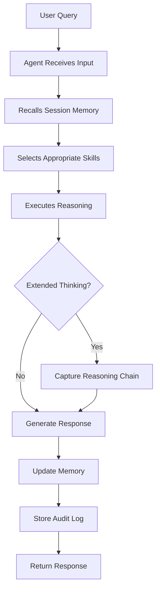
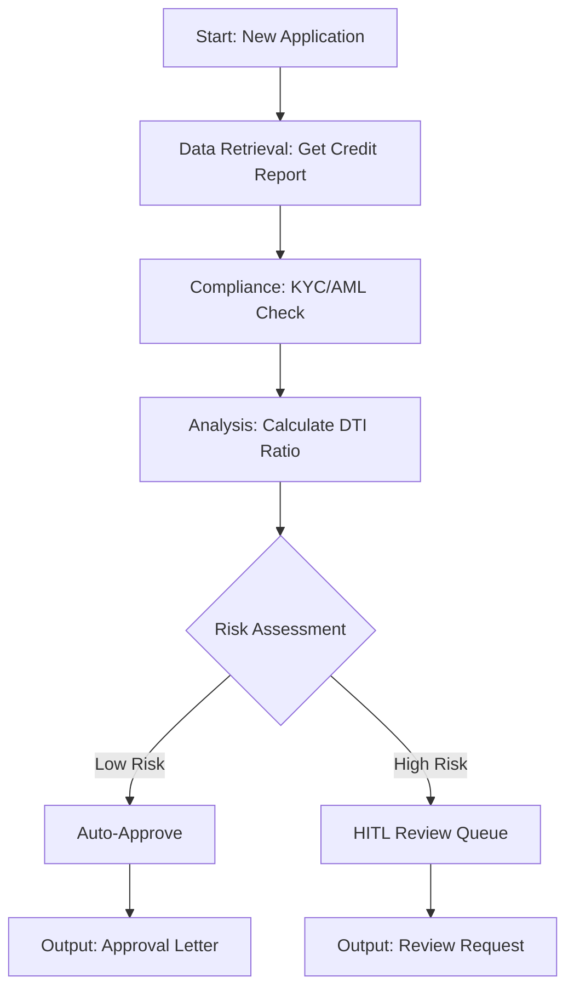

# Core Concepts

Understanding the fundamental building blocks of Oniva will help you build powerful, compliant workflows for your financial services operations.

## The Three Pillars

Oniva is built on three core concepts that work together:

```
┌─────────────┐
│   Agents    │  ← AI-powered specialists that execute tasks
└──────┬──────┘
       │ use
       ↓
┌─────────────┐
│   Skills    │  ← Reusable capabilities (search, analyze, calculate)
└──────┬──────┘
       │ orchestrated by
       ↓
┌─────────────┐
│  Workflows  │  ← Visual automation that chains agents together
└─────────────┘
```

## Agents

### What is an Agent?

An agent is an AI-powered specialist designed to perform specific tasks in financial services. Think of agents as intelligent assistants with:

- **Specialized Knowledge**: Pre-configured with domain expertise (compliance, analysis, research)
- **Tool Access**: Can use skills to perform actions (search, calculate, retrieve data)
- **Memory**: Remembers conversation context and user preferences
- **Reasoning**: Uses extended thinking to explain decisions transparently

### Agent Types

#### Production Agents (Built-in)

**Analysis Agent**
- **Purpose**: Financial metrics, calculations, and data analysis
- **Best For**: Portfolio analysis, risk assessment, financial modeling
- **Default Skills**: Python execution, chart generation, code analysis
- **Example Use**: "Calculate the Sharpe ratio for this portfolio over the last 12 months"

**Compliance Agent**
- **Purpose**: Regulatory checks and verification
- **Best For**: KYC/AML screening, sanctions checks, regulatory reporting
- **Default Skills**: Document parsing, knowledge search, regulatory filing
- **Example Use**: "Verify this customer against OFAC sanctions list"

**Data Retrieval Agent**
- **Purpose**: Fetch data from external systems
- **Best For**: Core banking queries, credit bureau data, market feeds
- **Default Skills**: Web search, URL browsing, structured data extraction
- **Example Use**: "Get the latest transaction history for account #12345"

**Research Agent**
- **Purpose**: Document analysis and knowledge retrieval
- **Best For**: Policy research, regulatory document search, case analysis
- **Default Skills**: Knowledge search, document parsing, summarization
- **Example Use**: "Summarize the latest FCA guidance on crypto assets"

#### Custom Agents (User-Created)

Custom agents let you create specialized assistants for your unique workflows:

- **Loan Officer Agent**: Automate loan application reviews
- **Fraud Detection Agent**: Identify suspicious patterns
- **Customer Service Agent**: Answer customer inquiries
- **Report Generator Agent**: Create formatted compliance reports

See [Custom Agents Guide](/docs/features/custom-agents) for details.

### Agent Execution Model

When you run an agent, here's what happens:



**Execution Time**: 1-5 seconds (varies by complexity and provider)

### Agent Configuration

Each agent can be configured with:

**System Prompt**: Instructions that define agent behavior
```text
You are a compliance officer specializing in AML screening.
Always cite regulatory sources. Maintain a professional tone.
Flag any suspicious patterns for human review.
```

**Skills**: Which capabilities the agent can use
```python
enabled_skills = [
    "kyc_verification",
    "aml_screening",
    "sanctions_check",
    "search_knowledge"
]
```

**Model Selection**: Which LLM to use
- **GPT-4**: Best for complex reasoning
- **Claude 3.5 Sonnet**: Balanced performance (default)
- **Claude 3.7 Sonnet**: Best for high-stakes compliance

**Memory Options**: How context is retained
- Session memory: Last 10 turns (default)
- Long-term facts: User preferences across sessions
- Entity graph: Relationship reasoning

## Skills

### What is a Skill?

A skill is a reusable capability that agents can use to perform specific actions. Skills are the "hands" that let agents interact with the world.

### Skill Categories (8 total, 85+ skills)

#### 1. Web Skills (3 skills)

**web_search**
- Search the web for current information
- Example: "Search for recent news about Federal Reserve rate decisions"

**browse_url**
- Fetch and read content from a specific URL
- Example: "Read the content from https://www.sec.gov/rules/final/2024/..."

**extract_structured_data**
- Extract tables, lists, and structured content from HTML
- Example: "Extract the rate table from this bank's website"

#### 2. Code Skills (3 skills)

**execute_python**
- Run Python code in a sandboxed environment
- Example: Calculate complex financial formulas, data transformations

**analyze_code**
- Analyze Python code for quality, complexity, and issues
- Example: Review a risk model implementation for bugs

**generate_chart**
- Create visualizations from data
- Example: Generate a portfolio performance chart

#### 3. Financial Skills (5 skills)

**fetch_market_data**
- Get real-time market data for stocks
- Returns: price, volume, change, market cap

**get_financial_statements**
- Retrieve income statement, balance sheet, cash flow
- Source: Public filings via API

**analyze_risk_metrics**
- Calculate VaR, Sharpe ratio, Beta, volatility
- Input: Array of returns

**fetch_economic_indicators**
- Get GDP, CPI, unemployment data
- Source: FRED API integration

**get_trading_volume**
- Analyze volume trends and anomalies
- Useful for market abuse detection

#### 4. Compliance Skills (5 skills)

**kyc_verification**
- Verify customer identity against watchlists
- Returns: verification status, match confidence

**aml_screening**
- Screen transactions for money laundering patterns
- Detects: Structuring, rapid movement, high-risk jurisdictions

**sanctions_check**
- Check entities against OFAC/EU sanctions lists
- Real-time API integration

**regulatory_filing**
- Parse and retrieve SEC/FINRA filings
- Extract: Entity name, filing type, key excerpts

**risk_assessment**
- Calculate composite risk score
- Factors: Transaction patterns, entity type, jurisdiction

#### 5. Document Skills (3 skills)

**parse_pdf**
- Extract text and metadata from PDF files
- Handles: Forms, reports, statements

**extract_entities**
- Named entity recognition for financial documents
- Extracts: Dates, amounts, organizations, people

**summarize_document**
- Generate concise document summaries
- Preserves: Key facts, decisions, dates

#### 6. Memory Skills (4 skills)

**store_memory**
- Store information in session memory (Redis)
- TTL: 24 hours

**recall_memory**
- Retrieve stored information
- Fast: <5ms access time

**search_knowledge**
- Semantic search across knowledge base
- Uses: pgvector for similarity search

**list_memories**
- List all memory keys for current session
- Useful for debugging

#### 7. File Skills (3 skills)

**read_file**
- Read content from temporary files
- Formats: Text, CSV, JSON

**write_file**
- Write content to temporary file
- Auto-cleanup after 24 hours

**parse_document**
- Parse structured documents
- Formats: CSV, JSON, XML

#### 8. Security Skills (Custom)

These are organization-specific skills for:
- Encryption/decryption
- Access control verification
- Audit log generation
- PII detection and masking

### Skill Execution

Skills run in a controlled environment:

**Sandboxed Execution**: Code skills run in isolated containers
**Timeout Protection**: 30-second max execution time
**Resource Limits**: CPU and memory constraints
**Error Handling**: Graceful failures with detailed error messages

### Creating Custom Skills

Developers can create organization-specific skills:

```python
from app.agents.skills.registry import skill
from pydantic_ai import RunContext

@skill(
    name="calculate_dti_ratio",
    description="Calculate debt-to-income ratio for loan application",
    category="financial",
    requires=[]
)
async def calculate_dti_ratio(
    ctx: RunContext,
    monthly_debt: float,
    gross_monthly_income: float
) -> dict:
    """
    Calculate DTI ratio following standard lending criteria
    """
    if gross_monthly_income <= 0:
        return {"error": "Invalid income value"}

    dti = (monthly_debt / gross_monthly_income) * 100

    return {
        "dti_ratio": round(dti, 2),
        "monthly_debt": monthly_debt,
        "gross_monthly_income": gross_monthly_income,
        "assessment": "acceptable" if dti < 43 else "high_risk"
    }
```

See [Developer Guide](/docs/user-guides/developers) for details.

## Workflows

### What is a Workflow?

A workflow is a visual automation that chains multiple agents, skills, and logic together to complete complex, multi-step processes.

Think of workflows as automated procedures where:
- Each step is a **node** (agent, skill, or logic)
- Steps are connected by **edges** (data flows from one to next)
- Execution is **orchestrated** (handled by DBOS engine)
- Results are **auditable** (complete execution history)

### When to Use Workflows

Use workflows when you need to:

**Chain Multiple Agents**
- Example: Data retrieval → Analysis → Compliance check → Report generation

**Add Conditional Logic**
- Example: If risk score > 7 → Send to human review, else → Auto-approve

**Repeat Operations**
- Example: Screen 100 transactions through the same compliance checks

**Orchestrate Complex Processes**
- Example: Loan application workflow with 15 decision points

### Workflow Node Types (18 types)

#### 1. Start Node
- Entry point for workflow
- Defines input parameters
- Every workflow has exactly one

#### 2. Agent Node
- Executes an AI agent
- Configuration:
  - Which agent to use
  - Instructions/prompt
  - Context variables

#### 3. LLM Node
- Direct language model call
- More flexible than Agent node
- Use when agent structure not needed

#### 4. Skill Node
- Execute a single skill
- Faster than agent for simple tasks
- No reasoning overhead

#### 5. Connector Node
- Call external systems via MCP
- Examples: core banking APIs, OFAC service, credit bureaus
- Phase 3 feature

#### 6. HTTP Node
- Make HTTP requests to external APIs
- Supports: GET, POST, PUT, DELETE
- Headers and authentication

#### 7. Code Node
- Execute custom Python code
- Sandboxed environment
- Access to previous node outputs

#### 8. Condition Node
- Branch based on logic
- Example: `if risk_score > 7: route_to_hitl else: auto_approve`

#### 9. Iterator Node
- Loop through arrays
- Example: Screen each transaction in a batch

#### 10. Classifier Node
- Route based on classification
- Example: Categorize transaction type → route to specialist

#### 11. Aggregator Node
- Merge multiple results
- Example: Combine outputs from parallel branches

#### 12. Template Node
- Format output using Jinja2 templates
- Generate reports, emails, documents

#### 13. Knowledge Node
- Retrieve from knowledge base (RAG)
- Semantic search with pgvector

#### 14. Output Node
- Final result formatting
- Formats: JSON, Markdown, PDF

#### 15-18. Custom Nodes
- Organization-specific node types
- Extend platform capabilities

### Workflow Example: Loan Application

Let's walk through a real workflow:



**Workflow Steps**:

1. **Start**: Application data (name, SSN, income, requested amount)
2. **Data Retrieval**: Fetch credit report from bureau
3. **Compliance**: Run KYC verification and AML screening
4. **Analysis**: Calculate debt-to-income ratio
5. **Condition**: If DTI < 43% and no AML flags → Approve, else → Review
6. **Output**: Generate appropriate response

**Execution Time**: 8-15 seconds
**Automation Rate**: 70% (low-risk applications auto-approved)

### Workflow Execution Model

Workflows run through the DBOS orchestrator:

**Durable Execution**: Survives crashes and restarts
**State Management**: Each step's output is persisted
**Error Recovery**: Automatic retries and rollback
**Audit Trail**: Complete execution history logged

### Workflow Monitoring

Track execution in real-time:

- **Visual Execution**: See which node is currently running
- **Intermediate Results**: View output of each node
- **Execution Logs**: Detailed logs for debugging
- **Performance Metrics**: Execution time per node
- **Cost Tracking**: Token usage per workflow run

## Understanding Relationships

### Agents vs. Workflows

| Aspect | Agent | Workflow |
|--------|-------|----------|
| **Purpose** | Single-task specialist | Multi-step orchestration |
| **Interaction** | Chat-based, conversational | Automated, programmatic |
| **Flexibility** | Adapts to conversation | Fixed logic path |
| **Best For** | Ad-hoc queries, exploration | Repeatable processes |
| **Example** | "Analyze this portfolio" | Loan approval pipeline |

### Skills vs. Agents

| Aspect | Skill | Agent |
|--------|-------|-------|
| **Autonomy** | No reasoning, just execution | Autonomous decision-making |
| **Scope** | Single specific action | Multiple related tasks |
| **Composability** | Building block | Composed of skills |
| **Example** | `fetch_market_data` | Analysis Agent (uses many skills) |

### Workflows vs. API Calls

| Aspect | Workflow | API Call |
|--------|----------|----------|
| **Orchestration** | Visual, low-code | Programmatic, code-based |
| **State** | Managed automatically | Manual state handling |
| **Retries** | Automatic | Manual implementation |
| **Audit** | Built-in logging | Custom logging needed |
| **Best For** | Business users | Developers |

## Memory & Context

Understanding how Oniva remembers information:

### Session Memory (Layer 1)

**What**: Conversation history for active sessions
**Storage**: Redis (in-memory, fast)
**Duration**: 24 hours
**Access Time**: <5ms

**Contains**:
- Last 10 conversation turns
- Active entities mentioned (customers, accounts)
- Session metadata (start time, turn count)

### Long-Term Memory (Layer 2)

**What**: User preferences and cross-session facts
**Storage**: PostgreSQL (persistent, compliant)
**Duration**: 7 years (regulatory retention)
**Access Time**: <50ms

**Contains**:
- User preferences (communication style, timezone)
- Learned patterns (common queries, workflows used)
- Historical facts (past decisions, case outcomes)

### Memory Store (Layer 3 - Phase 2)

**What**: Compressed conversation summaries
**Storage**: PostgreSQL via LangGraph
**Duration**: Permanent
**Token Reduction**: 90%

**Contains**:
- Conversation summaries (500 tokens vs 5,000)
- Cross-session context
- Important facts extracted from conversations

### Entity Graph (Layer 4 - Phase 3)

**What**: Relationship and temporal knowledge
**Storage**: Neo4j graph database
**Access Time**: <200ms

**Contains**:
- Entity relationships (customer owns account, applied for loan)
- Temporal versions (risk score changes over time)
- Time-travel queries (what did system know on date X?)

## Security & Compliance

### Audit Trails

Every action generates an audit log entry:

**What's Logged**:
- User ID and action timestamp
- Agent/workflow executed
- Input and output data
- Reasoning chains (extended thinking)
- Decision factors
- HITL reviews and overrides

**Immutability**: Database triggers prevent UPDATE/DELETE operations

**Retention**: 7 years minimum (SOX/FCA compliance)

**Export**: CSV/JSON for regulatory examination

### Extended Thinking

For high-stakes decisions, agents capture their reasoning process:

**Captured Information**:
- Observation: What data was considered
- Analysis: How data was interpreted
- Decision: What conclusion was reached
- Factors: Which regulatory requirements were evaluated

**Use Cases**:
- Loan denials (explain to applicant)
- AML SARs (justify to regulators)
- Trading decisions (audit trail for FINRA)

### Human-in-the-Loop (HITL) - Phase 1

For high-risk decisions, workflows can pause for human review:

**Triggers**:
- Risk score > configurable threshold
- Missing decision factors (CoT faithfulness)
- Dollar amount > limit
- Compliance flags

**Review Process**:
1. Decision queued for review
2. Reviewer sees full context + reasoning
3. Approve, reject, or override with explanation
4. Workflow resumes with human decision

## Cost Model

Understanding how Oniva pricing works:

### Token-Based Pricing

**What are Tokens?**
- Units of text (roughly 4 characters = 1 token)
- "Hello" = 1 token, "Hello world" = 2 tokens

**Cost Drivers**:
- **Prompt Tokens**: Your input + context (system prompt, memory, etc.)
- **Completion Tokens**: Agent's response
- **Model Selected**: GPT-4 > Claude 3.5 > DeepSeek

### Typical Costs

**Chat Interaction**:
- Simple query: 500-1,000 tokens ($0.01-0.02)
- Complex query with context: 2,000-4,000 tokens ($0.04-0.08)

**Workflow Execution**:
- 3-agent workflow: 5,000-10,000 tokens ($0.10-0.20)
- Complex multi-branch: 15,000-30,000 tokens ($0.30-0.60)

**Optimization Strategies**:
- Prompt caching: 80-90% reduction on repeated content
- Model routing: Use cheaper models for low-risk tasks
- Memory store: 90% reduction on long conversations

## Next Steps

Now that you understand the core concepts:

**Build Your First Complete Workflow**
→ [First Workflow Guide](/docs/getting-started/first-workflow)

**Explore Role-Specific Guides**
- [Compliance Teams](/docs/user-guides/compliance-teams)
- [Financial Analysts](/docs/user-guides/analysts)
- [Developers](/docs/user-guides/developers)
- [Administrators](/docs/user-guides/administrators)

**Dive Deep into Features**
- [AI Agents](/docs/features/ai-agents)
- [Workflows](/docs/features/workflows)
- [Skills Library](/docs/features/skills-library)
- [Custom Agents](/docs/features/custom-agents)
